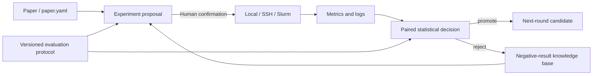

# Auto Research platform P1

<!-- source-sha256: 7fb36256f6f802ada645451662f1e6c0b631015f5646b8739f0af19f56b9557f -->

[简体中文](../research-platform-p1.md)

This layer turns one-off experiments into a loop that runs across machines, compares fairly, generates subsequent experiments, and remembers failures. It supports recommendation, foundation models, multimodal models, LLM post-training, and agents without binding the workflow to one architecture.



## Unified execution backend

One `execute` command supports local, SSH, and Slurm. Each run stores a separate `state.json`, stdout, and stderr. Backends support persistent FIFO queues, `--resume`, hard timeouts, retries, GPU memory estimates and limits, and cost caps. Hostnames and partition details belong to run parameters and artifacts, not public docs.

```bash
# Local
auto-research execute --backend local --run-id smoke -- \
  auto-research reproduce --paper din --budget smoke

# Configured SSH host; use a dry run to inspect the command
auto-research execute --backend ssh --host YOUR_SSH_ALIAS \
  --working-directory /path/to/auto-research --run-id gpu-check --dry-run -- \
  auto-research evolve --model rankmixer --dataset movielens-1m \
  --direction "Validate an efficient mixer" --generations 2

# Generate and submit an auditable Slurm job.sh
auto-research execute --backend slurm --partition YOUR_PARTITION \
  --gpu-memory-mb 24000 --timeout 7200 --run-id slurm-run -- \
  auto-research evolve --model micro-llm --dataset wikitext-2 \
  --direction "Compare efficient attention" --generations 2
```

SSH and Slurm are executable backends, not a claim that the repository owns a cluster. Submission depends on the user's local SSH and Slurm setup.

## Fair evaluation protocols

The protocol ID freezes dataset revision, split, candidate set, baseline, seeds, budget, and primary metric. Compare on one leaderboard only when these fields match.

```bash
auto-research protocols list
auto-research protocols show --id recommendation.movielens1m.v2
auto-research protocols compare --left run-a/protocol.json --right run-b/protocol.json
```

Built-in protocols: `recommendation.movielens1m.v2`, `foundation.wikitext2.v1`, `post_training.gsm8k.v1`, `agent.swe_local.v2`, and `multimodal.scienceqa.v1`. Changes require a new version, never a silent reinterpretation of old results.

## From papers to experiment proposals

A proposal reads core mechanisms, baselines, and evolve operators from a paper's `paper.yaml`, and combines them with a target model and evaluation protocol to design hypotheses, ablations, and search spaces:

```bash
auto-research proposals create --paper PAPER_ADAPTER \
  --model rankmixer --protocol recommendation.movielens1m.v2 \
  --direction "Apply the paper's mixer to RankMixer" --output runs/proposal.json
```

For a retrieved but uninstalled paper, create a matching `paper.yaml` and use `--spec path/to/paper.yaml`. Label the source `retrieved-paper-component`, not an installed implementation.

Proposals distinguish installed paper components, newly retrieved components, parameter variants, automated combinations, and novel hypotheses. Without an executable operator the proposal is design-only and `executable=false`. Initial status is always `awaiting-human-confirmation`; generated code is not automatically promoted.

## Statistical decisions

Paired bootstrap intervals, paired permutation tests, and Holm–Bonferroni correction combine with the minimum useful effect, maximum seed count, and cost cap to decide `promote`, `continue`, or `reject`:

```bash
auto-research stats decide \
  --baseline 0.101,0.104,0.102,0.103 \
  --candidate 0.108,0.111,0.109,0.110 \
  --minimum-effect 0.003 --maximum-seeds 9
```

`continue` recommends additional paired seeds. Cost overruns reject a proposal rather than promoting a single-seed peak. Each domain evaluator stores `fitness_by_seed`. Every round records parent–child paired decisions in `research_memory.statistical_decisions` to add seeds or reject ineffective directions later.

## Negative-result knowledge base

By default evolve saves failures and non-improvements in `.auto-research/negative-results.json`. Keys include domain, model, dataset, protocol, method, budget, and seeds. Skip only exact-context duplicates. A changed budget, protocol, or dataset allows another run so a small-budget failure is not made permanent.

```bash
auto-research evolve ... \
  --evaluation-protocol recommendation.movielens1m.v2 \
  --negative-memory runs/shared-negative-results.json
```

Categories include execution failure, numerical failure, no improvement, and conflicting objectives. Reasons and fitness deltas enter both per-round memory and persistent storage.

## Limits

- Remote backends provide submission contracts, not SSH configuration, Slurm accounts, or mounts.
- Protocols prevent comparisons across incompatible splits and budgets.
- Automatic proposals do not bypass human confirmation or candidate-promotion review.
- Offline statistical decisions do not replace production A/B evidence for industrial papers.
