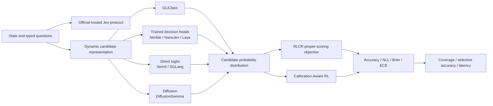

# Structured decision lineage and open gaps

<!-- source-sha256: a6ae55638a740a9fcdc313066cf8a2986d5677d7edc268d671c28adee90d6e89 -->

[简体中文](../../system-one/lineage.md)

## Current lineage

This diagram shows verifiable relationships among public methods. It does not imply Jev uses the internals of GLiClass, RLCR, or any community implementation.

## Covered research lines

- Official Choice, Score, and Noul request/response contracts and an optional HTTPS provider.
- Dynamic-candidate bilinear and rival-centered scorers.
- Cross-entropy, Brier, and hybrid calibration objectives.
- Validation-only temperature selection and held-out test.
- Three-seed public Banking77 baselines and executable Evolve operators.
- A 48-entry community snapshot organized into trained models, direct logits, diffusion, prior work, and evaluation.
- Provenance and capability boundaries for Bespoke Nimble, NanoJev, Laya, SemIf, and other projects.

## P0: Official evidence boundary

TypeSafe has not publicly released Jev's technical paper, weights, training data, or internal architecture in this snapshot. Keep behavior exposed by the official interface distinct from local mechanisms; do not infer internal replication from product output.

## P1: Selective prediction and evaluation of multiple primitives {#selective-prediction}

Banking77 primarily covers Choice. Further evaluation needs:

1. Ordinal rubric datasets and calibration for Score.
2. Binary risk/moderation datasets and cost-sensitive thresholds for Noul.
3. Abstention, coverage–risk curves, and out-of-distribution dynamic candidates.
4. Black-box protocol comparison on fixed public examples if the user supplies a Jev API key.

## P0: Open checkpoint comparisons

Compare Bespoke Nimble, NanoJev, and Laya on the same splits and budgets for accuracy, calibration, latency, and memory, not by combining self-reported numbers. NanoJev passed a pinned-checkpoint A100 OOD interoperability smoke test on a small sample. The planned next step is expanding the public protocol and integrating Bespoke Nimble and Laya. Smoke tests do not enter stable capability rankings.

## P1: Engineering and evaluation comparisons

1. Establish direct-logit and parallel constrained-decoding latency baselines with SemIf and openjev-sglang.
2. Check dataset licenses and gold isolation in jev-benchmarks, jev-ood-calibration, and behavior-study.
3. Evaluate DiffusionGemma as a separate experimental axis, not in a combined trained-checkpoint leaderboard.
4. Keep the [community snapshot](implementation-tracker.md) separate from the [integration roadmap](implementations.md), so cataloged does not mean implemented.

## Inclusion criteria

A new method needs a defining mechanism for dynamic candidates, typed scoring, calibration, selective prediction, or machine-executable decisions. Reformatting generated text as JSON is not enough.
