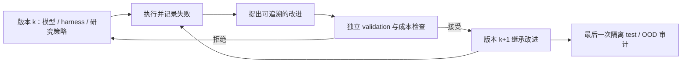

# 递归自我改进（RSI）

RSI 在本站是**跨领域研究专题**，不是第七套论文代码目录：它研究一个系统能否把上一轮的失败与验证结果，用来改进下一轮的模型、Agent harness、训练数据或研究策略。原论文和 adapter 仍分别归入[基础模型](../foundation-models/README.md)、[LLM 后训练](../post-training/README.md)或[Agent](../agent-research/README.md)；此页串起它们如何形成可审计的多轮闭环。

## 什么才算 RSI

判定关键不是“模型自己写了一段反思”，而是：**改动对象持久化**、下一轮**继承**该改动、用固定预算的外部反馈**验收**，并保留被拒绝的提案和失败轨迹。单题内的自我修正是有用组件，但单独不构成研究层面的递归自改进；论文搜到后未经实现就执行生成代码也不是本仓库的 RSI 路径。

| 改进对象 | 当前可用的本地入口 | 不能据此宣称的能力 |
|---|---|---|
| 模型结构、参数和训练配方 | [定向 Evolve](../model-evolution.md)、[可执行算子约束](../evolution-operators.md) | 自动实现任意实时检索论文 |
| LLM 权重与后训练数据 | [后训练 Evolve](../auto-research.md)、[Recursive OPSD 机制诊断](../reproductions/2609.30652-recursive-opsd/README.md) | 原论文规模的递归学习收益或模型自发改写训练算法 |
| Agent harness、记忆与工具策略 | [Agent Evolve](../agent-research/capability-benchmark.md)、[长周期研究控制器](research-portfolio.md) | 已在未知真实任务上稳定自我提升 |
| 研究流程本身 | [实验提案与负结果记忆](../research-platform-p1.md) | 无人工监督地修改执行器、评测器或安全边界 |

## 论文与评测线索

以下按“已实现的局部机制”和“待复核候选”区分，不把外部论文直接标为本地复现。

- [ImageRSI](../agent-research/2610.32120-image-rsi/README.md)：以真实图像生成、独立验证/修复和配对接纳扩展经验，再训练judge；本轮仅资料，完整生成/API/训练闭环成本过高，不复现（审查DONE），不以分数算术冒充judge。
- [RSI-Opt](../agent-research/2610.32026-rsi-opt/README.md)：代码Agent修改优化器并通过真实多任务训练继承改进；仅资料收录，高成本搜索不复现，明确保留原文披露的held-out lineage与archive传播疑点。
- [HarnessMM](../agent-research/2610.32813-harnessmm/README.md)：通过可审计的事件依赖图和callback边界证书减少重复调用；仅资料收录，完整原生harness矩阵不复现，不生成假的物理调用receipt。
- [OPST](../post-training/2610.32770-opst/README.md)：模型自生成、验证与EMA教师构成多轮自训练。本地仅实现无歧义的门控/外部散度归约/EMA，原PDF散度权重矛盾未被静默修复；不宣称已实现完整自我改进或接入Evolve。

- [Harness²](../agent-research/2610.14224-harness2/README.md)：固定模型、每个新任务重置到共同初始 Harness，在任务内执行 Propose–Probe–Compose，再持久保留有执行对照支撑的改进经验。本地已实现并行/顺序控制器、匿名既有产物选择与同域经验库，实跑 96 次 Python 探针；编辑器和选择器仍是确定性机制替身，不是模型支持的开放世界 RSI，也未接入 Evolve。完整模型/API 基准成本过高，不复现（审查 DONE）。
- [Harmony Harness](../agent-research/2610.15150-harmony-harness/README.md)：用多目标分解保留功能与安全的不同权衡，并按通用/环境范围演化工具、技能和逻辑。本轮仅资料收录；完整多配置、反复容器构建与漏洞执行的模型实验成本过高，不复现，不是本地可执行 Evolve 算子。
- [SEER](../agent-research/2610.04109-seer-forecasting/README.md)：对时间序列预测维护检索、筛选和因果经验，在训练回测中等待反馈成熟后更新，测试冻结记忆。本轮仅资料收录；闭源多模型、网络检索和回测完整实验不复现，不将时间隔离协议当作预测能力验证。
- [RSIFlow](../agent-research/2610.21791-rsiflow/README.md)：可执行冻结父代、M/H/A回调干预、配对接纳和失败经验保留。当前验证固定 meta-program 的数值 fixture，不是自主训练大模型或统一 Evolve 集成。
- [Terminal-RSI](../agent-research/2610.22192-terminal-rsi/README.md)：已实现跳过 observation 的 TB-GAE、分块续传及 FDR/SPR奖励组件；完整27B训练不复现，也不把主表收益归因于未确认进入该checkpoint的 TB-GAE。
- [Athanor](../agent-research/2610.21055-athanor/README.md)：自主后训练研究系统的资料收录；原文32卡、104小时研究 campaign成本过高，**完整实验不复现（审查 DONE）**，不是已接入本地的研究执行器。
- [Self-Refine](../agent-research/2303.17651-self-refine/README.md) 与 [Reflexion](../agent-research/2303.11366-reflexion/README.md)：单任务修正与跨 episode 语言记忆，是反馈循环的组件；是否改善后继版本要看隔离评测。
- [Recursive Self-Improvement via On-Policy Distillation](../reproductions/2609.30652-recursive-opsd/README.md)：动态教师与学生共用更新后的权重，本地已有小预算 Qwen 诊断；三种子对照未测出收益，尚未完成原论文训练与评测协议。
- [Video-RSI](../agent-research/2609.37950-video-rsi/README.md)：用主动视频调查诊断失败，再按准确率—视觉成本 Pareto 门槛接纳可继承 harness 修订；本地已实现接纳协议，完整视频环境仍未复现。
- [FrugalEvo](../agent-research/2610.03675-frugalevo/README.md)：强模型提出策略、弱模型编程，按固定成本与外部几何检查保留更好的程序；已有独立真实 checkpoint 运行路径，未接入统一 Evolve，也没有跨请求前缀 KV 缓存。
- [Sentry](../agent-research/2610.02994-sentry/README.md)：失败时检索经验，只在结果盲的恢复验证后写入记忆；本地使用真实 Qwen 与只读文档工具，测试冻结 playbook。恢复判断不等于最终答对，不宣称原文浏览器/软件工程结果。
- [RRSI](https://arxiv.org/abs/2609.24972)：针对 Agent harness 的提案和选择加正则，强调分布外能力与 token 成本；**待审候选，尚无本地 adapter**。
- [RSIBench-Data](https://arxiv.org/abs/2607.25886)：固定后训练栈，测 Agent 能否根据训练反馈改进数据策略；**待审评测候选，尚未接入本地统一评测**。
- [RSIPO](../reproductions/2610.15772-rsipo/README.md)：技能与策略共同进化，用分离的重放对照估计技能收益，并结合可靠性加权的 OPD/RL。**已完成论文解读与成本审查；成本过高，暂不复现／待验收**，不是可执行 evolve 算子。
- [LoOPSD](../reproductions/2610.18162-loopsd/README.md)：在当前模型中搜索循环层路径形成自教师，再交替在线蒸馏和重新搜索。**已收录，完整多轮训练延期**；不是已经验证的递归能力提升。
- [MemCon](../agent-research/2607.13591-memcon/README.md)：已实现低成本记忆控制器和持久化学习状态，但仅是 RSI 的可继承组件，不将局部 UCB 反馈循环直接称为通用自我进化。

## 验收协议

一次 RSI 实验至少记录初始版本、每轮改动及其来源、训练和推理预算、validation 决策、失败候选、最终隔离 test、分布外/回归集和成本。保留 **best-so-far** 与最后一轮两条曲线：末轮变差不能被中间峰值掩盖，反之亦然。比较不同方法时锁定数据修订、模型起点、种子及工具预算；不能让被评测 Agent 读取标准答案或验证集反馈之外的 test 信息。

新论文先走[发现审计](../paper-discovery-audit.md)和对应领域的论文信息合同，再决定是 evidence-only、独立 adapter，还是已实现算子的可执行组合。RSI 入口只聚合与解释，不复制论文页、指标文件，也不绕开 CUDA 验证门槛。
