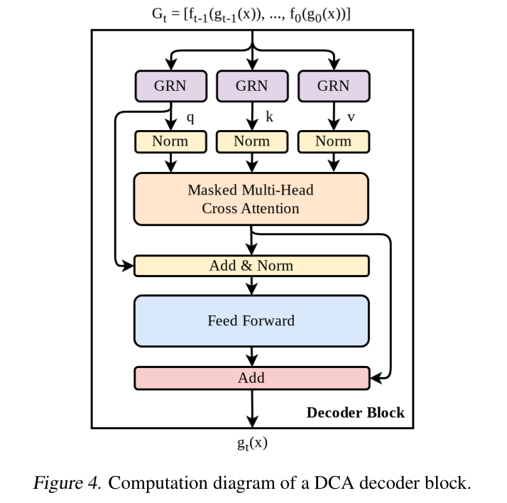
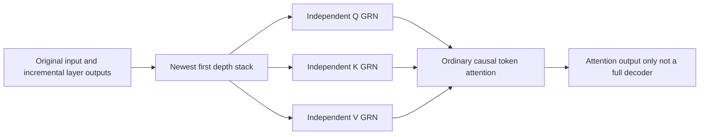

<!-- source-sha256: 6eff1be4e0b3147268c6ffeb8aab8df3050dbf84b38bbafbac74af7aba548c36 -->
# DeepCrossAttention: Supercharging Transformer Residual Connections

[简体中文](README.md)

> L1 component, diagnostic only; not complete paper/capability reproduction. Full experiments are too expensive, not reproduced (review DONE); no Evolve promotion.

## Paper information

| Field | Value |
| --- | --- |
| Paper link | [arXiv:2502.06785v2](https://arxiv.org/abs/2502.06785v2); [fixed PDF](https://arxiv.org/pdf/2502.06785v2) |
| Company / author institution | First author Mike Heddes: University of California, Irvine. Google Research collaborators are verified, not a Google first-author attribution. |
| Original publication | 2025-02-10T18:58:52Z; reviewedv2 is2025-07-23T19:32:20Z. A Google blog published2026-11-23 triggered this historical backfill; it is **not a newly published November paper**. |
| Author code | No verified paper-specific author repository was found in fixedv2 or the linked Google blog; this does not prove that none was ever released. |
| Local adapter / key | `deep-cross-attention`; `adapter: null`; not Evolve-integrated |
| Local code | `src/auto_research/foundation_models/deep_cross_attention.py` |

## Original paper summary

### Background and main changes

Standard residuals sum the input and previous incremental layer outputs. DCA retains that history and combines feature-by-history base weights with token/history-dependent terms. Q, K and V have independent GRN-v3 modules. Depth routing is an unnormalized weighted sum, not a layer-wise softmax; ordinary attention still operates across tokens.

<!-- paper-figure:start -->
### Key original figure

[](https://arxiv.org/pdf/2502.06785v2#page=4)

Original fixed-version PDF crop including the complete original caption; visually checked without scientific-content edits. Copyright belongs to the authors. The full method/result in the figure is not local capability evidence. [Provenance/SHA256](assets/provenance.json).
<!-- paper-figure:end -->



### Core formula

$$
g_t=(G_t\odot(b_t+\bar w_t))\mathbf1,\qquad \bar w_t=\mathbf1\operatorname{ReLU}(w_t^TG_t),\qquad (q,k,v)=\big(\mathrm{GRN}_Q(G_t),\mathrm{GRN}_K(G_t),\mathrm{GRN}_V(G_t)\big).
$$

The fixed-v2 Section3.1 text specifies b+ReLU(wᵀG), initializing b to one and w to zero. Under PyTorch's ReLU'(0)=0 convention, the initial dynamic-w gradient is zero. We expose that negative control instead of changing activation or initialization. Figure3 additionally depicts normalization and a different activation ordering not explicit in the text equation. Local code declares the text-formula interpretation, not the authors' training implementation. Three LayerNorms follow the Q/K/V routes as in Figure4.

### Paper results

Fixed-v2 Table5 reports49.73M parameters and PPL18.06±0.01 for six-layer DCA on LM1B versus49.65M and18.98±0.01 for the Transformer. Table1's2-DCA runs5.39±0.06 batches/s versus8.14±0.18, but its normalized time to reach the baseline's final PPL is0.33. Less time to a quality target is not faster individual steps. No production online A/B is reported. These are full-training paper results, not local routing timings.

### Same-topic comparison and boundaries

RD-AttnRes starts from Block AttnRes, retains one QK route and separates V through its attention-residual mechanism. DCA instead separates all three Q/K/V routes and uses feature-dependent base weights plus ReLU dynamic terms in a linear sum. It is not three copies of RD's V route. Their normalization, historical storage and full-training evidence are not interchangeable.

## Local reproduction

### Data protocol and code mapping

Implemented: text-formula GRN-v3, three independent routes, first/middle-sum/last-k history, small multi-head causal attention and actual autograd. History contains original input and incremental outputs, not repeatedly accumulated residual states. Limited history preserves intermediate outputs in an unweighted sum bucket rather than dropping them. Full FFN/outer-residual wiring, LM training, checkpoint retrofit, KV caching and benchmark gains are absent. Nonzero-w gradient checks use explicit parameter interventions, not a claim that dynamic routing was learned from zero initialization.

```bash
PYTHONPATH=src python -c 'from auto_research.foundation_models.deep_cross_attention import diagnostic; print(diagnostic(42))'
PYTHONPATH=src python -m pytest -q tests/test_nov24_dca.py
```

### Results and limitations

CPU three-seed component evidence is recorded separately. CUDA claims require this batch's real A100/A30 receipt, not CPU success. [CPU component evidence](metrics/component-cpu-seeds42-44.json).

### High-cost full experiments

Section5 uses width512, four-times-wider FFNs, sequence128 and batch2048 over64 TPUs for500k steps, totaling131B tokens, plus6–42-layer, C4-scale and ImageNet sweeps. This clearly exceeds one A100/A30 or Mac. No model/data download or trial training is attempted. Only a2×5-token,8-wide,4-source core is budgeted below30seconds across three seeds (estimate). The advertised CUDA path requires this batch's independent real-A100/A30 receipt.

Terminal full-experiment status: not_reproduced_high_cost, review DONE, excluded from automatic retries/implementation queues. Component execution is not a full-model comparison.
