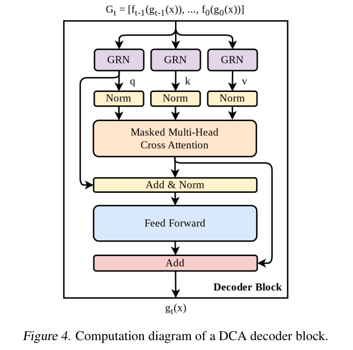
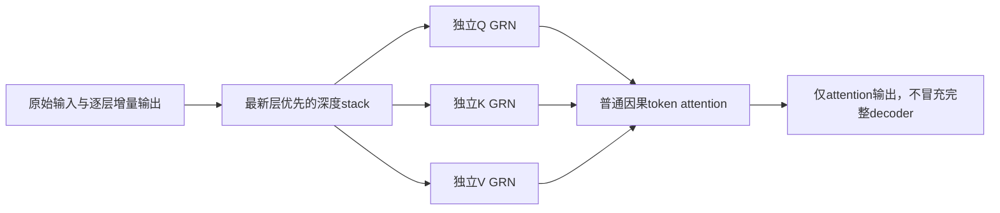

# DeepCrossAttention: Supercharging Transformer Residual Connections

[English](README-en.md)

> L1组件，diagnostic only，不是完整论文或模型能力复现。完整实验成本过高，不复现（审查 DONE）；不接Evolve晋级。

## 论文信息

| 字段 | 内容 |
| --- | --- |
| 论文链接 | [arXiv:2502.06785v2](https://arxiv.org/abs/2502.06785v2); [fixed PDF](https://arxiv.org/pdf/2502.06785v2) |
| 公司 / 作者机构 | 一作Mike Heddes：University of California, Irvine；Google Research合作者已核实，不把一作归为Google。 |
| 首次公开日期 | 2025-02-10T18:58:52Z；核对版本v2为2025-07-23T19:32:20Z。2026-11-23 Google官方博客触发历史补录，**不是11月新发表论文**。 |
| 原作者开源代码 | 固定v2全文与2026-11-23 Google官方博客未提供已核实的本篇作者代码仓库；未找到不等于作者从未发布。 |
| 本地 adapter / key | `deep-cross-attention`; `adapter: null`; not Evolve-integrated |
| 本地复现代码 | `src/auto_research/foundation_models/deep_cross_attention.py` |

## 原始论文总结

### 背景与主要改动

传统残差把原始输入和历层增量输出直接相加。DCA把这份历史保留下来，由可学习的feature×history基础权重，加上逐token、逐历史项的动态项，选择层输入；Q、K、V分别使用独立GRN-v3。这里的深度路由不是在层维做softmax，而是直接加权求和；普通attention仍在token维计算。

<!-- paper-figure:start -->
### 原论文关键图

[](https://arxiv.org/pdf/2502.06785v2#page=4)

固定版本PDF原图与完整原图注，已视觉核对，无科学内容编辑；版权归原作者所有。图中的完整方法/实验结果不是本地能力证据。 [Provenance/SHA256](assets/provenance.json).
<!-- paper-figure:end -->



### 核心公式

$$
g_t=(G_t\odot(b_t+\bar w_t))\mathbf1,\qquad \bar w_t=\mathbf1\operatorname{ReLU}(w_t^TG_t),\qquad (q,k,v)=\big(\mathrm{GRN}_Q(G_t),\mathrm{GRN}_K(G_t),\mathrm{GRN}_V(G_t)\big).
$$

固定v2§3.1文字公式为b+ReLU(wᵀG)：b初始化为1，w初始化为0。按PyTorch的ReLU'(0)=0，精确零初始化时动态w的第一步梯度为0；本地把它作为可见负控，而不是偷偷换激活或随机初始化。Figure3还画了文字公式未明确的Norm和不同的activation次序；本地声明按文字公式解释，不声称复刻作者训练器。Figure4的Q/K/V外部Norm以三套LayerNorm实现。

### 论文离线与线上效果

固定v2 Table5中6层LM1B模型的DCA为49.73M参数、PPL18.06±0.01，Transformer为49.65M、18.98±0.01；Table1的2-DCA速度5.39±0.06 batches/s低于基线8.14±0.18，但达到基线最终PPL的归一化训练时间为0.33。少用训练时间达到同PPL不等于每step更快。未报告生产线上A/B；这些是作者完整训练结果，不是本地路由核测量。

### 同主题比较与边界

RD-AttnRes从Block AttnRes出发保留共享QK路由、单独解耦V，采用其attention-residual深度选择机制。DCA的Q/K/V三路均独立，并以feature-dependent基础权重加ReLU动态项线性求和，不是把RD的V路由复制三份。两者都改变attention输入来源，却不能互换归一化、历史缓存或完整训练证据。

## 本地复现

### 数据协议与代码映射

实现GRN-v3文字公式、三套独立参数、first+middle-sum+last-k历史栈、小型多头因果attention及真实autograd。历史元素是原始输入和各层增量输出，不是重复累加的完整residual state。有限历史不直接丢弃中间层，而把它们保存在未加权sum桶中。没有完整FFN/外层残差接线、LM训练、预训练checkpoint改装、KV cache或benchmark收益。非零w的梯度检查使用显式参数干预，不冒充w从零学出了动态路由。

```bash
PYTHONPATH=src python -c 'from auto_research.foundation_models.deep_cross_attention import diagnostic; print(diagnostic(42))'
PYTHONPATH=src python -m pytest -q tests/test_nov24_dca.py
```

### 结果、负控与边界

CPU三seed组件证据单独记录。CUDA路径须以本批真实A100/A30收据验收，不能以CPU通过代替。 [CPU component evidence](metrics/component-cpu-seeds42-44.json).

### 高成本完整实验

§5默认embedding512、FFN宽4倍、sequence128、batch2048，在64个TPU上训练500k steps，共131B tokens；另扫6至42层、C4多规模和ImageNet。完整矩阵显然超出单A100/A30或Mac，直接成本过高不复现，不做模型/数据下载或试训。仅2×5token、8宽、4历史源的小型核，三seed预算小于30秒（估计）；CUDA路径必须由本批真实A100/A30收据独立验收。

完整实验为not_reproduced_high_cost终态、审查DONE，不进入自动重试/实现队列；组件执行不是完整模型对比。
