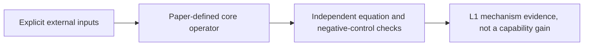
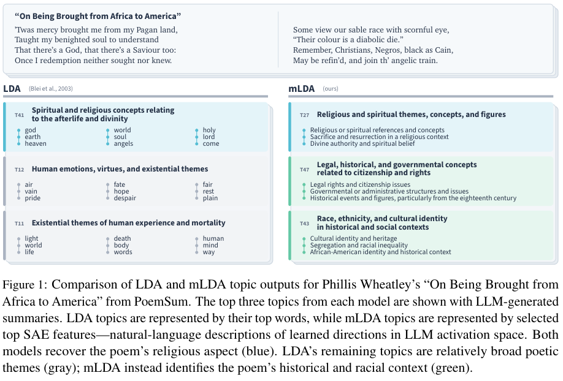

# Model Directions, Not Words: Mechanistic Topic Models Using Sparse Autoencoders

<!-- source-sha256: c4ae9d200aa2bbf2cc0e7bc40f2d6c363a09713adbc5cf2ef94da0cf4d1e99d2 -->

[简体中文](README.md)

mETM represents topics with sparse autoencoder (SAE) features rather than bags of words. It uses a frozen SAE encoder to compute sigmoid topic–feature probabilities and a binomial count likelihood to train logistic-normal topic proportions. Steering separately uses SAE decoder directions to replace the parallel component of an activation. The local interface keeps encoder and decoder distinct. It checks the ELBO and steering without faking an SAE or a complete topic evaluation.

## Paper information

| Field | Value |
| --- | --- |
| Paper | [arXiv 2507.23220 v1](https://arxiv.org/abs/2507.23220v1); [pinned review version v3](https://arxiv.org/html/2507.23220v3) |
| Organization | First author Carolina Zheng: Columbia University. On page 1 of the complete v3 PDF, Amir Feder's ⋄† markers indicate Columbia University / Google Research. Sweta Karlekar is at Columbia; Asif Mallik is independent. The HTML omits the complete affiliation table. |
| First published | 2025-07-31 03:17:43 UTC (arXiv v1) |
| Reviewed version | Methods and resources checked against pinned v3. Canonical identity and first publication still refer to v1; v3 is not asserted to match v1 line by line. |
| Original author code | [Public author resources](https://github.com/blei-lab/mechanistic-topic-models), pinned to `2faface4bd07985f885935d62a11d5e4bf9c73bf`, verified MIT. The local MIT mETM and steering components independently implement the pinned v3 equations, without copying upstream code. |
| Local adapter / stable key | `mechanistic-etm`; `adapter: null`; `component_only` |
| Local reproduction code | `src/auto_research/foundation_models/mechanistic_etm.py` |
| Full experiment | **Not reproduced due to cost (review DONE)**; excluded from automatic retries and the implementation queue. |

## Original paper summary

### Background and main changes

Pinned v3 §4.2.2, Eqs. 9–13: δ ~ N(0,I), θ = softmax δ, and βk = sigmoid(W_in vk + b), where W_in is the frozen SAE encoder, not its decoder. Each feature count follows Binomial(Ntokens, [θβ]i). The variational q architecture and Monte Carlo noise are supplied externally, and optimization combines NLL with analytical Gaussian KL. Eqs. 16–19 use independent SAE decoder columns only for steering: combine and normalize those directions, remove the existing parallel component, then inject the specified strength. A negative control with different encoders and decoders catches implicit weight tying.



<!-- paper-figure:start -->
### Key figure from the paper

[](https://arxiv.org/pdf/2507.23220v3#page=2)

**Figure 1**, pinned v3, page 2. The image comes from the [original paper](https://arxiv.org/html/2507.23220v3); copyright belongs to its authors. Scientific content and labels are retained without redrawing. [Source, crop, and SHA256](assets/provenance.json).
<!-- paper-figure:end -->

### Core equations

Document topic proportions are logistic-normal. The **frozen SAE encoder** $W_{\rm in}\in\mathbb R^{W\times H}$ supplies topic–feature probabilities and must not be tied to the decoder:

$$
\delta_d\sim\mathcal N(0,I),\quad\theta_d=\operatorname{softmax}(\delta_d),\quad
\beta_k=\sigma(W_{\rm in}v_k+b),\quad c_{di}\sim\operatorname{Binomial}(N_d,[\theta_d\beta]_i).
$$

The caller supplies the mean/log-variance network for $q_\phi(\delta\mid c)$ and explicit Gaussian noise. Binomial NLL and analytical Gaussian KL form the negative ELBO. Each feature can activate at most once per token; this is not a multinomial bag-of-words loss over normalized total counts.

Only steering uses **independent SAE decoder** directions $w_i^{out}$:

$$
s_k=\frac{\sum_i\beta_{ki}w_i^{out}}{\|\sum_i\beta_{ki}w_i^{out}\|_2},\quad
a'=a-b_{dec}-((a-b_{dec})\cdot s_k)s_k+\lambda s_k+b_{dec}.
$$

This replaces the existing parallel component rather than simply adding $a+\lambda s_k$. The implementation and tests use unequal encoder and decoder weights to detect implicit tying.

### Offline and online results in the paper

The authors' findings use their real models, data, and protocol. The full matrix was not run locally and its metrics are not presented as local measurements. The paper reports no production A/B.

## Local reproduction

MechanisticETM accepts frozen SAE encoder weights and real filtered activation counts. The steering function takes separate decoder directions and decoder bias. The caller supplies the variational architecture; a local linear fixture is not the authors' architecture. Gemma and its SAE were not loaded, feature-metadata filtering is not implemented, and mLDA/mBERTopic were not compared.

```bash
PYTHONPATH=src python -c 'from auto_research.foundation_models.mechanistic_etm import diagnostic; print(diagnostic(42))'
python -m pytest tests/test_google_emnlp25_foundation.py
```

`diagnostic(seed, device='cpu')` checks independent equations and negative controls on generated data only. CUDA must execute on a real A100/A30 and fails rather than falling back to CPU when unavailable. Acceptance is tied to the committed three-seed outputs and GPU receipt for the frozen source. Metrics concern operator error, gradient or parameter updates, and scorer parity, not formal model accuracy, writing quality, multilingual capability, or Evolve promotion.

## Reproduction limits

The full setup includes Gemma2-9B, a 16K GemmaScope SAE at layer 10, 8 datasets, LDA/ETM/BERTopic variants and Bayesian optimization, and a GPT4.1 topic judge with 2800 pairwise comparisons per dataset plus coherence and steering evaluations. It exceeds the short single-GPU budget. No LLM/SAE download or API call was made, and total GPU hours are not estimated without evidence.

**Not reproduced due to cost (review DONE).** This judgment follows from the documented setup; no full trial was started to measure cost. Small tensors and CPU protocol tests do not constitute a complete method, data pipeline, or benchmark integration. `diagnostic_only=true`, `promotion_eligible=false`, `evolve_integrated=false`.

This is a historical backfill from Google's official EMNLP page, not a new release today. The conference page alone does not establish a Google affiliation; see the per-author evidence above.
