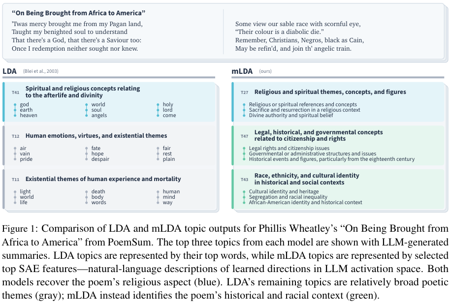

# Model Directions, Not Words: Mechanistic Topic Models Using Sparse Autoencoders

用SAE特征而非词袋表达主题，mETM以冻结SAE encoder计算sigmoid topic-feature概率和二项式计数似然训练logistic-normal主题比例；steering独立使用SAE decoder方向替换激活的parallel分量。本地外部接口严格区分encoder/decoder，仅验证ELBO与steering，不伪造SAE或完整topic评测。

## 论文信息

| 字段 | 内容 |
| --- | --- |
| 论文链接 | [arXiv 2507.23220 v1](https://arxiv.org/abs/2507.23220v1)；[固定核对版本 v3](https://arxiv.org/html/2507.23220v3) |
| 公司 / 机构 / 学校 | 一作 Carolina Zheng：Columbia University。完整v3 PDF第一页 Amir Feder 的上标⋄†对应 Columbia University / Google Research；Sweta Karlekar为Columbia，Asif Mallik为Independent。HTML漏掉了完整机构表。 |
| 首次公开日期 | 2025-07-31 03:17:43 UTC（arXiv v1） |
| 本轮版本 | 本轮方法/资源按固定v3核对，规范身份与首发时间仍为v1；未逐行声称v3与v1相同。 |
| 原作者代码 | [作者公开资源](https://github.com/blei-lab/mechanistic-topic-models)；固定commit `2faface4bd07985f885935d62a11d5e4bf9c73bf`；作者方法代码公开，固定commit核验MIT；本地独立按固定v3公式实现mETM/steering子组件，不复制上游代码；MIT |
| 本地 adapter / 稳定键 | `mechanistic-etm`；`adapter: null`；`component_only` |
| 本地复现代码目录 | `src/auto_research/foundation_models/mechanistic_etm.py` |
| 完整实验 | **成本过高，不复现（审查 DONE）**，不进入自动重试或实现队列 |

## 原始论文总结

### 背景与主要改动

固定v3 Section4.2.2 Eqs9–13：δ~N(0,I)、θ=softmaxδ、βk=sigmoid(W_in vk+b)，W_in为冻结SAE ENCODER，不是decoder；每个feature计数~Binomial(Ntokens,[θβ]i)。variational q拓扑与MC noise显式外传，优化NLL+analytic Gaussian KL。Eqs16–19仅steering才用独立SAE DECODER列方向加权单位化，再移除已有parallel分量、注入指定strength。以不同encoder/decoder的负控防隐式绑权。


<!-- paper-figure:start -->
### 原论文关键图

[](https://arxiv.org/pdf/2507.23220v3#page=2)

**Figure 1**，固定v3第2页。图片来自[原论文](https://arxiv.org/html/2507.23220v3)，版权归原作者所有；保留原图科学内容与标注，未重绘。[来源、裁切与SHA256](assets/provenance.json)。
<!-- paper-figure:end -->

### 核心公式

文档比例是logistic-normal；**冻结SAE encoder** $W_{\rm in}\in\mathbb R^{W\times H}$ 用于topic-feature概率，不能与decoder绑权：
$$
\delta_d\sim\mathcal N(0,I),\quad\theta_d=\operatorname{softmax}(\delta_d),\quad
\beta_k=\sigma(W_{\rm in}v_k+b),\quad c_{di}\sim\operatorname{Binomial}(N_d,[\theta_d\beta]_i).
$$
调用方提供 $q_\phi(\delta\mid c)$ 的mean/log-variance网络及显式Gaussian noise；本地用binomial NLL与analytic Gaussian KL形成负ELBO。feature每token最多激活一次，因此不是将所有feature计数归一化后改成multinomial词袋损失。
仅steering使用**独立SAE decoder**方向 $w_i^{out}$：
$$
s_k=\frac{\sum_i\beta_{ki}w_i^{out}}{\|\sum_i\beta_{ki}w_i^{out}\|_2},\quad
a'=a-b_{dec}-((a-b_{dec})\cdot s_k)s_k+\lambda s_k+b_{dec}.
$$
这会替换已有parallel分量，不是直接 $a+\lambda s_k$。源码与测试用不相同的encoder/decoder防止隐式绑权。

### 论文离线与线上效果

原文结论来自其真实模型、数据与协议；本页未运行完整矩阵，不将原文指标抄成“本地实测”。未报告生产线上 A/B。

## 本地复现

MechanisticETM接冻结SAE encoder_weights与真实过滤后的activation counts；steering函数单独接不同的decoder方向和decoder bias。variational网络拓扑显式外传，本地线性fixture不宣称作者架构。未加载Gemma/SAE、未实施feature metadata过滤或比较mLDA/mBERTopic。

```bash
PYTHONPATH=src python -c 'from auto_research.foundation_models.mechanistic_etm import diagnostic; print(diagnostic(42))'
python -m pytest tests/test_google_emnlp25_foundation.py
```

`diagnostic(seed, device='cpu')`只执行生成数据上的独立公式/负控。CUDA路径必须由真实A100/A30执行，CUDA不可用时失败、不回退CPU；本轮验收以提交的冻结源码三种子原始结果和GPU收据为准。 指标是算子误差、梯度/参数更新或scorer对照，不是正式模型accuracy、写作质量、跨语言能力或Evolve晋级证据。

## 复现边界

Gemma2-9B、layer10的16K GemmaScope SAE、8数据集、LDA/ETM/BERTopic多变种及Bayesian优化，GPT4.1 topic judge每数据集2800成对比较和额外coherence/steering评测。完整矩阵超单卡短时预算；不下载LLM/SAE或调API，不编造未报告总GPU小时。

**成本过高，不复现（审查 DONE）**。以上为论文配置/资源判断，未为了测成本而启动完整试跑。本地小张量或CPU协议通过不等于完整方法/数据管线或benchmark已接入；`diagnostic_only=true`、`promotion_eligible=false`、`evolve_integrated=false`。

本轮来自Google EMNLP官方会议页的历史线索补漏，不是今天新首发，也不单凭会议页就认定作者具有Google署名；机构证据在信息块逐条注明。
