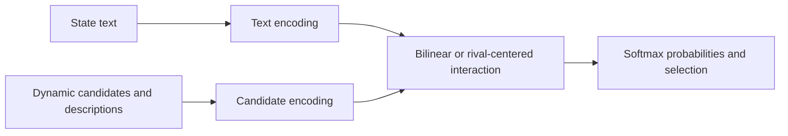
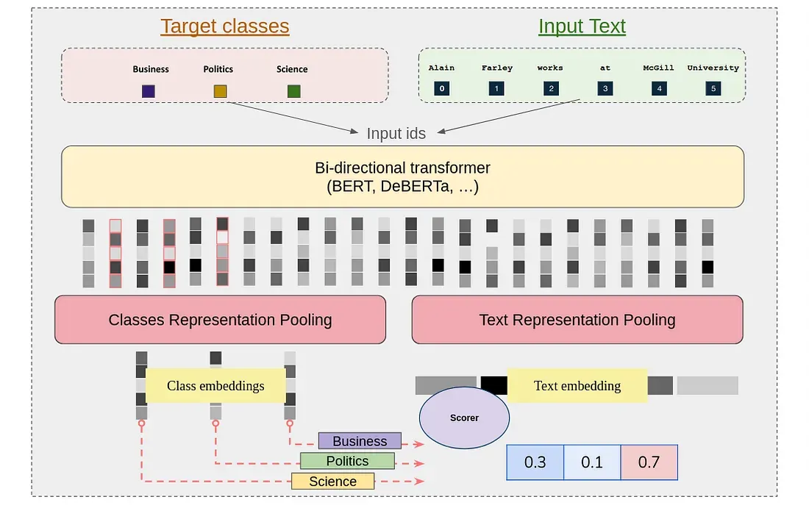

# GLiClass: lightweight classification with dynamic candidates

<!-- source-sha256: 58900d16a9d52fca3016d0e2b5aac2bfc9fed1137c796f8f51b84f0c6aa09734 -->

[简体中文](README.md)

## Paper information

| Field | Details |
|---|---|
| Paper | [arXiv 2508.07662](https://arxiv.org/abs/2508.07662) |
| Organization | First-author affiliation: Knowledgator |
| First public release | 2025-08-11 (arXiv v1) |
| Authors' code | [Knowledgator/GLiClass](https://github.com/Knowledgator/GLiClass) |
| Adapter / method | `system-one:bilinear-ce`, `system-one:rival-ce` |
| Local reproduction code | `src/auto_research/system_one/` |

## Original paper

### Motivation and method

GLiClass supplies text and runtime candidate labels to a single classification interface. This avoids unstable parsing of generative LLM outputs and separate cross-encoder inference on each text–label pair. The repository retains the defining mechanisms: candidate content affects scores, and one normalization produces a distribution over all candidates.

The local NumPy mechanism baseline does not load GLiClass weights or reproduce the full Transformer, PPO multi-label training, or paper results. It is used in the shared System One Banking77 protocol and evolve operator.

<!-- paper-figure:start -->
### Key figure from the paper

> **Figure 1:** Core architecture, modules, and their connections. From the [original paper](https://arxiv.org/abs/2508.07662); copyright remains with the authors.
<!-- paper-figure:end -->

### Core computation

The local scorer computes `softmax(h_state W h_candidate)`. The rival variant first centers candidate representations within the same question, then scores them.

### Paper results

The paper reports zero- and few-shot results across classification tasks. Local results use the shared Banking77 protocol, with no direct comparison against paper numbers from different model scales or hardware.

## Reproduction boundaries

Only dynamic candidate interaction and single normalization are reproduced, not the full GLiClass weights, training corpus, or PPO pipeline.
