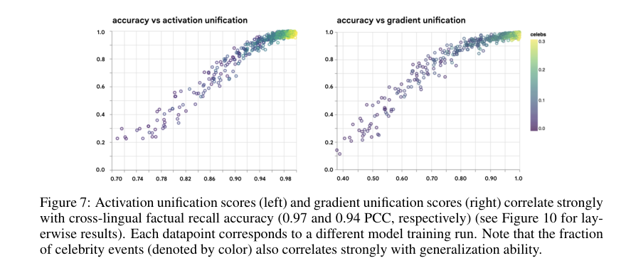

# Rosetta: representation unification and cross-language transfer

<!-- source-sha256: fdd60506465e631510c3a1484ebc45ff621db68bc213aef4bf1903e6c584bc2a -->

[简体中文](README.md)

> **L1 mechanism/evaluation component, diagnostic only—not a complete capability reproduction.** CPU component tests passed. There is no CUDA execution path and no GPU claim. Not integrated with Evolve; fixture results cannot justify promotion.

## Paper information

| Field | Value |
| --- | --- |
| Paper | [arXiv:2508.11017v1](https://arxiv.org/abs/2508.11017v1); [fixed v1 source](https://arxiv.org/html/2508.11017v1) |
| First author / institution | **Carter Blum**, first affiliation **Google DeepMind**; Google participation is verified from the author block, not model names |
| Original publication date | **2025-08-14 18:44:13 UTC**, arXiv v1 record; historical official-source backfill, not today's first publication |
| Author code | No verified paper-specific author implementation repository was found in fixed v1 as of 2026-11-13; model/dependency repositories do not count as this paper's code. |
| Local adapter / key | `rosetta-unification`; `adapter: null`, independent component |
| Local code | `src/auto_research/foundation_models/rosetta_unification.py` |
| Validation | CPU component tests passed. There is no CUDA execution path and no GPU claim. |

## Original paper summary

### Background and main change

The same fact can occupy separate language-specific representations. Controlled small-Transformer experiments vary parallel-fact coverage, language imbalance and language extractability, showing that near-perfect same-language recall does not establish cross-language transfer.

<!-- paper-figure:start -->
### Key original-paper figure

[](https://arxiv.org/html/2508.11017v1#page=9)

Figure 7, PDF page 9: the authors' correlation plots, not local performance. Source and image hashes are in [assets/provenance.json](assets/provenance.json). Figure from the [original paper](https://arxiv.org/html/2508.11017v1); copyright belongs to the original authors. Full-paper findings are not local component results.

<!-- paper-figure:end -->

### Defining mechanism and formula

Section 5 averages per-group ratios of cross-language mean pairwise cosine similarity to a same-language baseline. This is not self-cosine fixed at one or a ratio of global means. The local interface requires explicit X/Y/baseline representation groups; it does not guess fact grouping or extract model states.

```text
U = mean_g [ mean_cos(X_g,Y_g) / mean_cos(X_g,B_g) ]
```

### Original results and limitations

Figure 7 reports approximately 0.97/0.94 correlations for activation/gradient scores across training runs. These are not local measurements. Data-balance and shared-vocabulary interventions were not rerun. The paper's test-subset selection analysis must not be reused as test-based tuning in this project.

## Local reproduction

### Data protocol and code mapping

The two functions implement finite nonzero set-cosine arithmetic and per-group ratios, rejecting unstable denominators. Negative controls check scale invariance and mean-of-ratios behavior. Representations are external inputs, so these checks provide no evidence of improved multilingual capability.

```bash
PYTHONPATH=src python -c 'from auto_research.foundation_models.rosetta_unification import diagnostic; print(diagnostic(42, device="cpu"))'
PYTHONPATH=src python -m pytest -q tests/test_colm_foundation_components.py
```

### Results, negative controls and boundaries

The component test set has 44 passes and six locally skipped CUDA cases; skipping is not passing. Standard three-seed outputs use `metrics/component-cpu-seeds42-44.json`, not training or public-benchmark results. CPU component tests passed. There is no CUDA execution path and no GPU claim. All metrics are L1 diagnostics. No gold is exposed to an actor, no test-based selection is authorized, and no model improvement is claimed.

### Full-experiment disposition

110 controlled ~2M-parameter Transformer runs plus Gemma 2B/4B representation and translation analyses; full experiment matrix not reproduced.

**Full experiment not reproduced due to cost (review DONE).** No large checkpoint/corpus downloads, scaled-down substitute presented as replication, or automatic full-training retries.
