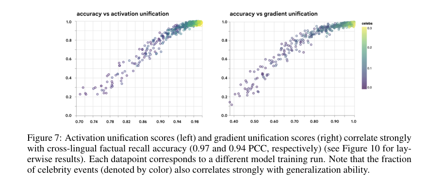

# Rosetta：跨语言表征统一度与知识迁移

[English](README-en.md)

> **L1 机制/评测组件，diagnostic only，不是完整模型能力复现。** CPU组件专测已通过；没有CUDA路径，不需要GPU验收。 未接入Evolve，不可据本地fixture成绩晋级。

## 论文信息

| 字段 | 内容 |
| --- | --- |
| 论文链接 | [arXiv:2508.11017v1](https://arxiv.org/abs/2508.11017v1)；[固定v1原文](https://arxiv.org/html/2508.11017v1) |
| 公司 / 作者机构 | 一作 **Carter Blum**，第一单位 **Google DeepMind**；论文有Google相关作者，按原文作者栏确认，不凭模型名归属 |
| 首次公开日期 | **2025-08-14 18:44:13 UTC**，依据arXiv v1记录；本次是历史官方源补漏，不是今天新首发 |
| 原作者开源代码 | 截至2026-11-13，固定v1未找到已核实的本篇作者代码仓库；基础模型与依赖仓库不算本篇开源。 |
| 本地 adapter / key | `rosetta-unification`；`adapter: null`，独立组件 |
| 本地复现代码 | `src/auto_research/foundation_models/rosetta_unification.py` |
| 验收范围 | CPU组件专测已通过；没有CUDA路径，不需要GPU验收。 |

## 原始论文总结

### 背景与主要改动

同一事实以不同语言出现时，模型可能把它们存成互不相通的表征。作者在受控合成知识图谱上从零训练小型 Transformer，分别改变平行事实比例、语言频率差异和语言可提取性，发现同语言准确率接近满分并不代表跨语言迁移良好。

<!-- paper-figure:start -->
### 原论文关键图

[](https://arxiv.org/html/2508.11017v1#page=9)

Figure 7，PDF 第9页；统一度与跨语言准确率的作者结果图。 来源与图像SHA见[assets/provenance.json](assets/provenance.json)。图片来自[原论文](https://arxiv.org/html/2508.11017v1)，版权归原作者所有；图中的完整实验结论不等于本地组件结果。

<!-- paper-figure:end -->

### 核心机制与公式

§5 对跨语言语义等价样本组计算平均两两余弦相似度，再除以同语言基线组的平均余弦，最后对组内比值取平均。分母不是单个向量和自身的余弦1，也不能用全局平均相似度之比代替平均比值。本地要求调用者显式给出 X、Y 和同语言基线组，不擅自猜测事实分组或隐藏状态抽取位置。

```text
U = mean_g [ mean_cos(X_g,Y_g) / mean_cos(X_g,B_g) ]
```

### 原文结果与限制

原文 Figure7 报告激活/梯度统一度与跨语言准确率的相关系数约0.97/0.94，来自不同训练运行，不是本地算术诊断的相关系数。作者还考察数据平衡与共享词表干预；本地没有重跑这些因果干预。原文选择实验含 OOD test 子集；本项目若扩展选择器必须改用独立 validation，不能沿用 test 调参。

## 本地复现

### 数据协议与代码映射

`average_cosine` 与 `unification_score` 实现有限、非零表示的集合余弦和逐组比值，拒绝接近零的分母。诊断验证尺度不变性、平均比值及集合自相似不等于对角线常数1。外部特征没有由本地模型生成；诊断不证明跨语言准确率提高。

```bash
PYTHONPATH=src python -c 'from auto_research.foundation_models.rosetta_unification import diagnostic; print(diagnostic(42, device="cpu"))'
PYTHONPATH=src python -m pytest -q tests/test_colm_foundation_components.py
```

### 结果、负控与边界

本批组件专测为44项通过、6项CUDA本机跳过；跳过不等于通过。三种子标准产物统一使用 `metrics/component-cpu-seeds42-44.json`；没有训练或公开benchmark成绩。CPU组件专测已通过；没有CUDA路径，不需要GPU验收。 所有metric仅属L1诊断，无gold给actor、无test选择、无模型效果提升声明。

### 完整实验处置

原文§2.1、§5–6包含110次约2M参数的受控Transformer训练，以及Gemma 2B/4B的表征和翻译分析；整个多配置训练/模型调用矩阵未复现，只执行外部表示上的相似度算术。

**完整实验成本过高，不复现（审查 DONE）**。不下载大权重/语料、不以缩水模型冒充原论文、不自动重试完整训练。
