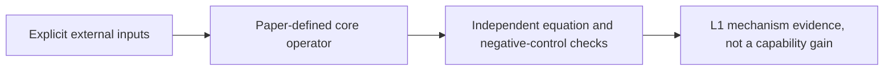
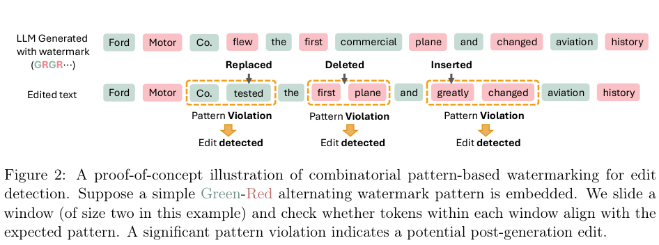

# Detecting Post-generation Edits to Watermarked LLM Outputs via Combinatorial Watermarking

<!-- source-sha256: d590830b4211df0efa77bdd2b03619d6f9232e114bb5c750e683b264eab0f702 -->

[简体中文](README.md)

A periodic pattern of vocabulary subsets biases next-token logits. A global statistic counts matching windows at any cyclic phase, while a local statistic aggregates every complete window covering a token to flag possible edits. The CPU implementation follows Eqs. 2–5 rather than using fixed absolute phase, padded boundaries, or randomized vocabulary rules.

## Paper information

| Field | Value |
| --- | --- |
| Paper | [arXiv 2510.01637 v1](https://arxiv.org/abs/2510.01637v1); [pinned v1 full text](https://arxiv.org/html/2510.01637v1) |
| Organization | First author Liyan Xie: University of Minnesota. The pinned v1 author list also identifies co-first author Muhammad Siddeek with Google. The first author's primary institution is Minnesota. |
| First published | 2025-10-02 03:33:12 UTC (arXiv v1) |
| Reviewed version | Methods checked against pinned v1. |
| Original author code | No method repository found in the pinned paper or exact-title search; code SHA and license could not be verified. Local equations are implemented independently. Paper license: CC BY 4.0. |
| Local adapter / stable key | `combinatorial-watermark`; `adapter: null`; `component_only` |
| Local reproduction code | `src/auto_research/foundation_models/combinatorial_watermark.py` |
| Full experiment | **Not reproduced due to cost (review DONE)**; excluded from automatic retry and implementation queues. |

## Original paper summary

### Background and main changes

Pinned v1 §3, Eqs. 2–5 take a caller-supplied secret partition and base logits, apply bias δ to the current pattern tag, and normalize with softmax. Iw(t) checks all cyclic phases, whose window indicators are averaged globally. Locally, the method averages the w complete covering windows for interior t=w−1..T−w. Global detection is at or above threshold; local edit flags are below threshold. Use calibration to control type I error. Deleting one complete binary period can be undetectable, so localization is not perfect.



<!-- paper-figure:start -->
### Key figure from the paper

[](https://arxiv.org/pdf/2510.01637v1#page=4)

**Figure 2**, pinned v1, page 4. Image from the [original paper](https://arxiv.org/html/2510.01637v1), with scientific content and labels unchanged. Copyright belongs to the authors. [Source, crop, and SHA256](assets/provenance.json).
<!-- paper-figure:end -->

### Core equations

Given secret vocabulary partition and periodic pattern $P$, add bias $\delta$ to logits for the current tag:

$$
\tilde p_u^{(t)}\propto\exp(l_u^{(t)}+\delta\,1[u\in V_{P[t\bmod R]}]).
$$

$I_w(t)$ checks whether a window matches **any cyclic phase**, not a fixed absolute position:

$$
D=\frac{\sum_{t=0}^{T-w}I_w(t)}{T-w+1},\qquad E(t)=\frac1w\sum_{i=0}^{w-1}I_w(t-i).
$$

The local statistic exists only for the complete interior $t=w-1,\ldots,T-w$. No zero padding or changed denominator. Global $D\ge\tau_d$ detects a watermark; local $E(t)<\tau_e$ flags a possible edit. Independent calibration is required for type I error. No false positive in a hard-pattern diagnostic is not a security guarantee for soft watermarks.

### Offline and online results in the paper

The paper's conclusions come from its actual models, data, and protocol. The full matrix was not run locally and author results are not presented as local measurements. No production A/B is reported.

## Local reproduction

The caller supplies the vocabulary partition and base logits. CPU code implements bias, softmax, cyclic window statistics, and thresholds, not a production secret manager or a cryptographic guarantee. The diagnostic loads no tokenizer or LLM. A retained negative control shows that deleting an entire period of AB may be undetectable.

```bash
PYTHONPATH=src python -c 'from auto_research.foundation_models.combinatorial_watermark import diagnostic; print(diagnostic(42))'
python -m pytest tests/test_google_emnlp25_foundation.py
```

`diagnostic(seed, device='cpu')` checks independent equations and negative controls on generated data. This is a CPU reference protocol with no advertised CUDA path. Metrics concern operator error, gradient or parameter updates, or scorer checks, not model accuracy, writing quality, multilingual ability, or Evolve promotion.

## Reproduction limits

The paper's full matrix uses Llama2-7B and OPT1.3B, WikiText, multiple strengths and patterns, 1–6 token edits across three edit types, 1000 sequences of 64 tokens, threshold calibration, and perplexity evaluation, on an RTX6000 Ada 48GB. The full data construction and matrix are not run. No unsupported runtime estimate is reported. Only CPU equations and negative controls are retained.

**Not reproduced due to cost (review DONE).** This decision follows from the documented configuration, not a full trial. Passing small-tensor or CPU tests does not constitute a complete method, data pipeline, or benchmark integration. `diagnostic_only=true`, `promotion_eligible=false`, `evolve_integrated=false`.

This is a historical lead from Google's official EMNLP page, not a new release. The conference listing alone does not establish Google affiliation; see the author evidence above.
