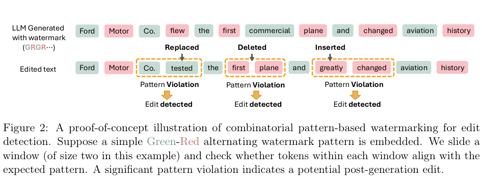

# Detecting Post-generation Edits to Watermarked LLM Outputs via Combinatorial Watermarking

按周期性词表子集模式给下一token logits加偏置，全局统计任意循环相位的窗口匹配率；局部统计覆盖某token的全部完整窗口，定位可能编辑。CPU实现式2–5，不用固定绝对相位、边界补零或随机词表规则冒充论文定义。

## 论文信息

| 字段 | 内容 |
| --- | --- |
| 论文链接 | [arXiv 2510.01637 v1](https://arxiv.org/abs/2510.01637v1)；[固定核对版本 v1](https://arxiv.org/html/2510.01637v1) |
| 公司 / 机构 / 学校 | 一作 Liyan Xie：University of Minnesota。固定v1作者栏共同一作Muhammad Siddeek署名Google；第一作者首机构为Minnesota。 |
| 首次公开日期 | 2025-10-02 03:33:12 UTC（arXiv v1） |
| 本轮版本 | 本轮方法核对固定v1。 |
| 原作者代码 | 固定论文/精确标题检索未找到原作者方法仓库，源码SHA和许可证不可核验；本地独立公式实现；未找到作者源码；论文CC BY4.0 |
| 本地 adapter / 稳定键 | `combinatorial-watermark`；`adapter: null`；`component_only` |
| 本地复现代码目录 | `src/auto_research/foundation_models/combinatorial_watermark.py` |
| 完整实验 | **成本过高，不复现（审查 DONE）**，不进入自动重试或实现队列 |

## 原始论文总结

### 背景与主要改动

固定v1 Section3 Eqs2–5：调用方提供真实secret分区与base logits；bias δ到当前pattern tag后softmax。Iw(t)对所有cyclic phases检查，global mean；local在完整interior t=w−1..T−w平均w个covering windows。全局>=threshold、局部<threshold，阈值需在calibration控制TypeI。binary周期整周期删除可以不可检测，不能承诺完美定位。


<!-- paper-figure:start -->
### 原论文关键图

[](https://arxiv.org/pdf/2510.01637v1#page=4)

**Figure 2**，固定v1第4页。图片来自[原论文](https://arxiv.org/html/2510.01637v1)，版权归原作者所有；保留原图科学内容与标注，未重绘。[来源、裁切与SHA256](assets/provenance.json)。
<!-- paper-figure:end -->

### 核心公式

调用方给定secret词表分区和周期pattern $P$，对当前tag的logits加 $\delta$：
$$
\tilde p_u^{(t)}\propto\exp(l_u^{(t)}+\delta\,1[u\in V_{P[t\bmod R]}]).
$$
$ I_w(t)$ 检查窗口是否匹配**任意循环相位**，而不是固定绝对位置：
$$
D=\frac{\sum_{t=0}^{T-w}I_w(t)}{T-w+1},\qquad E(t)=\frac1w\sum_{i=0}^{w-1}I_w(t-i).
$$
局部只在 $t=w-1,\ldots,T-w$ 的完整interior定义；不补零边界、不改变分母。全局 $D\ge\tau_d$ 判水印、局部 $E(t)<\tau_e$ 标可能编辑。阈值须独立calibration控制Type-I，不能把硬pattern诊断无误报外推为软水印安全保证。

### 论文离线与线上效果

原文结论来自其真实模型、数据与协议；本页未运行完整矩阵，不将原文指标抄成“本地实测”。未报告生产线上 A/B。

## 本地复现

调用方提供vocabulary partition与base logits；CPU实现bias、softmax、cyclic窗口统计和阈值判定，不提供production secret系统或密码安全保证。诊断不加载tokenizer/LLM。周期AB被删除整周期后可能不可检测，测试保留该负控。

```bash
PYTHONPATH=src python -c 'from auto_research.foundation_models.combinatorial_watermark import diagnostic; print(diagnostic(42))'
python -m pytest tests/test_google_emnlp25_foundation.py
```

`diagnostic(seed, device='cpu')`只执行生成数据上的独立公式/负控。这是纯CPU参考/协议，不advertise CUDA路径。 指标是算子误差、梯度/参数更新或scorer对照，不是正式模型accuracy、写作质量、跨语言能力或Evolve晋级证据。

## 复现边界

完整实验Llama2-7B/OPT1.3B，WikiText多水印强度/模式/1–6token编辑×三种编辑方式，1000条64token、阈值校准及PPL矩阵；原文RTX6000Ada48GB。完整模型数据构造与全矩阵不跑，不编造总耗时；只保留CPU公式和负控。

**成本过高，不复现（审查 DONE）**。以上为论文配置/资源判断，未为了测成本而启动完整试跑。本地小张量或CPU协议通过不等于完整方法/数据管线或benchmark已接入；`diagnostic_only=true`、`promotion_eligible=false`、`evolve_integrated=false`。

本轮来自Google EMNLP官方会议页的历史线索补漏，不是今天新首发，也不单凭会议页就认定作者具有Google署名；机构证据在信息块逐条注明。
