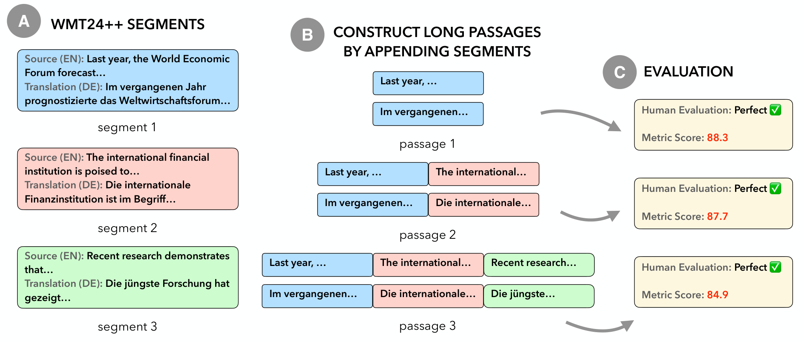
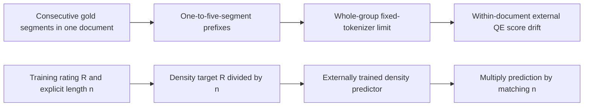

# QE length bias: train error density, not a post-hoc score division

<!-- source-sha256: eeeca4b59fe3a14e52d5b627ac0ee8e658887184eb458da8ad1d76492a220bd8 -->

[简体中文](README.md)

> Local delivery is an L1 numerical/protocol component, not a full paper capability reproduction. Full experiments are cost-deferred and review-DONE, with no pretrained model/API training, automatic retry or evolve promotion.

Independent component artifacts: [CPU, three seeds](metrics/component-cpu-seeds42-44.json). They validate only the stated small operators; actual NVIDIA execution is supported by a separate sanitized batch receipt.

## Paper information

| Field | Value |
|---|---|
| Paper | [Penalizing Length: Uncovering Systematic Bias in Quality Estimation Metrics](https://arxiv.org/abs/2510.22028v1); [fixed v1](https://arxiv.org/html/2510.22028v1) |
| Company / institution | First author Yilin Zhang: Carnegie Mellon University / Google; original byline also verifies Google. Group by the first author's institution, not model brands. |
| First publication | 2025-10-24 21:22:06 UTC, arXiv v1; historical omission, not a new paper this batch |
| Author code | No verified paper-specific author repository was found. Fixed v1 promises experiment scripts after acceptance; MetricX/WMT dependencies are not this paper's source release. |
| Adapter | `qe-length-normalization` is a catalog key; `adapter=null`, not a full reproduce/evolve adapter |
| Local code | `src/auto_research/foundation_models/qe_length_normalization.py`; `tests/test_nov13_colm_evaluation.py` |

<!-- paper-figure:start -->
### Key figure from the original paper



Source: [fixed original](https://arxiv.org/html/2510.22028v1/length-bias-teaser.png). Image from the [original paper](https://arxiv.org/abs/2510.22028v1); copyright belongs to its original authors. The complete system or results in this figure are not results of the local component. Source hashes and visual review are recorded in `assets/provenance.json`.
<!-- paper-figure:end -->

## Original paper summary

### Background and main change

A reference-free translation evaluator may penalize longer text even when its quality is held fixed. This can favor short candidates during reranking or reward-based training. The paper builds one-to-five-segment prefixes from consecutive gold translations in the same document, controlling domain and presumed error-free quality before measuring score drift.

Its mitigation changes the training target to error density and rescales the model's predicted density at inference. Dividing scores from an unchanged pretrained evaluator is not the proposed retraining procedure. The paper also investigates reference-based evaluation; that model branch is not implemented locally.



### Core formulas

Fixed v1 section4.2 defines $D(x,h)=R(x,h)/|h|$ and $\widehat R(x,h)=\widehat D(x,h)|h|$. The source calls the denominator segment length without fixing one unambiguous tokenization unit in that equation. The local interface therefore requires positive supplied lengths and an explicit `length_unit`, reused at training and inference. This declaration does not independently verify the caller's tokenizer.

Section3.2 uses $p_i=s_1+\cdots+s_i$ from the first five segments in one document. It rejects the entire group if the fifth concatenated prefix exceeds500 tokens under MetricX's tokenizer. The local function consumes counts obtained after concatenation; summing separately tokenized segment lengths is not equivalent. It compares $\Delta_i=M(p_i)-M(p_1)$ rather than pooling unrelated documents.

### Original offline and online results

Across ten language directions, the paper reports score decreases of1.0–2.0 for MetricX-24 QE and1.5–5.6 for CometKiwi when error-free text grows from one to five segments. These metric scales are not interchangeable. Retrained normalized MetricX reduces the score-change slope beyond three segments. None of these model results is established by the local arithmetic round trip. No production online A/B is reported.

## Local component

### Data protocol and code mapping

`density_targets` and `restore_ratings` implement the target transformation and output restoration. `controlled_passages` constructs the prefix group and filters it as a whole; `within_document_differences` computes the five matched score changes. No WMT download, pretrained evaluator, translation generation or MetricX training is included.

```bash
PYTHONPATH=src python -c 'from auto_research.foundation_models.qe_length_normalization import diagnostic; print(diagnostic(42))'
PYTHONPATH=src python -m pytest -q tests/test_nov13_colm_evaluation.py
```

### Local evidence and negative controls

The L1 diagnostic checks the rating-density-rating round trip, ordered prefixes, rejection of a fifth prefix containing501 tokens, and subtraction of the first score. Teaching numbers are not translation-quality observations. Three seeds do not turn an algebraic identity into evidence of debiasing, and this component is not eligible for evolve promotion.

### Full-experiment cost decision

The original matrix uses ten WMT24++ directions, four QE approaches, commercial Gemini inference and MetricX QE retraining. Total retraining hardware and wall time are not disclosed. The cost cannot be safely bounded by cheap source checks for one A100/A30 or a Mac, so the full reproduction is cost-deferred and review-DONE. No trial training or paid API calls are attempted.
