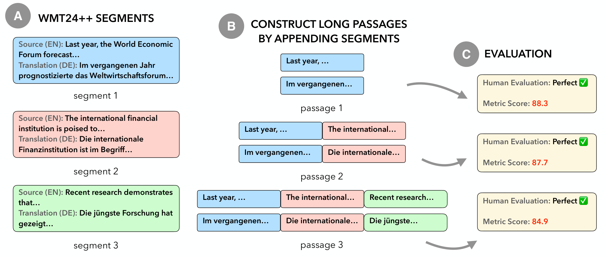
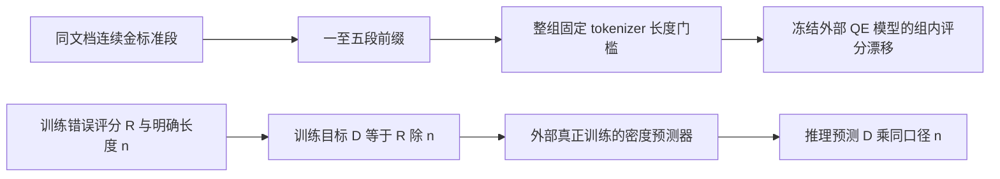

# QE 长度偏差：训练误差密度，而不是给冻结分数除长度

> 本地交付是 L1 数值/协议组件，不是完整论文能力复现。完整实验成本过高，不复现（审查 DONE）；未执行模型/API训练，不启用自动重试或 evolve 晋级。

本轮独立机制记录：[CPU 三种子](metrics/component-cpu-seeds42-44.json)。这些产物只验收所述小算子，不是论文能力分数；真实 GPU 结果以统一脱敏回执为准。

## 论文信息

| 字段 | 内容 |
|---|---|
| 论文链接 | [Penalizing Length: Uncovering Systematic Bias in Quality Estimation Metrics](https://arxiv.org/abs/2510.22028v1)；[固定 v1 原文](https://arxiv.org/html/2510.22028v1) |
| 公司 / 机构 | 一作 Yilin Zhang：Carnegie Mellon University / Google；原文另确认 Google 署名，按一作所属机构聚合，不以模型品牌判断机构 |
| 首次公开日期 | 2025-10-24 21:22:06 UTC（arXiv v1，不是本轮新首发） |
| 原作者代码 | 未找到可核实的本篇公开代码；固定v1称录用后发布实验脚本；截至2026-11-13的原文及有限作者/标题核查未确认本篇公开仓库，不把MetricX/WMT依赖算本篇源码。 |
| Adapter | `qe-length-normalization` 为 catalog key，`adapter=null`，不是完整 reproduce/evolve adapter |
| 本地复现代码 | `src/auto_research/foundation_models/qe_length_normalization.py`；专测 `tests/test_nov13_colm_evaluation.py` |

<!-- paper-figure:start -->
### 原论文关键图



来源：[固定 v1 原论文](https://arxiv.org/html/2510.22028v1)。图片来自[原论文](https://arxiv.org/abs/2510.22028v1)，版权归原作者所有；图中完整系统或实验结果不等于本地组件结果。原始来源、SHA256与视觉核验见 `assets/provenance.json`。
<!-- paper-figure:end -->

## 原始论文总结

### 背景与主要改动

同样没有翻译错误，较长译文却被质量估计器判得更差，会把 reranking 和基于评分的训练导向短答案。本文不把长度和真实质量相关性混在一起：对同一文档的连续金标准段落构造一至五段的前缀，尽量固定领域和质量，再观察评分漂移。

缓解方案之一是在训练时预测单位长度的错误密度，在推理时乘回译文长度。它改变监督目标及其分布，不是对已经训练好的 MetricX 输出做一次除法，就能声称修好了偏差。论文还检查引入参考文本的评估方案，本地未实现该模型分支。



### 核心公式

固定 v1 §4.2 定义：

$$
D(x,h)=R(x,h)/|h|,\qquad \widehat R(x,h)=\widehat D(x,h)|h|.
$$

原文只称 $|h|$ 为 segment length，没有在该式明确唯一分词单位。本地因此要求调用者显式给出正长度与非空 `length_unit`，并在训练和推理沿用同一计量。这个字符串声明不是外部 tokenizer 的真实性证明；接口不能自动阻止调用者偷偷换单位。

§3.2 的控制实验从同文档前五段构造 $p_i=s_1+\cdots+s_i$，用 MetricX 的固定 tokenizer 检查第五前缀是否超过 500 token；超过则整组丢弃。本地接收实际串接后算出的五个计数，不能用各段独立 token 数相加替代重新分词。评分比较为 $\Delta_i=M(p_i)-M(p_1)$，不同文档和语对不能直接混成长度效应。

### 论文离线与线上效果

原文十个语对的错误为零前缀，从一段到五段时 MetricX-24 QE 分数下降 1.0–2.0 点、CometKiwi 下降 1.5–5.6 点；不同指标方向和尺度不能横向相加。重新训练的归一化 MetricX 在三段以上降低评分变化斜率。这是作者模型实验，不是本地 target 往返误差。未报告生产线上 A/B。

## 本地复现

### 数据协议与代码映射

`density_targets`、`restore_ratings` 对应监督目标和输出恢复；`controlled_passages` 对应同文档前缀与整组过滤；`within_document_differences` 只计算五个控制前缀的相对评分。没有下载 WMT、加载 MetricX/Gemini、重新训练评分器或生成翻译。

```bash
PYTHONPATH=src python -c 'from auto_research.foundation_models.qe_length_normalization import diagnostic; print(diagnostic(42))'
PYTHONPATH=src python -m pytest -q tests/test_nov13_colm_evaluation.py
```

### 本地结果与负控

L1 诊断检查评分→密度→评分往返、前缀顺序、501-token 第五前缀整组拒绝，以及对首前缀的分差。输入是教学数值，不是公开翻译质量结果；三个种子不把代数恒等式升级为去偏能力。该组件不参与 evolve 晋级。

### 高成本完整实验

原文包括 WMT24++ 十语对、四种 QE 方案、商业 Gemini 推理和 MetricX QE 重新训练；未给完整重训的硬件和总墙钟。完整多臂成本不能通过现有廉价信息保证，按单 A100/A30 或 Mac 的预算直接记为**成本过高，不复现（审查 DONE）**。不试训、不调用商业 API，不以一个便宜的长度函数冒充训练后的去偏模型。
