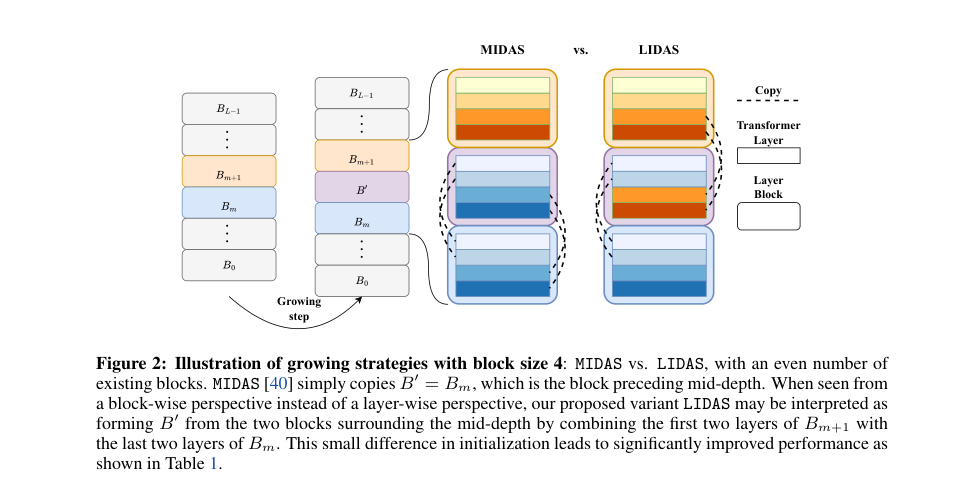

# LIDAS: middle-layer growth with optimizer-state inheritance

<!-- source-sha256: be77977eb086e191256ceb14fe78a5c1fb64879792d39290cd55be41bf6bf27d -->

[简体中文](README.md)

> **L1 mechanism/evaluation component, diagnostic only—not a complete capability reproduction.** CPU and real NVIDIA A100-SXM4-80GB L1 checks passed for seeds 42/43/44; only small tensor operators were executed, not full training. Not integrated with Evolve; fixture results cannot justify promotion.

## Paper information

| Field | Value |
| --- | --- |
| Paper | [arXiv:2512.08819v1](https://arxiv.org/abs/2512.08819v1); [fixed v1 source](https://arxiv.org/html/2512.08819v1) |
| First author / institution | **Ferdinand Kapl**, first affiliation **Technical University of Munich**; Google participation is verified from the author block, not model names |
| Original publication date | **2025-12-09 17:12:04 UTC**, arXiv v1 record; historical official-source backfill, not today's first publication |
| Author code | No verified paper-specific author implementation repository was found in fixed v1 as of 2026-11-13; model/dependency repositories do not count as this paper's code. |
| Local adapter / key | `lidas`; `adapter: null`, independent component |
| Local code | `src/auto_research/foundation_models/lidas.py` |
| Validation | CPU and real NVIDIA A100-SXM4-80GB L1 checks passed for seeds 42/43/44; only small tensor operators were executed, not full training. |

## Original paper summary

### Background and main change

Later Transformer layers may contribute little to predictions. The paper compares gradual depth growth with fixed-depth training and proposes LIDAS, whose layer-centered copy region differs from block-centered MIDAS when the block count is even.

<!-- paper-figure:start -->
### Key original-paper figure

[](https://arxiv.org/html/2512.08819v1#page=4)

Figure 2, PDF page 4: the four-layer copy positions for MIDAS and LIDAS. Source and image hashes are in [assets/provenance.json](assets/provenance.json). Figure from the [original paper](https://arxiv.org/html/2512.08819v1); copyright belongs to the original authors. Full-paper findings are not local component results.

<!-- paper-figure:end -->

### Defining mechanism and formula

The implementation fixes the paper's experimental block size to four. At depth eight, layers 2–5 are copied after layer 5, giving 0,1,2,3,4,5,2',3',4',5',6,7. At depth twelve it coincides with MIDAS. Figure 2 and the odd-block equivalence resolve an inclusive-index notation ambiguity. Parameters and AdamW moments/step are deep-copied without aliases; groups and the global scheduler step survive.

```text
T_s = T * (s+1) / sum_{j=1..S} j  (PROP-1)
```

### Original results and limitations

The 360M/1.7B SmolLM experiments find stronger depth utilization and reasoning results, not a universal benefit from copying layers. Baselines use 64/128 A100-40GB GPUs for about 1.5/4.5 days. Local execution checks growth and a real subsequent gradient update, not 200B/400B-token pretraining.

## Local reproduction

### Data protocol and code mapping

`grow_layers` transforms an actual ModuleList and AdamW state while leaving external embeddings/heads untouched; model-specific depth configuration and position indexing remain the caller's responsibility. Tied layers are rejected. PROP-1 conserves the total budget using an explicit largest-remainder convention. Controls test AMSGrad state independence, scheduler continuity and real copied-layer updates.

```bash
PYTHONPATH=src python -c 'from auto_research.foundation_models.lidas import diagnostic; print(diagnostic(42, device="cpu"))'
PYTHONPATH=src python -m pytest -q tests/test_colm_foundation_components.py
```

### Results, negative controls and boundaries

The component test set has 44 passes and six locally skipped CUDA cases; skipping is not passing. Standard three-seed outputs use `metrics/component-cpu-seeds42-44.json`, with `metrics/component-cuda-seeds42-44.json` and a sanitized GPU receipt for CUDA. CPU and real NVIDIA A100-SXM4-80GB L1 checks passed for seeds 42/43/44; only small tensor operators were executed, not full training. All metrics are L1 diagnostics. No gold is exposed to an actor, no test-based selection is authorized, and no model improvement is claimed.

Real-GPU evidence: [three-seed CUDA metrics](metrics/component-cuda-seeds42-44.json) and [sanitized A100 receipt](../../gpu-validations/lidas-a100-20261113.json), bound to frozen source commit `1b7fe8699efd48e6421b01f6df756d6e4086eb52`. About 1.468 seconds for all seven CUDA components is small-operator time, not this paper's training runtime.

### Full-experiment disposition

360M baseline uses 64 A100-40GB for 1.5 days; 1.7B baseline 128 A100-40GB for 4.5 days; full pretraining not reproduced.

**Full experiment not reproduced due to cost (review DONE).** No large checkpoint/corpus downloads, scaled-down substitute presented as replication, or automatic full-training retries.
