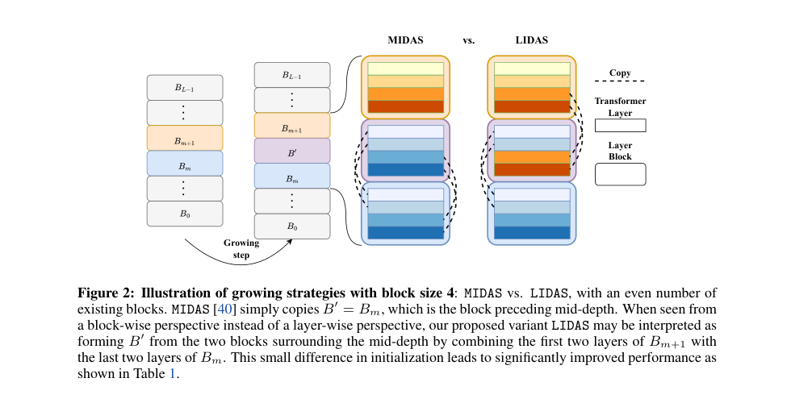

# LIDAS：按中间层生长 Transformer 并继承优化器状态

[English](README-en.md)

> **L1 机制/评测组件，diagnostic only，不是完整模型能力复现。** CPU及真实NVIDIA A100-SXM4-80GB的42/43/44三种子L1检查已通过；只运行小张量算子，没有完整训练。 未接入Evolve，不可据本地fixture成绩晋级。

## 论文信息

| 字段 | 内容 |
| --- | --- |
| 论文链接 | [arXiv:2512.08819v1](https://arxiv.org/abs/2512.08819v1)；[固定v1原文](https://arxiv.org/html/2512.08819v1) |
| 公司 / 作者机构 | 一作 **Ferdinand Kapl**，第一单位 **Technical University of Munich**；论文有Google相关作者，按原文作者栏确认，不凭模型名归属 |
| 首次公开日期 | **2025-12-09 17:12:04 UTC**，依据arXiv v1记录；本次是历史官方源补漏，不是今天新首发 |
| 原作者开源代码 | 截至2026-11-13，固定v1未找到已核实的本篇作者代码仓库；基础模型与依赖仓库不算本篇开源。 |
| 本地 adapter / key | `lidas`；`adapter: null`，独立组件 |
| 本地复现代码 | `src/auto_research/foundation_models/lidas.py` |
| 验收范围 | CPU及真实NVIDIA A100-SXM4-80GB的42/43/44三种子L1检查已通过；只运行小张量算子，没有完整训练。 |

## 原始论文总结

### 背景与主要改动

深层 Transformer 后半段可能对最终预测贡献很小。论文比较从浅到深逐步生长与固定深度预训练，并提出 LIDAS：以层而不是固定块的中点选择复制区域，使偶数块时的初始化区别于 MIDAS。

<!-- paper-figure:start -->
### 原论文关键图

[](https://arxiv.org/html/2512.08819v1#page=4)

Figure2，PDF 第4页；MIDAS 与 LIDAS 的四层复制位置。 来源与图像SHA见[assets/provenance.json](assets/provenance.json)。图片来自[原论文](https://arxiv.org/html/2512.08819v1)，版权归原作者所有；图中的完整实验结论不等于本地组件结果。

<!-- paper-figure:end -->

### 核心机制与公式

本地固定原文实际使用的 block size=4。L=8 时复制第2、3、4、5层（从0计数），插入第5层后，得到0,1,2,3,4,5,2′,3′,4′,5′,6,7；L=12 时与 MIDAS 一致。以 Figure2 及“奇数块相同”的约束消解正文闭区间记号多一项的排版歧义。所有新参数和 AdamW 一、二阶矩及step都 deep copy，不能共享内存；保留参数组与全局 scheduler step。

```text
T_s = T * (s+1) / sum_{j=1..S} j  (PROP-1)
```

### 原文结果与限制

原文训练360M/1.7B SmolLM结构，发现增长模型在多项推理任务更有效利用深度；不是任意模型复制后都会改善。完整训练分别使用64/128张A100-40GB、约1.5/4.5天。本地只验证生长变换和后续真实梯度更新，不复现200B/400B token预训练。

## 本地复现

### 数据协议与代码映射

`grow_layers` 对实际 `nn.ModuleList` 和 AdamW 状态执行变换，保留列表外的embedding/head；不自动改任意模型的配置或位置索引。拒绝跨层绑权重，避免悄悄破坏权重共享语义。`prop1_schedule` 保留总预算；整数化使用明确的最大余数约定。负控覆盖AMSGrad所有状态不alias、scheduler不重启、复制层确有梯度和参数变化。

```bash
PYTHONPATH=src python -c 'from auto_research.foundation_models.lidas import diagnostic; print(diagnostic(42, device="cpu"))'
PYTHONPATH=src python -m pytest -q tests/test_colm_foundation_components.py
```

### 结果、负控与边界

本批组件专测为44项通过、6项CUDA本机跳过；跳过不等于通过。三种子标准产物统一使用 `metrics/component-cpu-seeds42-44.json`，GPU另用 `metrics/component-cuda-seeds42-44.json` 与脱敏回执。CPU及真实NVIDIA A100-SXM4-80GB的42/43/44三种子L1检查已通过；只运行小张量算子，没有完整训练。 所有metric仅属L1诊断，无gold给actor、无test选择、无模型效果提升声明。

真实GPU产物：[三种子CUDA指标](metrics/component-cuda-seeds42-44.json)、[脱敏A100回执](../../gpu-validations/lidas-a100-20261113.json)，绑定冻结源码 `1b7fe8699efd48e6421b01f6df756d6e4086eb52`。全批7个CUDA组件用时约1.468秒是小算子时间，不是本篇完整训练耗时。

### 完整实验处置

原文Appendix E：360M baseline使用64张A100-40GB训练约1.5天；1.7B baseline使用128张A100-40GB约4.5天。完整200B/400B token预训练与消融矩阵远超单卡预算，不运行。

**完整实验成本过高，不复现（审查 DONE）**。不下载大权重/语料、不以缩水模型冒充原论文、不自动重试完整训练。
