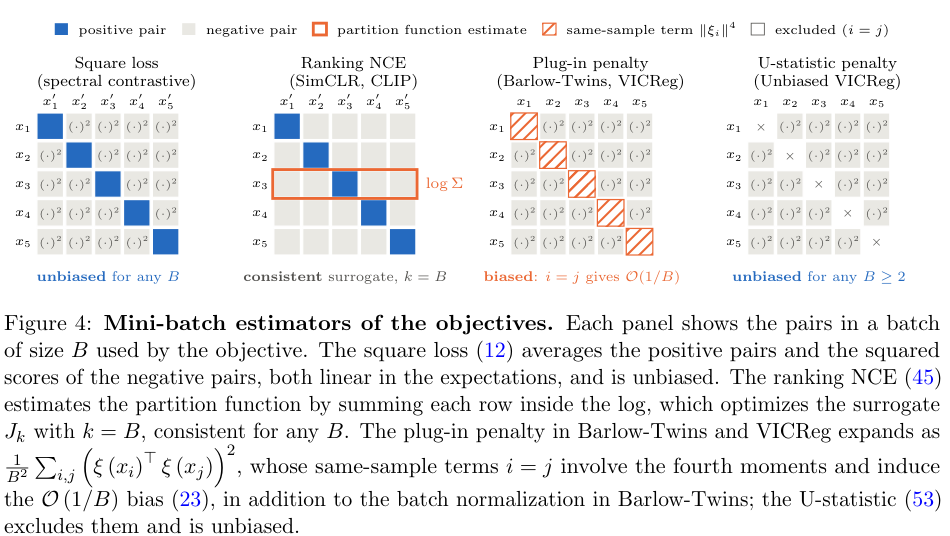

# Spectral Ghost: a spectral view of self-supervised objectives

<!-- source-sha256: 8974441bb41e91e867e062ab0490aef1ba6086eb162dd60354b1c09df6ad05bd -->

[简体中文](README.md)

> **Theory review only, not implemented.** Fixed v4 leaves empirical ablations to future work. There is no local training, metric or GPU experiment, and no invented expensive experiment attributed to the paper.

## Paper information

| Field | Value |
| --- | --- |
| Paper | [arXiv:2601.20154v4](https://arxiv.org/abs/2601.20154v4); [fixed v4](https://arxiv.org/html/2601.20154v4); [v1](https://arxiv.org/html/2601.20154v1) |
| Institution/company | Fixed v4: Bo Dai, Georgia Tech; Na Li, Harvard; Dale Schuurmans, University of Alberta. V1 listed Google DeepMind first for Bo Dai and Dale; v4 no longer does. Group by the reviewed-v4 first affiliation, not author-name inference |
| Original release | V1: January 28, 2026, 01:08:24 UTC. Reviewed v4: November 10, 2026, 21:17:38 UTC. A historical-version backfill, not a November first release |
| Authors' code | No dedicated author repository found in fixed v4 or arXiv resources. Baseline links and acknowledgments do not establish a source release |
| Local adapter/key | spectral-ghost; adapter null; review_only_theory; no Evolve integration |
| Local code | Not implemented: theoretical discussion, versioned affiliation evidence and original figure only; no run metrics |

## Original paper

### Motivation and changes

The contrastive/non-contrastive split does not explain representation sufficiency or batch-size effects. The paper organizes spectral, energy-based, denoising, nonlinear, latent-variable and multimodal approaches by **representation parametrization** and **objective estimation**. It connects established methods and derives new objectives, rather than providing an empirical leaderboard or only an opinion survey. [Sections 2–3 and 9](https://arxiv.org/html/2601.20154v4#S2)

### Key original figure

Fixed-v4 Figure 4 and caption; authors retain copyright under the arXiv perpetual non-exclusive license. This illustrates estimators, not local experimental results. [Provenance](assets/provenance.json).

### Mechanisms and equations

A finite-dimensional spectral representation can factor a paired density ratio, but sufficiency for arbitrary downstream tasks also depends on assumptions and rank. A learned finite vector is not automatically a universal sufficient statistic.

One identifiable new objective removes same-sample terms from the squared plug-in covariance penalty. For $z_i=\xi(x_i)$, Eq.53 uses:

$$
\widehat R=\frac{1}{B(B-1)}\sum_{i\ne j}(z_i^Tz_j)^2-\frac2B\sum_i\|z_i\|^2+d,\qquad B\ge2.
$$

Under the paper's independent-sampling conditions it is unbiased for $\|E[zz^T]-I\|_F^2$, unlike the $B^{-2}$ plug-in including $i=j$. Unbiasedness guarantees neither low small-batch variance nor stability at arbitrary learning rates. [Sections 3.2 and 9.1](https://arxiv.org/html/2601.20154v4#S3.SS2)

Ranking NCE optimizes a fixed-negative-count surrogate and is consistent under a well-specified model. With misspecification, different negative counts may change the optimum: more negatives do not universally only reduce variance. JEPA's stopped/EMA targets have a variational-power-iteration interpretation; this does not make every objective interchangeable with ordinary MSE.

### Results and evidence boundaries

The results are derivations about representations, estimator bias and algorithmic connections, not a new unified training matrix or production A/B. Section 12 explicitly leaves empirical parametrization/optimization ablations outside scope. There are no local accuracy, loss-reduction or GPU-receipt claims; discussing an existing method does not reproduce it.

## Local scope

**Review only: no implementation, queue or automatic retry.** An independent future implementation would need explicit sampling, positivity/nonzero constraints, finite-rank assumptions and matched budgets, then arithmetic/gradient checks. No such experiment is claimed here. The status is review_only_theory / no_empirical_experiment, not a deferred high-cost campaign.
