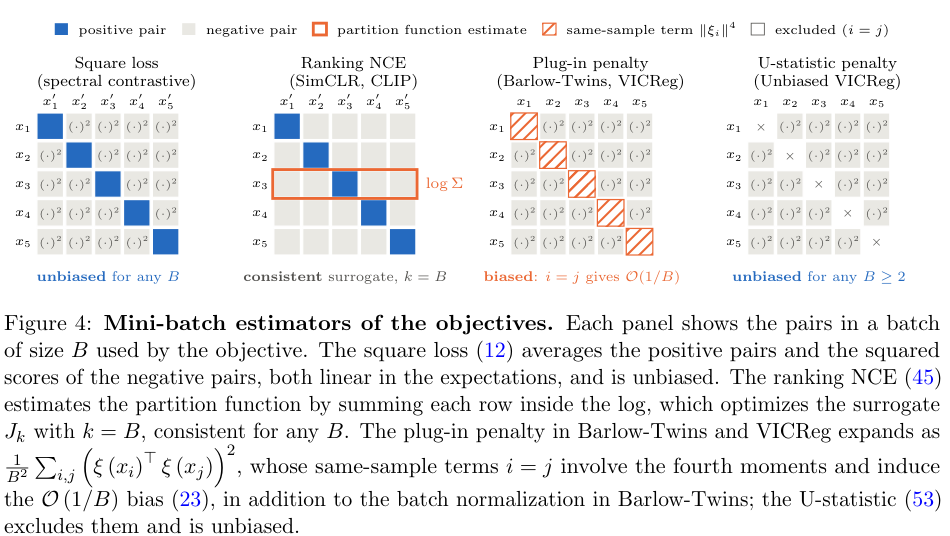

# Spectral Ghost：从谱表示理解自监督目标

[English](README-en.md)

> **理论资料收录，未实现**。按固定v4审读；原文把实证消融留作未来工作，本地没有训练、指标或GPU实验，**不虚构“高成本原文实验”**。

## 论文信息

| 字段 | 内容 |
| --- | --- |
| 论文链接 | [arXiv:2601.20154v4](https://arxiv.org/abs/2601.20154v4)；[固定v4全文](https://arxiv.org/html/2601.20154v4)；[v1全文](https://arxiv.org/html/2601.20154v1) |
| 公司 / 机构 | 固定v4一作 Bo Dai：Georgia Tech；Na Li：Harvard；Dale Schuurmans：University of Alberta。v1曾给Bo Dai和Dale列Google DeepMind在前，v4已不再这样署名；按v4一作机构聚合，不依据姓名推断Google |
| 首次公开日期 | v1：2026-01-28 01:08:24 UTC；本轮审读v4更新于2026-11-10 21:17:38 UTC，是历史版本补漏，不计为11月新首发 |
| 原作者开源代码 | 固定v4正文与arXiv资源未找到专属作者源码仓库；文中基线与致谢不是本文开源证明 |
| 本地 adapter / key | `spectral-ghost`；adapter 为 null，review_only_theory，未接入 Evolve |
| 本地复现代码目录 | 未实现；仅理论解读、版本化机构证据与原图，无运行指标 |

## 原始论文总结

### 背景与主要改动

把自监督方法仅分为contrastive/non-contrastive，无法解释表示对下游任务何时充分，也无法推断batch大小的作用。本文按**表示参数化**和**目标估计方式**组织谱分解、energy、denoising、nonlinear、latent-variable及multimodal路线，既联系已有方法，也推导新目标。它不是实证排行榜，也不是只有观点的综述。[§2—3、§9](https://arxiv.org/html/2601.20154v4#S2)

<!-- paper-figure:start -->
### 原论文关键图

固定v4 Figure 4及图注，版权归原作者，arXiv perpetual non-exclusive license。它是目标估计的示意，不是本地实验结果。[来源与 SHA256](assets/provenance.json)。
图片来自[原论文](https://arxiv.org/html/2601.20154v4)，版权归原作者所有。
<!-- paper-figure:end -->

### 核心机制与公式

有限维谱表示可分解配对变量的density ratio；是否足以覆盖所有下游任务还依赖模型假设与秩，不能把有限学得向量直接称为通用充分统计量。

一个可独立辨认的新目标是去除plug-in协方差平方里的同样本项。若$z_i=\xi(x_i)$，论文Eq53的二次正交惩罚估计为：

$$
\widehat R=\frac{1}{B(B-1)}\sum_{i\ne j}(z_i^Tz_j)^2-\frac2B\sum_i\|z_i\|^2+d,\qquad B\ge2.
$$

在论文的独立采样条件下，它无偏估计$\|E[zz^T]-I\|_F^2$，不同于包含$i=j$的$B^{-2}$plug-in；无偏不等于小样本方差小，更不等于任意学习率都稳定。[§3.2、§9.1](https://arxiv.org/html/2601.20154v4#S3.SS2)

ranking NCE对固定负例数优化自己的surrogate，在well-specified假设下有一致性；模型错设时不同负例数可改变最优点。因此“更多负例只是降方差”也不是普遍结论。JEPA的stop-gradient/EMA可从variational power iteration理解，不应把不同目标统一成一个普通MSE后声称等价。

### 论文结果与证据边界

本文的主要结果是表示、估计偏差和算法联系的推导，不报告新的统一benchmark训练矩阵或生产A/B。§12明确把参数化/优化的实证消融排除在本文范围之外。这里不提供本地准确率、loss下降、GPU回执，也不把已有方法在文中被讨论当成本文已复现。

## 本地范围

**仅资料收录，不实现、不排队、不自动重试。** 后续若独立实施某一目标，应单独声明独立采样、非零/正值约束、有限秩及比较预算，再验证算术与梯度；本轮没有授权或声称完成该实验。该状态为`review_only_theory` / `no_empirical_experiment`，不是高成本完整实验延期。
