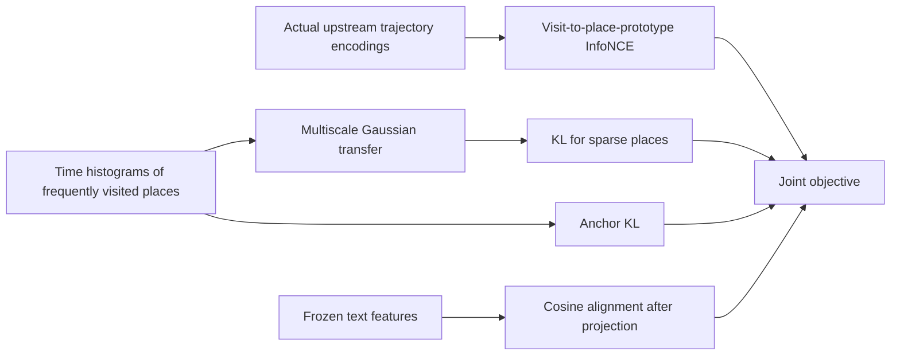
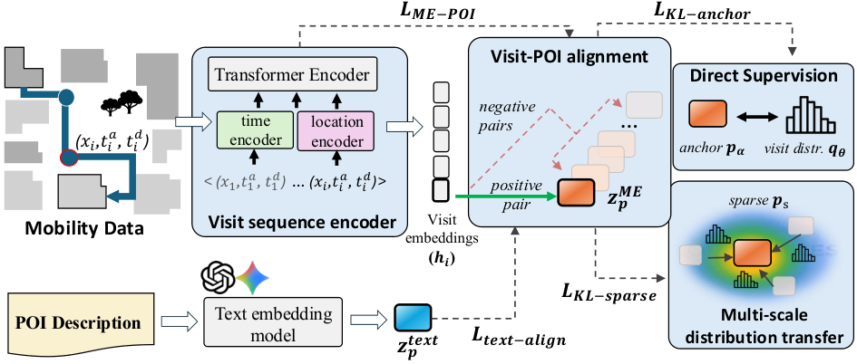

# ME-POIs: Joint objectives for mobility trajectories and place prototypes

<!-- source-sha256: 020372f891fbda2dd97b639b573392451eed2a5655e7fb62c2385d8be2cdf070 -->

[简体中文](README.md)

## Paper information

| Field | Value |
| --- | --- |
| Paper | [arXiv 2601.21149](https://arxiv.org/abs/2601.21149); [pinned v1 full text](https://arxiv.org/html/2601.21149v1) |
| Original title | Mobility-Embedded POIs: Learning What A Place Is and How It Is Used from Human Movement |
| Organization | First author Maria Despoina Siampou: University of Southern California. Google Research collaboration, not a Google first author. |
| First published | 2026-01-29 (arXiv v1; earlier non-arXiv versions have not been exhaustively ruled out) |
| Original author code | No training repository found in v1 or on the official institution page; this is not a claim that no implementation exists anywhere. |
| Local adapter / key | `me-pois`; `adapter: null`, standalone `component_only` loss |
| Local code | `src/auto_research/foundation_models/google16_me_pois.py`; `scripts/run_google16_neural.py` |
| Full experiment | Veraset, SafeGraph, and Google Maps labels are unavailable; not reproduced (review DONE). No data purchases or paid embedding API calls. |

## Original paper summary

### Background and main changes

A visit-sequence encoder links short-term trajectories to persistent place prototypes. Temporal distributions from frequently visited places transfer to sparse places across spatial scales. Text semantics add another alignment signal. After pretraining, frozen representations feed map-attribute probes. See [§§3.2–3.6](https://arxiv.org/html/2601.21149v1#S3.SS2).



<!-- paper-figure:start -->
### Key figure from the paper

[](https://arxiv.org/html/2601.21149v1#S1.F2)

> **Figure 2, author architecture.** Four objectives connect visits, place prototypes, and text features. The local implementation covers only the objective and distribution transfer, not the visit encoder or private data path. Copyright belongs to the authors. [Source and image hash](assets/provenance.json).
<!-- paper-figure:end -->

### Core equation

Eqs. 10–11 normalize over anchors **within each scale** before averaging over scales:

$$
\alpha^{(m)}_{sa}=\operatorname{softmax}_{a}(-\|x_s-x_a\|^2/(2\sigma_m^2)),\qquad
\widetilde r_s=M^{-1}\sum_m\sum_a\alpha^{(m)}_{sa}r_a.
$$

Eq. 9 uses **distinct place prototypes** in the minibatch as negatives, not repeated visit records. Eqs. 13 and 15 compute $\operatorname{KL}(r\|q)$ and sum over places. A shared one-hidden-layer ReLU MLP predicts time distributions. Eq. 16 uses $1-\cos$ for projected text and prototypes. Eq. 17 combines the four terms with externally supplied weights.

### Offline and online results in the paper

The paper probes frozen representations on five map-attribute tasks in LA and Houston. No online A/B is reported. The local diagnostic neither reads private labels nor compares its formula checks with the map results.

## Local reproduction

The implementation provides `transferred_visit_distribution`, `prototype_contrastive_loss`, `distribution_kl_sum`, and `MobilityPrototypeLoss`. The caller supplies real visit encodings and text features; **random vectors do not replace the trajectory encoder**. Generated tensors in the runner are labeled `fixture_only: true` and check normalization, independent formulas, prototype/MLP/visit gradients, and frozen external text inputs.

```bash
PYTHONPATH=src python scripts/run_google16_neural.py \
  --device cpu --seed 42 --output runs/google16-neural-cpu.json
```

The bounded CPU/CUDA component downloads no resources. The same runner executed on an A100 with a saved [receipt](../../gpu-validations/me-pois-a100-20261021.json). This verifies execution, not full trajectory representation or map capability. Space2Vec, Time2Vec, the paper's visit Transformer, private-data pretraining, and the five attribute training tasks are not implemented. No Evolve integration.

### Cost and data contract

The appendix specifies approximately 53.7M parameters, 20 pretraining epochs, and up to 100 downstream epochs. The model itself fits on one GPU; use of a V100 is not a cost justification. The barriers are paid/private mobility data, SafeGraph and Maps labels, and the complete multi-embedding matrix. Full experiments are not reproduced or queued for automatic retry. This is an L0/L1 formula and gradient diagnostic with no validation/test capability claim.
