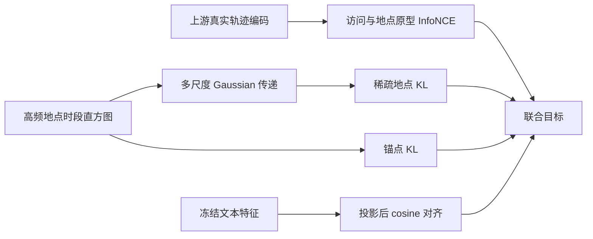
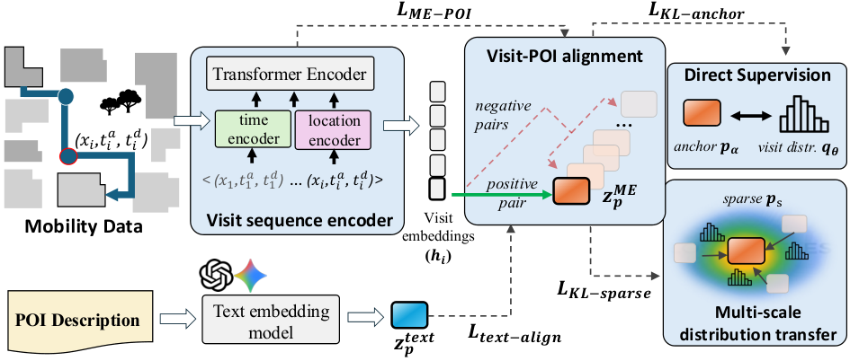

# ME-POIs：移动轨迹与地点原型的联合学习目标

## 论文信息

| 字段 | 内容 |
| --- | --- |
| 论文链接 | [arXiv 2601.21149](https://arxiv.org/abs/2601.21149)；[固定 v1 全文](https://arxiv.org/html/2601.21149v1) |
| 原文标题 | Mobility-Embedded POIs: Learning What A Place Is and How It Is Used from Human Movement |
| 公司 / 机构 | 一作 Maria Despoina Siampou：University of Southern California；Google Research 合作，非 Google 一作 |
| 首次公开日期 | 2026-01-29（arXiv v1；不声称已穷尽更早非 arXiv 版本） |
| 原作者代码 | 原文 v1 及官方机构页未找到/未发布训练仓库；不据此声称全网没有实现 |
| 本地 adapter / 稳定键 | `me-pois`；`adapter: null`，独立 `component_only` 损失组件 |
| 本地复现代码目录 | `src/auto_research/foundation_models/google16_me_pois.py`；`scripts/run_google16_neural.py` |
| 完整实验 | 原始 Veraset、SafeGraph 与 Google Maps 标签不可用，不复现（审查 DONE）；未购买数据或调用付费 embedding API |

## 原始论文总结

### 背景与主要改动

原方法用访问序列编码器连接短期轨迹与长期地点原型，并把高频地点的时段分布跨空间尺度传给稀疏地点；文本语义作为另一条对齐监督。冻结预训练表征后，再训练地图属性探针。主要机制与公式见[原文 §3.2–3.6](https://arxiv.org/html/2601.21149v1#S3.SS2)。



<!-- paper-figure:start -->
### 原论文关键图

[](https://arxiv.org/html/2601.21149v1#S1.F2)

> **Figure 2，原作者架构图**：四项训练目标连接访问、地点原型和文本特征。当前本地只实现目标函数及分布迁移，不声称完整实现图中访问编码器与私有数据链路。图片来自原文，版权归原作者；[来源与图像hash](assets/provenance.json)。
<!-- paper-figure:end -->

### 核心公式

Eq.10–11 在**每个尺度内**先对锚点归一化，再在尺度间取平均：

$$
\alpha^{(m)}_{sa}=\operatorname{softmax}_{a}(-\|x_s-x_a\|^2/(2\sigma_m^2)),\qquad
\widetilde r_s=M^{-1}\sum_m\sum_a\alpha^{(m)}_{sa}r_a.
$$

Eq.9 的负例集合是 minibatch 中**不重复的地点原型**，不是重复访问记录。Eq.13、15 的 KL 为 $\operatorname{KL}(r\|q)$，并对地点求和；共享一隐层 ReLU MLP 预测时段分布。Eq.16 对投影文本与原型求 $1-\cos$，Eq.17 按外部权重联合四项目标。

### 论文离线与线上效果

原文在 LA 与 Houston 的五项地图属性任务报告冻结表征探针；未报告线上 A/B。本地不读取该私有标签，不将数学诊断与论文地图结果比较。

## 本地复现

实现 `transferred_visit_distribution`、`prototype_contrastive_loss`、`distribution_kl_sum` 和 `MobilityPrototypeLoss`。接口要求调用方提供真实访问编码及文本特征；**没有用随机向量冒充轨迹编码器**。runner 的生成张量显式标记 `fixture_only: true`，仅检查概率归一化、独立公式、原型/MLP/访问梯度和外部文本冻结边界。

```bash
PYTHONPATH=src python scripts/run_google16_neural.py \
  --device cpu --seed 42 --output runs/google16-neural-cpu.json
```

有界 CPU/CUDA 数学组件不下载资源。同一 runner 已在 A100 执行并保存[回执](../../gpu-validations/me-pois-a100-20261021.json)；GPU 完成只说明公式运行，不代表完整轨迹表征或地图能力复现。未实现 Space2Vec、Time2Vec、原访问 Transformer、私有数据预训练及五项属性训练，不接入 Evolve。

### 成本与数据协议

原文附录配置为约 53.7M 参数、20 epoch 预训练及最多100 epoch 下游训练；模型本身可单卡放下，不把“使用 V100”当高成本理由。阻碍是付费/私有移动数据、SafeGraph 与 Maps 标签及完整多 embedding 组合，因此完整实验不复现，不进入自动重试队列。当前仅为 L0/L1 公式与梯度诊断，无 validation/test 能力结论。
