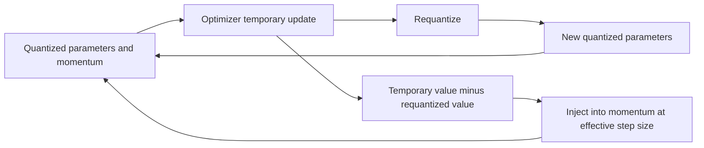
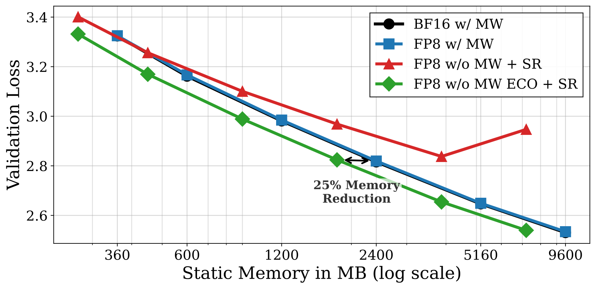

# ECO: Removing Master Weights by Compensating Quantization Error in Momentum

<!-- source-sha256: a7da5c72f5f8ac77a1928d9db59068a9e03727f8a8c2bd75d8fea56df3a36994 -->

[简体中文](README.md)

> Historical high-priority catch-up; full experiment not reproduced due to cost (review complete). No local capability result or executable Evolve operator.

## Paper information

| Field | Details |
|---|---|
| Paper | [arXiv 2601.22101v1](https://arxiv.org/abs/2601.22101v1); [pinned text](https://arxiv.org/html/2601.22101v1) |
| Organization | First author Mahdi Nikdan lists Google Research and ISTA; both are collaborating institutions. |
| First public release | 2026-01-29 18:35:01 UTC (arXiv v1, not the institution listing date). |
| Authors' code | No author repository was found in the paper or official Google details. This is not proof of non-release. |
| Adapter / method | `eco-optimizer` (catalog only); `adapter: null`. |
| Local reproduction code | None; this note and `src/auto_research/paper_specs/catalog/foundation-models/eco-optimizer.json` only. |

## Original paper

### Motivation and method

Low-precision training often keeps high-precision master weights to accumulate small updates. ECO updates quantized weights directly and feeds requantization error into existing momentum, without master weights or a persistent error buffer. Adam uses an elementwise effective step size; reusing SGDM's scalar coefficient is incorrect.

Redrawn from Algorithms 1–3. [Original algorithms and Figure 1](https://arxiv.org/html/2601.22101v1).

<!-- paper-figure:start -->
### Key figure from the paper

> **Figure 1:** Reported static memory versus validation loss, not architecture or local measurements. Author SVG rendered to PNG, separate from the Mermaid redraw. From the [original paper](https://arxiv.org/abs/2601.22101v1); copyright remains with the authors.
<!-- paper-figure:end -->

### Core equation

Let $e_{t+1}=\tilde\theta_{t+1}-q(\tilde\theta_{t+1})$. Section 3.2 gives this buffer-free SGDM rule:

$$
\hat m_{t+1}=\tilde m_{t+1}
+\frac1\eta\left(1-\frac1\beta\right)e_{t+1}.
$$

This is not exactly equivalent to storing errors from both steps. The derivation uses the observation that adjacent errors are close; the paper analyzes convergence separately. Adam replaces the scalar step with elementwise $\eta_t$ from bias correction and second moments. Quantization format, scale granularity, and stochastic rounding matter.

### Paper results

Table 1, 30M model: stochastic-rounded FP8 ECO gives validation loss 3.3317 versus 3.3309 with master weights. This does not show uniform superiority. The paper also reports 1B and MoE training and emphasizes the memory–loss tradeoff. No production A/B is reported.

## Local status and cost

Section 4.2 trains on $100N$ C4 tokens for $N$ parameters; the smallest 30M setup already uses 3B tokens. Other experiments include Gemma-3 1B, 2.1B MoE pretraining, and DeepSeek-MoE-16B fine-tuning. **Full experiment not reproduced due to cost (review complete)** based on reported settings, without a cost probe.

No author implementation was verified. No optimizer implementation, FP8 kernel, training metrics, GPU evidence, executable operator, or Evolve integration was added. A later small-tensor error-feedback check would not establish native low-precision speedup.
