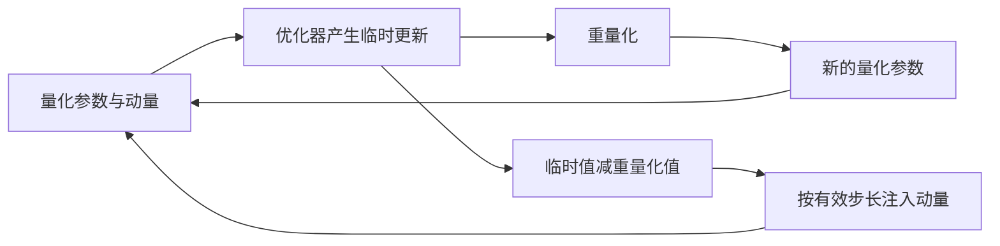
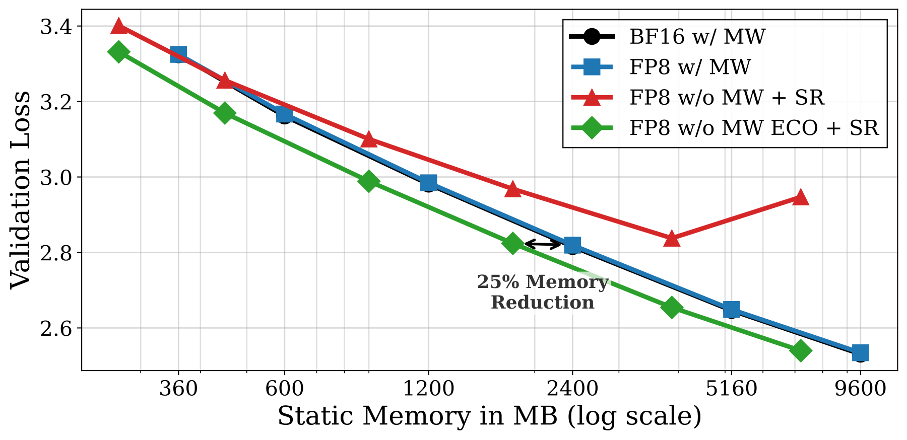

# ECO：用动量补偿量化误差，移除高精度主权重

> 历史高优先补漏资料；**成本过高，不复现（审查 DONE）**。没有本地能力结果或可执行 Evolve 算子。

## 论文信息

| 字段 | 内容 |
| --- | --- |
| 论文链接 | [arXiv 2601.22101v1](https://arxiv.org/abs/2601.22101v1)；[固定正文](https://arxiv.org/html/2601.22101v1) |
| 公司 / 机构 | 一作 Mahdi Nikdan 同时署名 Google Research 与 ISTA；论文合作机构 Google Research / ISTA |
| 首次公开日期 | 2026-01-29 18:35:01 UTC（arXiv v1，不用机构目录日期覆盖） |
| 原作者代码 | 所读原文和 Google 官方详情未找到作者代码仓库；未找到不表示已证明未发布 |
| 本地 adapter / 稳定键 | `eco-optimizer`（仅资料键）；`adapter: null` |
| 本地复现代码 | 无；仅本文及 `src/auto_research/paper_specs/catalog/foundation-models/eco-optimizer.json` |

## 原始论文总结

### 背景与主要改动

低精度训练通常仍保留高精度 master weights 累积微小更新。ECO 直接在量化权重上更新，将本次重量化误差注入已有动量，避免再保存主权重或持久误差缓冲；Adam 必须使用逐元素有效步长，不能把 SGDM 的标量系数照搬过去。

图按原文 Algorithm 1–3 重绘。[原文算法及 Figure 1](https://arxiv.org/html/2601.22101v1)。

<!-- paper-figure:start -->
### 原论文关键图

> **原论文 Figure 1**：静态内存与验证损失的权衡，是作者实验结果图而非优化器架构图，也不是本地测量。 图片来自[原论文](https://arxiv.org/abs/2601.22101v1)，版权归原作者所有；此处将作者SVG渲染为PNG展示，不是上方Mermaid重绘。点击图片查看原始图源。
<!-- paper-figure:end -->

### 核心公式

定义 $e_{t+1}=\tilde\theta_{t+1}-q(\tilde\theta_{t+1})$。原文 §3.2 的无额外误差缓冲 SGDM 规则为：

$$
\hat m_{t+1}=\tilde m_{t+1}
+\frac1\eta\left(1-\frac1\beta\right)e_{t+1}.
$$

这不是保存前后两步误差时的精确等价规则；作者用相邻误差接近的观察推导无缓冲形式，并另给收敛分析。Adam 以偏置修正及二阶矩构成的逐元素 $\eta_t$ 替换标量步长。量化格式、缩放粒度及随机舍入都影响结果。

### 论文离线与线上效果

原文 Table 1 的 30M 模型，FP8 随机舍入 ECO 验证损失 3.3317，对应保留主权重基线 3.3309；不能解读为 ECO 全面超过基线。论文还报告 1B 与 MoE 训练，重点是内存—损失权衡。没有生产 A/B，不将训练资源实验冒充线上收益。

## 本地复现与成本判断

§4.2 按参数量 $N$ 训练 $100N$ 个 C4 token，最低 30M 配置也为 3B token；另有 Gemma-3 1B、2.1B MoE 预训练及 DeepSeek-MoE-16B 微调。完整实验**成本过高，不复现（审查 DONE）**，依据论文配置判断，未运行成本探针。

未核到作者实现仓库。本轮没有优化器实现、FP8 kernel、训练指标或 GPU 验证；小张量误差反馈将来也只能验证机制，不能据此宣传原生低精度加速。未注册可执行入口，未接入 Evolve。
