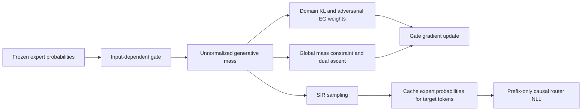
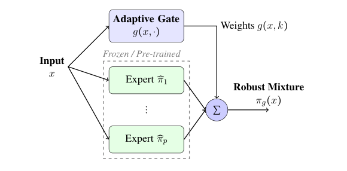

<!-- source-sha256: b0585aee352faf56f032b339220fbed2a5f721ec5d18d26daa081599fab2e10e -->

[简体中文](README.md) · English

# Modular Robust Generative: Robust gating with explicit global normalization

## Paper information

| Field | Details |
| --- | --- |
| Paper | [arXiv 2602.17554](https://arxiv.org/abs/2602.17554); [pinned v1 full text](https://arxiv.org/html/2602.17554v1) |
| Original title | A Theoretical Framework for Modular Learning of Robust Generative Models |
| Institution | First author Corinna Cortes: Google Research |
| First public release | 2026-02-19 (arXiv v1) |
| Author code | No implementation repository found or released in v1 or the official institution page. This is not a claim that no code exists anywhere. |
| Local adapter or method key | `modular-robust-generative`; `adapter: null`, `component_only` |
| Local reproduction code | `src/auto_research/foundation_models/google16_robust_gate.py`; `scripts/run_google16_neural.py` |
| Full experiment | The original-scale multi-expert campaign with multiple controls, datasets, and seeds is too costly; not reproduced (review DONE). |

## Original paper summary

### Background and main changes

The method learns an input-dependent gate over frozen generative experts against the worst data domain. It is not an expert average. A per-input softmax **does not guarantee that the entire generative distribution integrates to one**, so global mass must be constrained separately. Noncausal teacher samples are also distilled into a causal router that reads only prefixes. See [§§5.2, 6, and 7.3](https://arxiv.org/html/2602.17554v1#S5.SS2).



<!-- paper-figure:start -->
### Key figure from the paper

[](https://arxiv.org/pdf/2602.17554v1#page=6)

> **Figure 1, PDF page 6:** An input-dependent gate combines frozen experts. This is an original crop from the official PDF, not redrawn. The local implementation covers finite support only; the figure does not imply a trained LLM system. Copyright belongs to the authors. See [source, crop bounds, and hash](assets/provenance.json).
<!-- paper-figure:end -->

### Core equations

$$
\pi_g(x)=\sum_k g(x,k)\widehat\pi_k(x),\quad Z_g=\sum_x\pi_g(x),\quad
\mathcal L=\sum_k\lambda_k\operatorname{KL}(p_k\|\pi_g)+\mu(Z_g-1).
$$

The theoretical adversarial payoff in Algorithm 1 is domain KL, but the practical §5.2 / Appendix D Algorithm 6 uses domain NLL $\ell_k=-\mathbb E_{p_k}\log\pi_g$. The two differ by domain entropy. **Their gate gradients are equivalent; their adversarial weights need not be when entropies differ.** Local practice defaults to `nll`. Explicit `adversary_objective="kl"` is a theoretical comparison only. Tests keep an unequal-entropy counterexample so symmetric fixtures do not hide the difference.

Algorithm 2 updates $\lambda_k\propto\lambda_k\exp(\eta_\lambda\ell_k)$ and $\mu\leftarrow\mu+\eta_\mu(Z_g-1)$, then updates the gate. Exact summation on finite support replaces Monte Carlo/EMA estimation while preserving the constraint rather than hiding errors through silent renormalization. SIR proposes from uniformly weighted experts with weights $\pi_g/q$. Algorithm 5's cached target is $-\log\sum_k\gamma_k(x_{<t})\widehat\pi_k(y_t|x_{<t})$, not the arithmetic mean of expert NLLs.

### Offline and online results

The paper reports synthetic-domain and Wikipedia/Code/FineWeb offline NLL and distribution-shift comparisons, not production online A/B. The local run does not reproduce those tables or present lower finite-support training loss as evidence of language-model robustness.

## Local reproduction

`gated_mass` explicitly returns unnormalized mass; `primal_dual_step` performs three-party updates; `sir_resample` executes importance resampling; and `cached_router_nll` trains the router on a frozen cache. Independent tests cover the global-constraint counterexample, EG/dual formulas, reproducible sampling, mixture probabilities, and gradient isolation. The API does not automatically verify causality of the caller's network. The caller must generate router logits from prefixes alone.

```bash
PYTHONPATH=src python scripts/run_google16_neural.py \
  --device cpu --steps 16 --seed 42 --output runs/google16-neural-cpu.json
```

The runner is a two-expert by four-outcome mathematical diagnostic, explicitly `fixture_only: true`. It runs only 16 steps and logs the global normalization residual **without requiring it to converge to zero**. It does not claim a robust gate satisfying the theoretical constraint. No full Transformer or language data training, model downloads, capability comparison, or Evolve integration. The [CUDA receipt](../../gpu-validations/modular-robust-generative-a100-20261021.json) verifies execution and provenance only.

### Cost and unreproduced scope

Section 8.4 uses 80K×128 tokens per expert, three experts of about 6.5M parameters, additional gate training and a 19.8M control, and five repetitions each of two types. Experts alone require about 3.07 × 10⁸ tokens, excluding extra gate/control training. No full-run local runtime is measured. One small synthetic run is affordable, but the full multi-arm campaign exceeds the short single-A100/A30 budget and is not launched. The finite-support component does not replace those experiments or trigger automatic retries.
