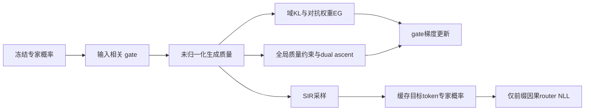
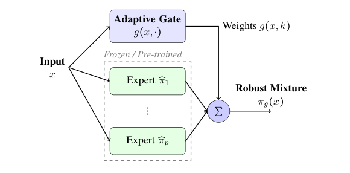

# Modular Robust Generative：显式全局归一化的鲁棒门控

## 论文信息

| 字段 | 内容 |
| --- | --- |
| 论文链接 | [arXiv 2602.17554](https://arxiv.org/abs/2602.17554)；[固定 v1 全文](https://arxiv.org/html/2602.17554v1) |
| 原文标题 | A Theoretical Framework for Modular Learning of Robust Generative Models |
| 公司 / 机构 | 一作 Corinna Cortes：Google Research |
| 首次公开日期 | 2026-02-19（arXiv v1） |
| 原作者代码 | 原文 v1 与官方机构页未找到/未发布实现仓库；不声称全网均无代码 |
| 本地 adapter / 稳定键 | `modular-robust-generative`；`adapter: null`，`component_only` |
| 本地复现代码目录 | `src/auto_research/foundation_models/google16_robust_gate.py`；`scripts/run_google16_neural.py` |
| 完整实验 | 原尺度多专家、多对照、多数据/seed完整 campaign 成本过高，不复现（审查 DONE） |

## 原始论文总结

### 背景与主要改动

以冻结生成专家为基础，优化面对最差数据域的输入相关 gate。核心不是专家均值：逐输入 softmax **不保证整个生成分布积分为一**，必须额外约束全局质量。另将非因果教师采样轨迹蒸馏到只读前缀的因果 router。[§5.2、§6、§7.3](https://arxiv.org/html/2602.17554v1#S5.SS2) 给出实施过程。



<!-- paper-figure:start -->
### 原论文关键图

[](https://arxiv.org/pdf/2602.17554v1#page=6)

> **Figure 1，PDF第6页**：输入相关gate组合冻结专家。图为官方PDF局部原图，未重画；本地仅有限支持机制，不把此图当已训练LLM系统。版权归原作者；[来源、裁剪区域与hash](assets/provenance.json)。
<!-- paper-figure:end -->

### 核心公式

$$
\pi_g(x)=\sum_k g(x,k)\widehat\pi_k(x),\quad Z_g=\sum_x\pi_g(x),\quad
\mathcal L=\sum_k\lambda_k\operatorname{KL}(p_k\|\pi_g)+\mu(Z_g-1).
$$

论文理论 Algorithm 1 的对抗收益是域KL，但实践 §5.2 / Appendix D Algorithm 6 使用域NLL $\ell_k=-\mathbb E_{p_k}\log\pi_g$；两者相差域熵，**对gate梯度等价，不同域熵时对抗权重并不等价**。本地默认实践 `nll`，显式 `adversary_objective="kl"` 仅用于理论口径对照；测试保留不等熵反例，不以对称fixture掩盖差异。

Algorithm 2 更新 $\lambda_k\propto\lambda_k\exp(\eta_\lambda\ell_k)$、$\mu\leftarrow\mu+\eta_\mu(Z_g-1)$，再更新 gate。本地以有限支持精确求和替代 Monte Carlo/EMA 估计，保留约束而不静默后归一化掩盖误差。SIR 用均匀专家 proposal，权重为 $\pi_g/q$。Algorithm 5 的缓存目标是 $-\log\sum_k\gamma_k(x_{<t})\widehat\pi_k(y_t|x_{<t})$，不是各专家 NLL 的算术均值。

### 论文离线与线上效果

论文报告合成域、Wikipedia/Code/FineWeb 离线 NLL 与分布偏移对照；未报告生产线上 A/B。本地不复现其表格，也不把有限支持训练损失下降视为语言模型鲁棒性证据。

## 本地复现

`gated_mass` 明确返回未归一化质量；`primal_dual_step` 执行三方更新；`sir_resample` 进行实际重要性重采样；`cached_router_nll` 对冻结缓存训练 router。独立测试覆盖全局约束反例、EG/dual 公式、采样复现、混合概率及梯度隔离。该 API 不自动验证调用方网络的因果性，调用者必须只用前缀产生 router logits。

```bash
PYTHONPATH=src python scripts/run_google16_neural.py \
  --device cpu --steps 16 --seed 42 --output runs/google16-neural-cpu.json
```

runner 为两专家×四结果的生成式数学诊断，显式 `fixture_only: true`。只运行16步，记录而**不要求全局归一化残差收敛到零**；不宣称已求得满足理论约束的鲁棒 gate。无完整 Transformer/语言数据训练，无模型下载、无能力比较、不接入 Evolve。CUDA [回执](../../gpu-validations/modular-robust-generative-a100-20261021.json)仅核验运行与来源。

### 成本与未复现范围

§8.4 原配置每专家80K×128 token，三个约6.5M专家，再训练 gate 与19.8M对照，并有两类各五重复。仅专家就涉及约3.07亿token，尚不含额外 gate/对照训练；没有原文完整运行时实测。小型合成单次可负担，但完整多臂 campaign 超出本轮短预算，按单 A100/A30成本规则不启动。有限支持核心不替代这些实验，也不恢复自动重试。
