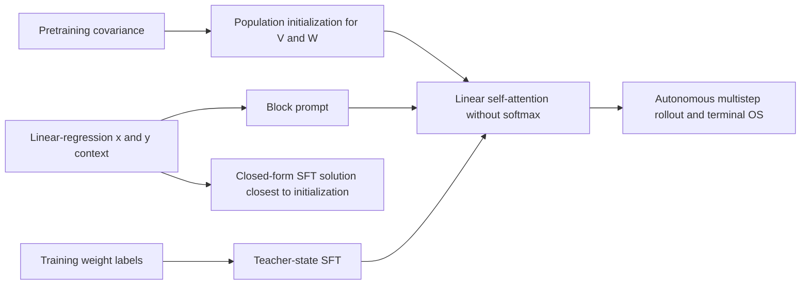
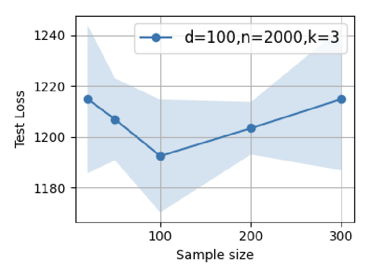

# Data Quality LSA: Pretraining covariance, SFT, and outcome supervision

<!-- source-sha256: 5b9d51e312a8f59dbc18b9c6e42df3a0e4838db6a069f667090fdaffb49f6a1f -->

[简体中文](README.md)

## Paper information

| Field | Value |
| --- | --- |
| Paper | [arXiv 2603.01293](https://arxiv.org/abs/2603.01293); [pinned v1 full text](https://arxiv.org/html/2603.01293v1) |
| Original title | Theoretical Perspectives on Data Quality and Synergistic Effects in Pre- and Post-Training Reasoning Models |
| Organization | First author Adel Javanmard: University of Southern California / Google Research |
| First published | 2026-03-01 (arXiv v1) |
| Original author code | No implementation repository found in v1 or on the official institution page; this is not an exhaustive claim about public code. |
| Local adapter / key | `data-quality-lsa`; `adapter: null`, `component_only` |
| Local code | `src/auto_research/foundation_models/google16_data_quality_lsa.py`; `scripts/run_google16_neural.py` |
| Full experiment | GPT2 training over multiple grids and long repeated runs is not reproduced due to cost (review DONE). |

## Original paper summary

### Background and main changes

In-context weight prediction for linear regression isolates how pretraining and post-training covariance affect learning. SFT uses teacher intermediate states; OS supervises only the final prediction. The paper defines OS as outcome-supervised regression, **not full RL with sampling, advantage estimation, and policy gradients**. See [§§3 and 4](https://arxiv.org/html/2603.01293v1#S3) for the linear attention and closed-form solution.



<!-- paper-figure:start -->
### Key figure from the paper

[](https://arxiv.org/html/2603.01293v1#S8.F4)

> **Figure 4(a): effect of SFT sample size on LSA.** This is one subfigure of the original six-panel figure, not a local run. The paper provides no model architecture image; none is fabricated here. Copyright belongs to the authors. [Source and hash](assets/provenance.json).
<!-- paper-figure:end -->

### Core equations

$$
f_{LSA}(Z)=Z+VZ(Z^TWZ)/n,\qquad
\Gamma_0=(1+1/n)\Sigma_0+\operatorname{tr}(\Sigma_0)I/n.
$$

Eqs. 3.2–3.8 retain four blocks for inputs, labels, predicted weights, and constants. OS appends actual generated tokens at every step and minimizes $\|\widehat w_k-w^*\|^2/(2B)$ at the end. SFT uses $w_i=[1-(1-\eta)^i]w^*$ and sums next-token terms for $i=0,\ldots,k$.

The nonzero value block in Eq. 4.1 is $\widetilde V_*=-\eta\Omega\Phi^\dagger-\Gamma_0^{-1}(I-\Phi\Phi^\dagger)$ with fixed $\widetilde W=I$. The implementation retains the initialization's data-null-space component instead of returning only the minimum-norm fit.

### Offline and online results in the paper

The paper tests the theoretical trends with synthetic covariance shifts and a roughly 9.5M-parameter GPT2 architecture. It reports no online A/B. Local checks cover equations, gradients, and closed-form normal equations, not general claims about data quality in large-model RL.

## Local reproduction

`population_initialization`, `context_embedding`, `lsa_forward`, `rollout`, `sft_loss`, `outcome_supervision_loss`, and `closest_sft_value` can be composed. Autonomous `rollout` has **no ground-truth weight argument**; it sees only public task context. Targets enter only explicitly named training losses.

```bash
PYTHONPATH=src python scripts/run_google16_neural.py \
  --device cpu --seed 42 --output runs/google16-neural-cpu.json
```

The runner uses d=4 and 6 generated prompts as a mathematical diagnostic, `fixture_only: true`, with no train/test capability claim. Independent tests check rearranged matrix products, first-step preconditioned covariance prediction, SFT/OS supervision boundaries, normal equations, and null space. The CUDA [receipt](../../gpu-validations/data-quality-lsa-a100-20261021.json) does not raise the L0/L1 evidence tier. No Evolve execution mapping.

### Cost and unreproduced scope

Section 8 uses long d=100 LSA training and a 12-layer, 8-head GPT2 with d=256, 100 SFT steps, 12K OS steps, ten repeats, and multiple dataset sizes and covariances. That grid is not a short component task on the available single GPU. No downloads or trial runs were started. The exact low-dimensional mathematical core is retained without presenting the scaled fixture as the full experiment.
