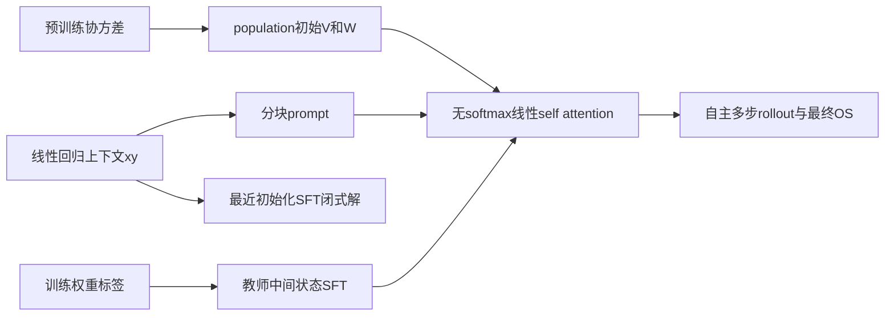
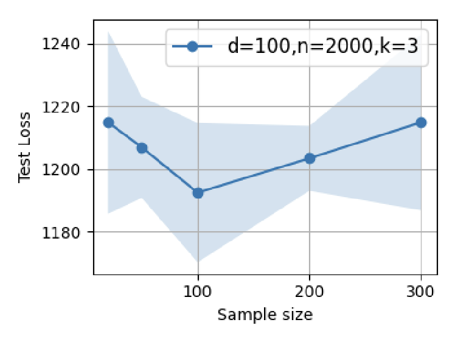

# Data Quality LSA：预训练协方差、SFT 与 outcome supervision

## 论文信息

| 字段 | 内容 |
| --- | --- |
| 论文链接 | [arXiv 2603.01293](https://arxiv.org/abs/2603.01293)；[固定 v1 全文](https://arxiv.org/html/2603.01293v1) |
| 原文标题 | Theoretical Perspectives on Data Quality and Synergistic Effects in Pre- and Post-Training Reasoning Models |
| 公司 / 机构 | 一作 Adel Javanmard：University of Southern California / Google Research |
| 首次公开日期 | 2026-03-01（arXiv v1） |
| 原作者代码 | 原文 v1 与官方机构页未找到/未发布实现仓库；不声称全网没有代码 |
| 本地 adapter / 稳定键 | `data-quality-lsa`；`adapter: null`，`component_only` |
| 本地复现代码目录 | `src/auto_research/foundation_models/google16_data_quality_lsa.py`；`scripts/run_google16_neural.py` |
| 完整实验 | GPT2 多网格、多重复长训练成本过高，不复现（审查 DONE） |

## 原始论文总结

### 背景与主要改动

以 in-context 线性回归的权重预测分析预训练与后训练数据协方差。SFT 使用教师中间状态，OS 仅监督最终预测；原文明确 OS 是 outcome-supervised regression，**不是包含采样、优势估计和 policy gradient 的完整 RL**。[§3、§4](https://arxiv.org/html/2603.01293v1#S3) 给出线性注意力结构及闭式解。



<!-- paper-figure:start -->
### 原论文关键图

[](https://arxiv.org/html/2603.01293v1#S8.F4)

> **Figure 4(a)，LSA的SFT样本规模结果**：这里只展示原图的(a)子图，非整张六面板图，非本地实验。原文未提供模型结构图，本地不伪造原图。版权归原作者；[来源与hash](assets/provenance.json)。
<!-- paper-figure:end -->

### 核心公式

$$
f_{LSA}(Z)=Z+VZ(Z^TWZ)/n,\qquad
\Gamma_0=(1+1/n)\Sigma_0+\operatorname{tr}(\Sigma_0)I/n.
$$

按 Eq.3.2–3.8 保留输入、标签、预测权重、常量四个分块。OS 每步追加实际生成 token，最终损失为 $\|\widehat w_k-w^*\|^2/(2B)$；SFT 采用 $w_i=[1-(1-\eta)^i]w^*$，对 $i=0,\ldots,k$ 的下一 token 求和。

Eq.4.1 的非零 value block 为 $\widetilde V_*=-\eta\Omega\Phi^\dagger-\Gamma_0^{-1}(I-\Phi\Phi^\dagger)$，固定 $\widetilde W=I$。实现保留初始化在数据零空间的分量，而不是仅返回最小范数拟合。

### 论文离线与线上效果

原文以合成协方差偏移和约9.5M参数 GPT2结构验证理论趋势；未报告线上 A/B。本地仅验证公式、梯度与闭式解正规方程，不宣称验证普遍的“大模型 RL 数据质量规律”。

## 本地复现

`population_initialization`、`context_embedding`、`lsa_forward`、`rollout`、`sft_loss`、`outcome_supervision_loss` 与 `closest_sft_value` 可组合执行。自主 `rollout` **没有真实权重参数**，只读取公开任务上下文；训练目标只进入明确命名的训练 loss。

```bash
PYTHONPATH=src python scripts/run_google16_neural.py \
  --device cpu --seed 42 --output runs/google16-neural-cpu.json
```

runner 使用 d=4、6个生成 prompt 的数学诊断，`fixture_only: true`，没有 benchmark train/test 能力结论。独立测试核验矩阵乘法重排、首步预条件协方差预测、SFT/OS监督边界、最优解正规方程和零空间。CUDA [回执](../../gpu-validations/data-quality-lsa-a100-20261021.json)不改变 L0/L1 资格；没有 Evolve 执行映射。

### 成本与未复现范围

原文 §8 包含 d=100 LSA长训练、12层8头d256的GPT2结构，SFT100步、OS12K步及十次重复，并遍历多种数据规模与协方差。这不是本轮可用单卡的短时组件任务；完整网格成本过高，不下载或试跑。保留精确低维数学核心，不以缩小fixture冒充完整实验。
