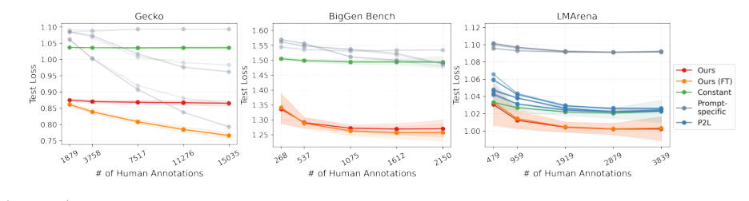

<!-- source-sha256: 10f8c79451154b1ea1ba119c7e34e291104f752ec5db55faa5f969a7c5a4bdfc -->
# Rich Insights from Cheap Signals: Efficient Evaluations via Tensor Factorization

[简体中文](README.md)

> L1 bounded mechanism component, not a capability benchmark or Evolve promotion.

## Paper information

| Field | Content |
| --- | --- |
| Paper | [Rich Insights from Cheap Signals: Efficient Evaluations via Tensor Factorization](https://arxiv.org/abs/2603.02029v1); [fixed v1](https://arxiv.org/html/2603.02029v1) |
| Institution | First author Felipe Maia Polo: University of Michigan; fixed-v1 byline checked |
| First publication | 2026-03-02 16:12:46 UTC, arXiv v1 |
| Original source code | Verified official Google DeepMind repository, Apache-2.0, commit `b4421d929d1078631ee890f8e4a776442c816d36`; new code on2026-11-16 does not change the March publication date. |
| Local adapter / key | `efficient-evals-tensor`; adapter is null, not a complete model |
| Local implementation | `src/auto_research/foundation_models/efficient_evals_tensor.py` |

## Paper summary

### Motivation and changes

A low-rank CP model factorizes capabilities across models, prompts and raters. Many cheap autorater labels learn shared representations; a small human calibration set then fits only the human rater vector and ordered cutoffs with those features frozen. This preserves prompt heterogeneity and rater differences rather than treating one automated judge as human truth. November16 is the new Google repository release, not first publication: arXivv1 was posted March2,2026 at16:12:46UTC.

<!-- paper-figure:start -->
### Original figure



Image from the [original paper](https://arxiv.org/pdf/2603.02029v1); copyright belongs to the original authors. Original asset/PDF crop, not local results. [Provenance and SHA256](assets/provenance.json).
<!-- paper-figure:end -->

### Core formulas

$$
\Psi_{ijk}=\sum_r\Theta_{ir}A_{jr}\Gamma_{kr},\quad P(Y=y)=\sigma(\beta_{y+1}-\Delta)-\sigma(\beta_y-\Delta),\quad CI=\widehat\Psi\pm z\sqrt{v^T\widehat\Sigma v/m}.
$$

Section3 uses an ordinal likelihood for single-sided scores and paired capability differences, including ties; endpoint categories useCDF boundaries0/1. Stage2 sends gradients only to the human vector/cutoffs while model/prompt factors stay frozen. Conditional Wald intervals assume high-precision fixed stage1 features and use Bonferroni for multiple comparisons; asymptotic covarianceSigma is divided bym. Optional all-parameter human fine-tuning can help prediction but invalidates these intervals, so both claims cannot be combined.

### Author results

Section4 uses30 splits per human-label budget on Gecko, BigGen Bench and LMArena and reports lower test cross-entropy than Constant, Prompt-specific and applicable P2L baselines. Gecko has about18K pairwise human labels, BGB2,780 ratings and LMArena nearly5K pairs, plus extensive autorater ratings/repeats. No production A/B is reported; local tensor NLL does not validate those benchmark results.

## Local implementation and boundaries

### Data protocol and code mapping

The officialgoogle-research/efficient_evals release is pinned atb4421d929d1078631ee890f8e4a776442c816d36, Apache2.0. The local slice runsCP, ordinal probabilities, frozen-feature human NLL and conditional intervals from an externally suppliedSigma. It omits full Adam/BFGS fitting,30 splits and rating recollection. Upstream estimates about one hour for the full CPU notebook; the complete multi-judge campaign is not reproduced. CUDA validates operators only.

```bash
PYTHONPATH=src python -c 'from auto_research.foundation_models.efficient_evals_tensor import diagnostic; print(diagnostic(42, device="cpu"))'
```

### Results, controls and limits

L1 bounded mechanism component, not a capability benchmark or Evolve promotion. Seeds42/43/44 check explicit fixtures/small-tensor arithmetic and gradients, not three independent model-capability trials. CPU and actual GPU evidence remain separate. Author scores must not populate local dashboards.

### High-cost full experiments

New official Nov16 repository refers to March paper. Public saved-label analysis is possible but upstream full CPU notebook estimates1hour; original three-dataset30-split campaign adds hundreds of thousands of judge ratings. No recollection or full campaign run **Not reproduced due to high cost; review DONE.** No automatic training/retry queue and no blocking of declared review closure.

### Same-topic comparison

ProEval builds a GP prior from historical per-item scores and actively chooses the next evaluation. This paper learns model/prompt features from multiple cheap raters and aligns them to humans. Active posterior sampling is not rater-bias calibration, and conditional intervals do not automatically cover shared-feature estimation error.
