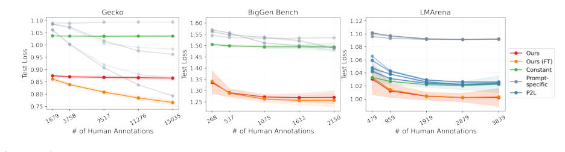

# Efficient Evals：借廉价评分学能力张量，再用少量人类标签校准

[English](README-en.md)

> L1低成本机制组件；不是能力benchmark，未接入Evolve晋级。

## 论文信息

| 字段 | 内容 |
| --- | --- |
| 论文链接 | [Rich Insights from Cheap Signals: Efficient Evaluations via Tensor Factorization](https://arxiv.org/abs/2603.02029v1)；[固定v1全文](https://arxiv.org/html/2603.02029v1) |
| 公司 / 作者机构 | 一作 Felipe Maia Polo：University of Michigan；按固定v1作者栏核对 |
| 首次公开日期 | 2026-03-02 16:12:46 UTC（arXiv v1） |
| 原作者开源代码 | 已验证Google DeepMind官方仓库，Apache-2.0，固定commit `b4421d929d1078631ee890f8e4a776442c816d36`；2026-11-16新开源，不改变3月首发日期。 |
| 本地adapter / 稳定键 | `efficient-evals-tensor`；adapter为null，不冒充完整模型 |
| 本地复现代码目录 | `src/auto_research/foundation_models/efficient_evals_tensor.py` |

## 原始论文总结

### 背景与主要改动

本文将模型、prompt和rater三者的能力张量作低rank CP分解，先用大量廉价autorater评分学共享表示，再冻结表示、只拟合人类rater向量及有序cutoff。它保留prompt异质性和rater偏好差异，不把某个自动judge分数直接当人类真值。2026-11-16是Google官方代码新仓库，不是论文首发；v1首发为2026-03-02 16:12:46 UTC。

<!-- paper-figure:start -->
### 原论文关键图



图片来自[原论文](https://arxiv.org/pdf/2603.02029v1)，版权归原作者所有；为原图或PDF裁剪，不是本地结果。[出处与SHA256](assets/provenance.json)。
<!-- paper-figure:end -->

### 核心公式

$$
\Psi_{ijk}=\sum_r\Theta_{ir}A_{jr}\Gamma_{kr},\quad P(Y=y)=\sigma(\beta_{y+1}-\Delta)-\sigma(\beta_y-\Delta),\quad CI=\widehat\Psi\pm z\sqrt{v^T\widehat\Sigma v/m}.
$$

§3的ordinal likelihood支持单侧评分和成对能力差及平局；首尾类别用0/1 CDF边界。第二阶段只给human向量／cutoff梯度，模型和prompt因子冻结。条件Wald区间把第一阶段表示当高精度固定量，并用Bonferroni处理多比较；Sigma是渐近协方差，需除m。可选全参数human fine-tune可能改善点预测，却使这些条件区间失效，不能两种好处同时声称。

### 论文离线与线上效果

§4在Gecko、BigGen Bench、LMArena上按不同人工预算做30次切分，作者报告测试交叉熵优于Constant、Prompt-specific及适用的P2L。Gecko约18K成对标签，BGB2780个人类评分，LMArena近5K对；autorater另有大量评分与重复。未报告生产线上A/B；本地小张量NLL不验证这些数据集结果。

## 本地复现与边界

### 数据协议与代码映射

官方google-research/efficient_evals固定b4421d929d1078631ee890f8e4a776442c816d36、Apache2.0。本地只执行CP、ordinal概率、冻结human NLL和外部Sigma的条件区间算术；不含完整Adam/BFGS拟合、30切分或真实评分重收集。上游CPU notebook估约1小时，完整多judge矩阵高成本不复现，CUDA只验算子。

```bash
PYTHONPATH=src python -c 'from auto_research.foundation_models.efficient_evals_tensor import diagnostic; print(diagnostic(42, device="cpu"))'
```

### 结果、负控与边界

L1低成本机制组件；不是能力benchmark，未接入Evolve晋级。 种子42/43/44只验证显式夹具/小张量的数值和梯度，不是三次独立模型能力试验。CPU与实际GPU证据分别保存，不能用作者指标填充本地看板。

### 高成本完整实验

原文三基准、30次切分及大量judge评分的完整矩阵不重采集；新仓库公开已存评分使离线分析可行，但其完整CPU notebook估计约1小时，本轮不运行。原始数据可用不等于每个组件都必须跑全campaign。 **成本过高，不复现（审查DONE）**；不阻塞已声明的审查闭环，不进入自动训练或补跑队列。

### 同主题对照

ProEval用其他模型历史逐题分数建立GP先验并主动决定下一题；本篇用多rater廉价数据学prompt/model表示再做人类对齐。前者的采样后验不等于后者的rater偏差校准，条件置信界也不能无条件覆盖共享表示估计误差。
