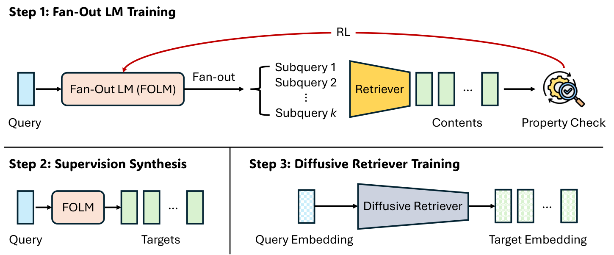

# Efficient, Property-Aligned Fan-Out Retrieval via RL-Compiled Diffusion

<!-- source-sha256: 35e9b283e597101711aa143a290fd6b91f817d7adb38db933449f0286bbb7484 -->

[简体中文](README.md)

> L1 alignment/diversity set objective; no training of the 53.9M-parameter diffusion retriever.

## Paper information

| Field | Details |
|---|---|
| Paper | [Efficient, Property-Aligned Fan-Out Retrieval via RL-Compiled Diffusion](https://arxiv.org/abs/2603.06397) |
| Institution | University of Illinois Urbana-Champaign / Google Research (first author). |
| First public release | 2026-03-06 (arXiv v1) |
| Author code | No public author repository found as of 2026-09-16. |
| Local adapter or method key | `r4t` |
| Local reproduction code | [`src/auto_research/foundation_latest_20260916.py`](https://github.com/daiwk/auto-research/blob/main/src/auto_research/foundation_latest_20260916.py) |

## Paper method and evidence

Define alignment with a composite set-level reward, then compile that target into a single diffusion fan-out retrieval pass.

<!-- paper-figure:start -->
### Original paper figure

The original figure illustrates compiling the objective into retrieval. From the [original paper](https://arxiv.org/abs/2603.06397); copyright remains with the authors.
<!-- paper-figure:end -->

### Core equation

The reference preserves the defining set decision and reports auditable intermediate states.

### Reported results

Paper capability, speed and cost do not transfer to these fixtures or production.

## Local reproduction

[Three-seed metrics](metrics/mechanism-seeds42-44.json) use the same public fixtures, budget, and seeds. The deterministic reference exposes decisions and state transitions; tests verify invariants and boundaries. These are not capability or production results. Results are diagnostic_only=true and not eligible as formal dashboard improvements.
