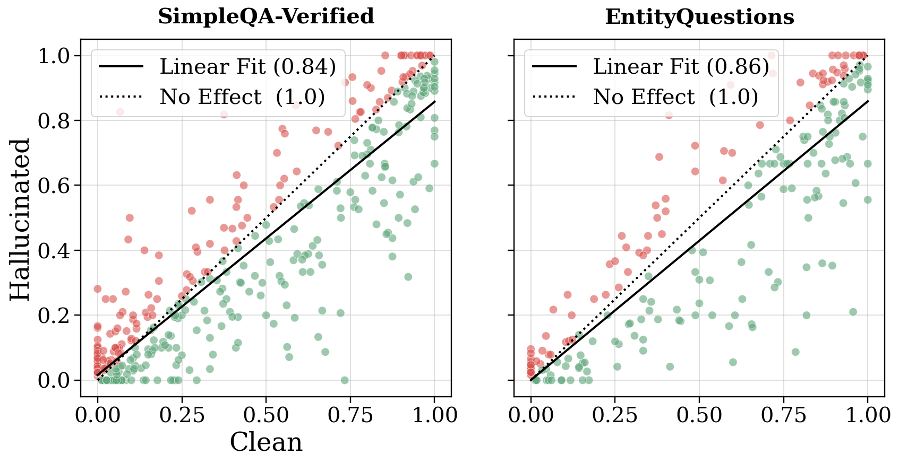

# Thinking to Recall: offline conditional accuracy of factual traces

<!-- source-sha256: 3d42a1aece23df722b71c4b9a6a64846a01ec1c10cbc62d36b0130ce31fae90f -->

[简体中文](README.md)

> **L1 mechanism/evaluation component, diagnostic only—not a complete capability reproduction.** CPU component tests passed. There is no CUDA execution path and no GPU claim. Not integrated with Evolve; fixture results cannot justify promotion.

## Paper information

| Field | Value |
| --- | --- |
| Paper | [arXiv:2603.09906v1](https://arxiv.org/abs/2603.09906v1); [fixed v1 source](https://arxiv.org/html/2603.09906v1) |
| First author / institution | **Zorik Gekhman**, first affiliation **Google Research**; Google participation is verified from the author block, not model names |
| Original publication date | **2026-03-10 16:59:20 UTC**, arXiv v1 record; historical official-source backfill, not today's first publication |
| Author code | No verified paper-specific author implementation repository was found in fixed v1 as of 2026-11-13; model/dependency repositories do not count as this paper's code. |
| Local adapter / key | `thinking-to-recall`; `adapter: null`, independent component |
| Local code | `src/auto_research/foundation_models/thinking_to_recall.py` |
| Validation | CPU component tests passed. There is no CUDA execution path and no GPU claim. |

## Original paper summary

### Background and main change

Reasoning may help single-hop recall through extra computation and self-generated factual priming, not just task decomposition. Controlled reasoning ON/OFF comparisons distinguish these effects and associate hallucinated intermediate facts with answer errors.

<!-- paper-figure:start -->
### Key original-paper figure

[](https://arxiv.org/html/2603.09906v1)

Figure 7 from fixed v1 HTML: per-question clean/hallucinated trace accuracies from the authors' offline analysis. Source and image hashes are in [assets/provenance.json](assets/provenance.json). Figure from the [original paper](https://arxiv.org/html/2603.09906v1); copyright belongs to the original authors. Full-paper findings are not local component results.

<!-- paper-figure:end -->

### Defining mechanism and formula

Section 5.4 simulates conditional expectations after 100 completed samples using external factual annotations; it is not a deployed oracle-free selector. Per-question answer accuracy is computed over all traces, factual traces and factual/all-correct traces. Questions with any empty subset are excluded from every arm before macro averaging. Correctness labels belong exclusively to the offline evaluator, never an actor.

```text
Acc(M) = mean_{q in common_nonempty} [ sum_i correct(q,i)*M(q,i) / sum_i M(q,i) ]
```

### Original results and limitations

The study uses Gemini 2.5 Flash/Pro, Qwen3-32B, roughly 2,000 factual questions, repeated sampling and factual judging. Higher conditioned accuracy assumes factual correctness is known; it does not establish a free deployment-time filter. Local code does not implement search-based fact verification.

## Local reproduction

### Data protocol and code mapping

The interface returns aggregate rates and retention counts only—not selected traces, actions or training examples—and defaults to exactly 100 samples per question. `pass_at_k` uses the combinatorial unbiased estimator. Controls cover the common question mask, macro rather than micro averaging, empty facts and missing subsets. Synthetic truth arrays are explicit evaluator fixtures, not agent scores.

```bash
PYTHONPATH=src python -c 'from auto_research.foundation_models.thinking_to_recall import diagnostic; print(diagnostic(42, device="cpu"))'
PYTHONPATH=src python -m pytest -q tests/test_colm_foundation_components.py
```

### Results, negative controls and boundaries

The component test set has 44 passes and six locally skipped CUDA cases; skipping is not passing. Standard three-seed outputs use `metrics/component-cpu-seeds42-44.json`, not training or public-benchmark results. CPU component tests passed. There is no CUDA execution path and no GPU claim. All metrics are L1 diagnostics. No gold is exposed to an actor, no test-based selection is authorized, and no model improvement is claimed.

### Full-experiment disposition

Gemini 2.5 Flash/Pro and Qwen3-32B, 100 samples per question, ~2000 questions plus factual extraction/search judging; full study not reproduced.

**Full experiment not reproduced due to cost (review DONE).** No large checkpoint/corpus downloads, scaled-down substitute presented as replication, or automatic full-training retries.
