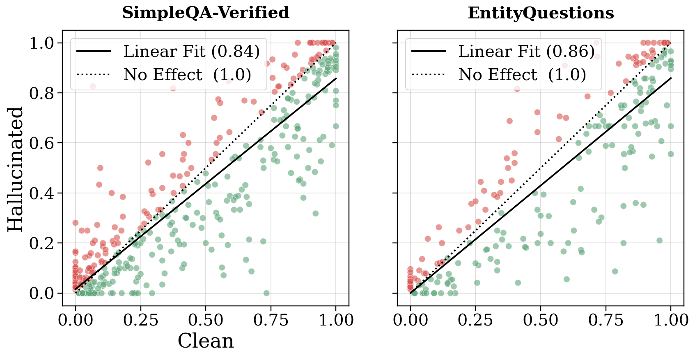

# Thinking to Recall：事实干净轨迹的离线条件准确率

[English](README-en.md)

> **L1 机制/评测组件，diagnostic only，不是完整模型能力复现。** CPU组件专测已通过；没有CUDA路径，不需要GPU验收。 未接入Evolve，不可据本地fixture成绩晋级。

## 论文信息

| 字段 | 内容 |
| --- | --- |
| 论文链接 | [arXiv:2603.09906v1](https://arxiv.org/abs/2603.09906v1)；[固定v1原文](https://arxiv.org/html/2603.09906v1) |
| 公司 / 作者机构 | 一作 **Zorik Gekhman**，第一单位 **Google Research**；论文有Google相关作者，按原文作者栏确认，不凭模型名归属 |
| 首次公开日期 | **2026-03-10 16:59:20 UTC**，依据arXiv v1记录；本次是历史官方源补漏，不是今天新首发 |
| 原作者开源代码 | 截至2026-11-13，固定v1未找到已核实的本篇作者代码仓库；基础模型与依赖仓库不算本篇开源。 |
| 本地 adapter / key | `thinking-to-recall`；`adapter: null`，独立组件 |
| 本地复现代码 | `src/auto_research/foundation_models/thinking_to_recall.py` |
| 验收范围 | CPU组件专测已通过；没有CUDA路径，不需要GPU验收。 |

## 原始论文总结

### 背景与主要改动

推理不仅可能分解复杂任务，也可能通过额外计算和相关事实的自检索帮助单跳知识召回。论文控制同一 hybrid 模型的 reasoning ON/OFF，区分计算缓冲与 factual priming，同时发现中间事实幻觉会连带增加最终答案错误。

<!-- paper-figure:start -->
### 原论文关键图

[](https://arxiv.org/html/2603.09906v1)

Figure7，固定v1 HTML；干净与含幻觉轨迹的逐题正确率散点图，是作者离线分析。 来源与图像SHA见[assets/provenance.json](assets/provenance.json)。图片来自[原论文](https://arxiv.org/html/2603.09906v1)，版权归原作者所有；图中的完整实验结论不等于本地组件结果。

<!-- paper-figure:end -->

### 核心机制与公式

§5.4 的“优先干净轨迹”是已完成100条采样后，用外部事实标注模拟条件期望，不是已经部署的无oracle选择器。对每道题分别计算全部轨迹、含事实轨迹、含事实且全部事实正确轨迹的答案正确率；任一子集为空的题从三臂共同剔除，再宏平均。独立 evaluator 才能读正确性标签，actor 不应读取gold答案或筛选标签。

```text
Acc(M) = mean_{q in common_nonempty} [ sum_i correct(q,i)*M(q,i) / sum_i M(q,i) ]
```

### 原文结果与限制

作者用Gemini2.5 Flash/Pro、Qwen3-32B以及约2000道公开事实题、100次采样和事实判定研究召回边界。条件准确率提升依赖知道哪些事实正确，不能据此宣称部署时可免费过滤幻觉。本地也不实现搜索判真或自动标注。

## 本地复现

### 数据协议与代码映射

`conditional_expected_accuracy` 只返回汇总统计、保留/剔除题数，绝不返回被oracle选中的轨迹、行动或训练样本；默认严格要求每题100条。`pass_at_k` 使用无偏组合数估计。负控同时覆盖共同题目mask、逐题宏平均而非微平均、空事实集合和缺失子集。诊断中的真值数组是显式教学输入，不是Agent任务成绩。

```bash
PYTHONPATH=src python -c 'from auto_research.foundation_models.thinking_to_recall import diagnostic; print(diagnostic(42, device="cpu"))'
PYTHONPATH=src python -m pytest -q tests/test_colm_foundation_components.py
```

### 结果、负控与边界

本批组件专测为44项通过、6项CUDA本机跳过；跳过不等于通过。三种子标准产物统一使用 `metrics/component-cpu-seeds42-44.json`；没有训练或公开benchmark成绩。CPU组件专测已通过；没有CUDA路径，不需要GPU验收。 所有metric仅属L1诊断，无gold给actor、无test选择、无模型效果提升声明。

### 完整实验处置

固定v1包含Gemini2.5 Flash/Pro、Qwen3-32B，每题100条采样、约2000道题，以及事实抽取、搜索验证和额外控制实验。完整模型调用/长生成/判定矩阵不复现；不下载Qwen权重。

**完整实验成本过高，不复现（审查 DONE）**。不下载大权重/语料、不以缩水模型冒充原论文、不自动重试完整训练。
