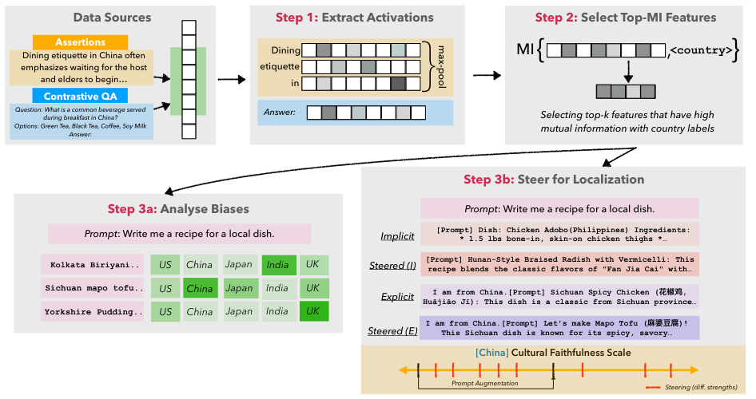
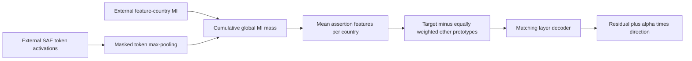

# CuE: SAE cultural features and controlled residual interventions

<!-- source-sha256: 3b76e934c2ee23cd0dcade5b6080b98718119b4a571b87b54a40a12f77f19c2f -->

[简体中文](README.md)

> Local delivery is an L1 numerical/protocol component, not a full paper capability reproduction. Full experiments are cost-deferred and review-DONE, with no pretrained model/API training, automatic retry or evolve promotion.

Independent component artifacts: [CPU, three seeds](metrics/component-cpu-seeds42-44.json), [CUDA, three seeds](metrics/component-cuda-seeds42-44.json). They validate only the stated small operators; actual NVIDIA execution is supported by a separate sanitized batch receipt.

## Paper information

| Field | Value |
|---|---|
| Paper | [Steering LLMs for Culturally Localized Generation](https://arxiv.org/abs/2603.23301v1); [fixed v1](https://arxiv.org/html/2603.23301v1) |
| Company / institution | First author Simran Khanuja: Carnegie Mellon University; original byline also verifies Google DeepMind. Group by the first author's institution, not model brands. |
| First publication | 2026-03-24 15:04:01 UTC, arXiv v1; historical omission, not a new paper this batch |
| Author code | No independently verified paper-specific repository was found in fixed v1 or the bounded author-source check. Gemma Scope/Llama Scope are SAE dependencies, not a CuE release. |
| Adapter | `cultural-cue` is a catalog key; `adapter=null`, not a full reproduce/evolve adapter |
| Local code | `src/auto_research/foundation_models/cultural_cue.py`; `tests/test_nov13_colm_evaluation.py` |

<!-- paper-figure:start -->
### Key figure from the original paper



Source: [fixed original](https://arxiv.org/pdf/2603.23301v1#page=2). Image from the [original paper](https://arxiv.org/abs/2603.23301v1); copyright belongs to its original authors. The complete system or results in this figure are not results of the local component. Source hashes and visual review are recorded in `assets/provenance.json`.
<!-- paper-figure:end -->

## Original paper summary

### Background and main change

A localization failure can reflect absent cultural knowledge or failure to elicit knowledge already represented by the model. CuE selects culturally informative SAE features, averages them into country prototypes, and steers residual activations toward a target relative to other countries. Country is the paper's proxy for culture, not a complete representation of individuals or communities.

This is a white-box intervention, not merely an extra country name in a prompt. It requires real SAE activations, layer/feature alignment and decoder weights. The local component executes deterministic tensor operations on supplied evidence; it does not generate cultural judgments.



### Core formulas

Section2.2 uses $a_j(x)=\max_tz_j(t)$ over valid tokens. Section2.3 selects the smallest descending-MI prefix whose cumulative information reaches $\rho\sum_j I_j$. This is a fraction of information mass, not a fixed fraction of feature count; shorthand in AppendixC does not override the defining method.

For country prototypes $p_c$, the intervention is
$\delta_c=p_c-(|\mathcal C|-1)^{-1}\sum_{c'\ne c}p_{c'}$,
$v_c=\delta_cW_{dec}$, and $h'=h+\alpha v_c$.
Other countries are equally weighted after their within-country means, regardless of sample counts. Decoder rows must match selected features.

The local core accepts externally estimated finite nonnegative MI. It does not invent a binning estimator for the source's incompletely specified continuous-MI step. Global cross-layer selection and layer-specific decoder mapping remain explicit integration responsibilities.

### Original offline and online results

The paper evaluates Gemma-2/Llama-3.1 combinations with two judges for cultural faithfulness, rare concepts and pairwise preferences. Steering can complement explicit country prompting, with results depending on country, layer and SAE width. No production online A/B is reported; a general statement about globally deployed LLMs is not deployment evidence for this method.

## Local component

### Data protocol and code mapping

`max_pool_features`, `select_cumulative_mi`, `country_prototypes`, `steering_direction` and `apply_steering` implement the stated operations. CPU and CUDA tensors are supported; an actual NVIDIA validation must be recorded by the integrated batch. Cultural assertions, MI estimation, SAE extraction, generation and judges are external.

```bash
PYTHONPATH=src python -c 'from auto_research.foundation_models.cultural_cue import diagnostic; print(diagnostic(42, "cpu"))'
PYTHONPATH=src python -m pytest -q tests/test_nov13_colm_evaluation.py
```

### Local evidence and negative controls

An intentionally imbalanced country example distinguishes country weighting from example weighting. Tests also check cumulative MI selection, padding exclusion, decoder multiplication, residual addition and gradients. A random-tensor direction norm is not cultural faithfulness, safety or a full SAE-based localization capability. There is no executable evolve integration.

### Full-experiment cost decision

Six2B/8B/9B model/SAE combinations, widths up to131K/128K, countries, four prompt conditions, four steering strengths and judge evaluations form the original matrix. AppendixC reports one A10080GB and states that all layers of larger SAEs exceed its memory; every fourth layer is used instead. The full matrix is cost-deferred, review-DONE, with no downloads or judge API calls. Prototype and strength selection must use training/validation, not test output.
