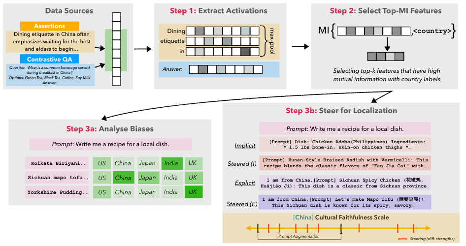
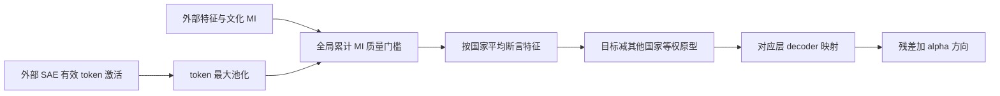

# CuE：从 SAE 文化特征到可控残差干预

> 本地交付是 L1 数值/协议组件，不是完整论文能力复现。完整实验成本过高，不复现（审查 DONE）；未执行模型/API训练，不启用自动重试或 evolve 晋级。

本轮独立机制记录：[CPU 三种子](metrics/component-cpu-seeds42-44.json)、[CUDA 三种子](metrics/component-cuda-seeds42-44.json)。这些产物只验收所述小算子，不是论文能力分数；真实 GPU 结果以统一脱敏回执为准。

## 论文信息

| 字段 | 内容 |
|---|---|
| 论文链接 | [Steering LLMs for Culturally Localized Generation](https://arxiv.org/abs/2603.23301v1)；[固定 v1 原文](https://arxiv.org/html/2603.23301v1) |
| 公司 / 机构 | 一作 Simran Khanuja：Carnegie Mellon University；原文另确认 Google DeepMind 署名，按一作所属机构聚合，不以模型品牌判断机构 |
| 首次公开日期 | 2026-03-24 15:04:01 UTC（arXiv v1，不是本轮新首发） |
| 原作者代码 | 未找到可核实的本篇公开代码；固定v1及有限作者入口未找到本篇独立公开实现；Gemma Scope/Llama Scope是SAE依赖，不等于CuE源码。 |
| Adapter | `cultural-cue` 为 catalog key，`adapter=null`，不是完整 reproduce/evolve adapter |
| 本地复现代码 | `src/auto_research/foundation_models/cultural_cue.py`；专测 `tests/test_nov13_colm_evaluation.py` |

<!-- paper-figure:start -->
### 原论文关键图



来源：[固定 v1 原论文](https://arxiv.org/html/2603.23301v1)。图片来自[原论文](https://arxiv.org/abs/2603.23301v1)，版权归原作者所有；图中完整系统或实验结果不等于本地组件结果。原始来源、SHA256与视觉核验见 `assets/provenance.json`。
<!-- paper-figure:end -->

## 原始论文总结

### 背景与主要改动

文化定位失败可能是知识缺失，也可能是已有知识不易被提示词唤起。CuE 从预训练 SAE 的稀疏特征中寻找与国家标签相关的维度，建立可解释文化原型，再沿目标文化相对其他文化的差向量干预残差流。国家只是论文采用的文化代理，不能把国家均值当成每个个体的价值观。

这种方法不更新语言模型参数，也不是给模型简单补上一句国家名称。它需要真实 SAE、对齐的层/特征编号和 decoder；本地只实现这些外部结果上的确定性张量部分，不生成文化判断或假装理解刻板印象。



### 核心公式

§2.2 按 token 最大池化 $a_j(x)=\max_tz_j(t)$；padding 不参与。§2.3 令互信息从大到小为 $I_{(j)}$，选择满足累计和至少达到 $\rho\sum_j I_j$ 的最短前缀。**这是互信息质量比例，不是固定选取百分之十的维度**；附录 C 的简写不能覆盖主方法定义。

每个国家先在自己的断言内平均得 $p_c$，再计算：

$$
\delta_c=p_c-\frac1{|\mathcal C|-1}\sum_{c'\ne c}p_{c'},\qquad
v_c=\delta_c W_{dec},\qquad h'=h+\alpha v_c.
$$

其他国家在基线中等权，不按各国样本量重复加权。decoder 行必须是所选特征对应的真实 decoder 向量。本地接受外部估计的有限非负 MI，**不使用任意分箱启发式代替原文未细述的连续 MI 估计器**。全局跨层的索引选择与每层残差坐标映射仍由集成方明确完成；本核不把不同层的 decoder 随意相加。

### 论文离线与线上效果

原文在 Gemma-2/Llama-3.1 组合上，以双 judge 对文化忠实度、稀有概念及配对偏好评价；CuE 干预可与显式国家提示互补，收益依文化和层/宽度配置而变。没有生产线上 A/B，也不把“全局部署的 LLM”背景句当作本文部署证据。本地不复算这些 judge 分数。

## 本地复现

### 数据协议与代码映射

`max_pool_features`、`select_cumulative_mi`、`country_prototypes`、`steering_direction`、`apply_steering` 依次实现上述确定性算子。张量支持 CPU/CUDA；真实 NVIDIA 验收由统一批次记录，不能由单元测试替代。文化断言、MI、SAE、生成模型和 judge 全部是外部边界。

```bash
PYTHONPATH=src python -c 'from auto_research.foundation_models.cultural_cue import diagnostic; print(diagnostic(42, "cpu"))'
PYTHONPATH=src python -m pytest -q tests/test_nov13_colm_evaluation.py
```

### 本地结果与负控

诊断刻意使用不均衡国家样本数，区分“国家等权”与“样本等权”；另检验累计 MI 而非维度百分比、padding 屏蔽、decoder 乘法、残差相加及梯度。小随机张量上的方向范数不是文化忠实度，更不等于真实文化安全性或完整 SAE 定位能力。无自动 evolve 集成。

### 高成本完整实验

原文六组2B/8B/9B模型、16K至131K/128K SAE、多文化、四种提示条件与 $\alpha\in\{0.25,0.5,1,2\}$ 扫描，使用单 A10080GB。附录 C 明确较大 SAE 全层加载超过该卡显存，只加载每四层。可容纳部分配置不等于完整矩阵廉价；**成本过高，不复现（审查 DONE）**，不下载模型或调用 judge API。原型和 $\alpha$ 应由训练/验证确定，测试文化输出不得反向调参。
