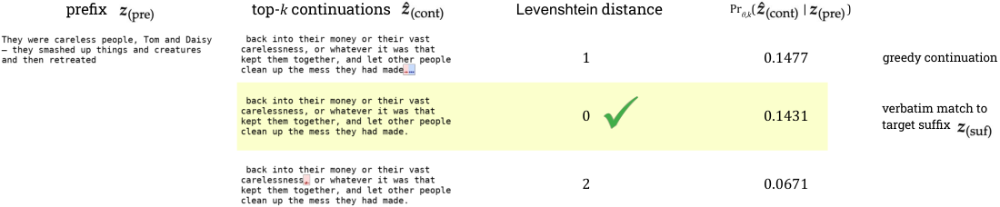
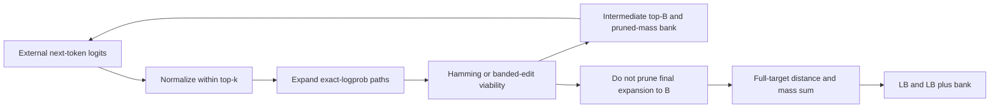

# Decoding-constrained beam search: deterministic near-verbatim risk bounds

<!-- source-sha256: ec970f56615141cfc860ec86c9d443933ad7c9040bf6672f416bdaee23ebf69d -->

[简体中文](README.md)

> Local delivery is an L1 numerical/protocol component, not a full paper capability reproduction. Full experiments are cost-deferred and review-DONE, with no pretrained model/API training, automatic retry or evolve promotion.

Independent component artifacts: [CPU, three seeds](metrics/component-cpu-seeds42-44.json). They validate only the stated small operators; actual NVIDIA execution is supported by a separate sanitized batch receipt.

## Paper information

| Field | Value |
|---|---|
| Paper | [Estimating near-verbatim extraction risk in language models with decoding-constrained beam search](https://arxiv.org/abs/2603.24917v1); [fixed v1](https://arxiv.org/html/2603.24917v1) |
| Company / institution | First author A. Feder Cooper: AVERI / Stanford University; original byline also verifies Google DeepMind. Group by the first author's institution, not model brands. |
| First publication | 2026-03-26 01:15:16 UTC, arXiv v1; historical omission, not a new paper this batch |
| Author code | [Author-linked repository](https://github.com/pasta41/probabilistic-extraction-toolkit). The original paper links this author repository, but its GitHub metadata API and main/master README returned Not Found on2026-11-13. Availability is unverified; the exception is preserved. |
| Adapter | `decoding-constrained-beam` is a catalog key; `adapter=null`, not a full reproduce/evolve adapter |
| Local code | `src/auto_research/foundation_models/decoding_constrained_beam.py`; `tests/test_nov13_colm_evaluation.py` |

<!-- paper-figure:start -->
### Key figure from the original paper



Source: [fixed original](https://arxiv.org/html/2603.24917v1/near-verbatim-fig-1.png). Image from the [original paper](https://arxiv.org/abs/2603.24917v1); copyright belongs to its original authors. The complete system or results in this figure are not results of the local component. Source hashes and visual review are recorded in `assets/provenance.json`.
<!-- paper-figure:end -->

## Original paper summary

### Background and main change

Greedy verbatim matching can miss a substantial total mass of near-verbatim variants. Ordinary beam scores are also not probabilities under top-k decoding. The method renormalizes within the decoder's support, keeps exact path probabilities, and sums enumerated near-target continuations to obtain a deterministic lower bound.

The local implementation is an audit-side probability and distance component. A model callback receives only the prefix and generated tokens; it is not given the target suffix used for distance pruning. No training corpus or pretrained model is downloaded.



### Core formulas

With top-k support $S_k(u)$, the decoder probability is
$q(v\mid u)=\exp\ell_v(u)/\sum_{w\in S_k(u)}\exp\ell_w(u)$.
Path log probability is the sum of these conditionals. Neither removing low-rank tokens nor viability pruning permits renormalizing over the surviving beam.

Section4.2 retains up to $Bk$ final expansions rather than $B$, then sums near-target path probabilities. Section4.3 tracks a monotone mismatch count for Hamming or a streamed Levenshtein band of width at most $2\epsilon+1$. A row minimum above $\epsilon$ proves nonviability, but the final acceptance check is $D[T,T]\le\epsilon$, not merely row-min viability.

The mass of viable prefixes removed by cross-beam pruning is banked, giving $UB=LB+bank$, capped at1 locally. Banked mass is only potentially recoverable mass, not evidence that those completions were found.

### Original offline and online results

For10,000 Wikipedia training sequences and OLMo2-32B, the source reports a near-verbatim extraction-rate lower bound of2.57% at edit budget5, compared with1.62% for greedy near-verbatim and0.61% for greedy verbatim. It also tests post-cutoff Wikipedia negative controls. These model/corpus results are not estimated by the local two-token example. No production online A/B is reported.

## Local component

### Data protocol and code mapping

`search` performs top-k normalization, exact path scoring, Hamming/banded-edit pruning, deterministic ties and final mass calculation. EOS is removed before the final depth but retained in final expansions, matching the fixed-length algorithm. Optional minimum-probability early stopping, batch KV caching and GPU model execution are not implemented.

```bash
PYTHONPATH=src python -c 'from auto_research.foundation_models.decoding_constrained_beam import diagnostic; print(diagnostic(42))'
PYTHONPATH=src python -m pytest -q tests/test_nov13_colm_evaluation.py
```

### Local evidence and negative controls

Tests enumerate a complete two-token, three-step distribution for both distance metrics, several edit budgets and beam widths. They verify $LB\le p\le UB$ and exact recovery with a wide beam, plus normalization, final expansion cardinality, EOS handling and target isolation. This supports the numerical search core, not real-model memorization risk, throughput or a formal deployment audit.

### Full-experiment cost decision

The original matrix includes OLMo2 up to32B, Llama2 up to70B, Pythia, thousands of sequences and independent controls, commonly with $B=20,k=40,T=50$. AppendixC.3/F.7 distinguishes token work, sequential forward passes, KV-cache memory and wall time. Full reproduction is cost-deferred and review-DONE. The linked author repository returned404 in this review; its URL is preserved as an access exception, not advertised as verified available code.
