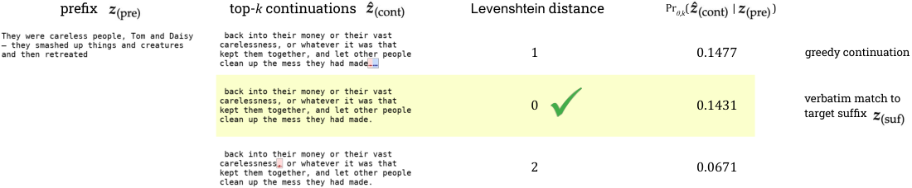
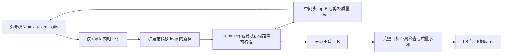

# 解码约束 Beam：近逐字提取风险的确定性概率界

> 本地交付是 L1 数值/协议组件，不是完整论文能力复现。完整实验成本过高，不复现（审查 DONE）；未执行模型/API训练，不启用自动重试或 evolve 晋级。

本轮独立机制记录：[CPU 三种子](metrics/component-cpu-seeds42-44.json)。这些产物只验收所述小算子，不是论文能力分数；真实 GPU 结果以统一脱敏回执为准。

## 论文信息

| 字段 | 内容 |
|---|---|
| 论文链接 | [Estimating near-verbatim extraction risk in language models with decoding-constrained beam search](https://arxiv.org/abs/2603.24917v1)；[固定 v1 原文](https://arxiv.org/html/2603.24917v1) |
| 公司 / 机构 | 一作 A. Feder Cooper：AVERI / Stanford University；原文另确认 Google DeepMind 署名，按一作所属机构聚合，不以模型品牌判断机构 |
| 首次公开日期 | 2026-03-26 01:15:16 UTC（arXiv v1，不是本轮新首发） |
| 原作者代码 | [作者链接](https://github.com/pasta41/probabilistic-extraction-toolkit)；原文提供作者仓库URL；本轮GitHub仓库API及main/master README均返回Not Found，无法确认当前公开代码可用，保留访问例外，不写成已验证开源实现。 |
| Adapter | `decoding-constrained-beam` 为 catalog key，`adapter=null`，不是完整 reproduce/evolve adapter |
| 本地复现代码 | `src/auto_research/foundation_models/decoding_constrained_beam.py`；专测 `tests/test_nov13_colm_evaluation.py` |

<!-- paper-figure:start -->
### 原论文关键图



来源：[固定 v1 原论文](https://arxiv.org/html/2603.24917v1)。图片来自[原论文](https://arxiv.org/abs/2603.24917v1)，版权归原作者所有；图中完整系统或实验结果不等于本地组件结果。原始来源、SHA256与视觉核验见 `assets/provenance.json`。
<!-- paper-figure:end -->

## 原始论文总结

### 背景与主要改动

只检查 greedy 是否生成训练原文，会漏掉许多单条概率不大、合计概率却很高的近逐字变体。普通 beam 的模型 softmax 分数也不等于实际 top-k 解码分布下的概率。本文把解码约束纳入每一步归一化，枚举部分高概率路径，对与目标后缀接近的路径求和得到确定性下界。

本地用途是可审计的概率与距离算子：模型 callback 只接收前缀和已生成 token；目标后缀留在评价侧用于距离剪枝，不交给 callback。没有下载训练语料或加载被审计模型，也不把玩具转移概率称作真实记忆泄漏。



### 核心公式

对于历史 $u$ 的 top-k 集合 $S_k(u)$：

$$
q(v\mid u)=\frac{\exp \ell_v(u)}{\sum_{w\in S_k(u)}\exp\ell_w(u)},\qquad
\log q(y\mid x)=\sum_t\log q(y_t\mid xy_{<t}).
$$

分母不包含 top-k 外 token；距离剪掉的分支也不能再把剩余概率重新归一化，否则改变了审计分布。固定 v1 §4.2 在最后一层保留最多 $B k$ 个候选而非 $B$，求 $LB=\sum_{y\in F,dist(y,y^*)\le\epsilon}q(y\mid x)$。

§4.3 的 Hamming 状态是不可减少的错位计数；Levenshtein 维护宽至 $2\epsilon+1$ 的动态规划带，行最小值大于 $\epsilon$ 才能安全剪枝。**到最后仍须检查 $D[T,T]$，行最小值不等于完整目标距离。** 被跨 beam 丢弃的可行前缀质量累加为 bank，$UB=LB+bank$；本地上限截在1。bank 是可能质量，不声称已经找到了这些路径。

### 论文离线与线上效果

OLMo2-32B 的10,000条 Wikipedia 训练序列中，$\epsilon=5$ 的近逐字提取率下界为2.57%，greedy近逐字为1.62%、greedy逐字为0.61%；原文另有训练截断之后的 Wikipedia 负控。不同语料/模型的风险结构不同，不能由本地两个 token 的枚举推断线上用户泄漏率。未报告生产线上 A/B。

## 本地复现

### 数据协议与代码映射

`search` 实际执行 top-k、路径 logp、带状编辑/Hamming 剪枝、确定性同分排序和末步质量求和。EOS 在非最终步被移除，最终扩展仍按原算法允许；固定长度协议不等于任意停止规则。没有实现可选的 $\tau_{min}$ 提前停止、批量 KV cache 或 GPU 模型执行，不能用 callback 次数证明原文吞吐。

```bash
PYTHONPATH=src python -c 'from auto_research.foundation_models.decoding_constrained_beam import diagnostic; print(diagnostic(42))'
PYTHONPATH=src python -m pytest -q tests/test_nov13_colm_evaluation.py
```

### 本地结果与负控

专测穷举两 token、三步的完整分布，在 Hamming/Levenshtein、多个 $\epsilon$ 与 beam 宽度下验证 $LB\le p\le UB$；宽 beam 恢复精确质量。额外检验 top-k 重归一、末步保留多个候选、EOS 和 callback 未得到目标。只支持概率核正确性，不支持真实大模型提取成功率或正式安全审计结论。

### 高成本完整实验

原文使用 OLMo2至32B、Llama2至70B、Pythia系列，上万序列及独立负控；典型 $B=20,k=40,T=50$，每序列 beam 带来显存和连续前向开销。附录 C.3/F.7 专门区分 token 次数、KV cache 和墙钟。完整模型/语料/参数矩阵**成本过高，不复现（审查 DONE）**。作者仓库本轮返回404，保留可核来源异常，不把URL存在当代码已可用。
