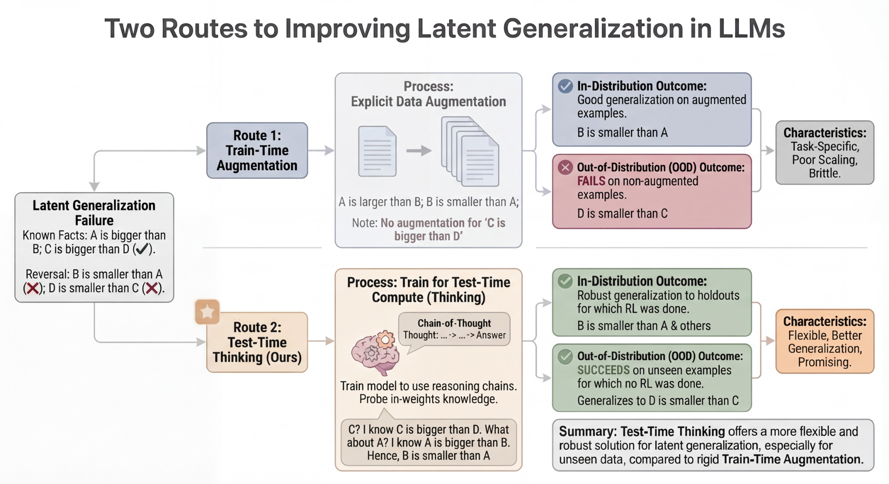

# Latent generalization: separating exposed and held-out answer-set recall

<!-- source-sha256: 6ba5d43a5e2f8cdcedae84204cf4b83171aef83d11ca84510132a134c615491b -->

[简体中文](README.md)

> **L1 mechanism/evaluation component, diagnostic only—not a complete capability reproduction.** CPU component tests passed. There is no CUDA execution path and no GPU claim. Not integrated with Evolve; fixture results cannot justify promotion.

## Paper information

| Field | Value |
| --- | --- |
| Paper | [arXiv:2604.01430v1](https://arxiv.org/abs/2604.01430v1); [fixed v1 source](https://arxiv.org/html/2604.01430v1) |
| First author / institution | **Arslan Chaudhry**, first affiliation **Google DeepMind**; Google participation is verified from the author block, not model names |
| Original publication date | **2026-04-01 22:10:21 UTC**, arXiv v1 record; historical official-source backfill, not today's first publication |
| Author code | No verified paper-specific author implementation repository was found in fixed v1 as of 2026-11-13; model/dependency repositories do not count as this paper's code. |
| Local adapter / key | `latent-generalization`; `adapter: null`, independent component |
| Local code | `src/auto_research/foundation_models/latent_generalization.py` |
| Validation | CPU component tests passed. There is no CUDA execution path and no GPU claim. |

## Original paper summary

### Background and main change

Knowing A>B does not guarantee answering B<A or unseen relational combinations. The paper separates knowledge acquisition, reasoning-trace bootstrapping and correctness RL to test whether reasoning trained on one structure transfers to another exposed only through knowledge SFT.

<!-- paper-figure:start -->
### Key original-paper figure

[](https://arxiv.org/html/2604.01430v1)

Figure 1 from fixed v1 HTML: the authors' comparison of train-time augmentation and test-time thinking. Source and image hashes are in [assets/provenance.json](assets/provenance.json). Figure from the [original paper](https://arxiv.org/html/2604.01430v1); copyright belongs to the original authors. Full-paper findings are not local component results.

<!-- paper-figure:end -->

### Defining mechanism and formula

The original pipeline uses Gemini 2.5 Flash knowledge SFT, gold-conditioned teacher trace bootstrapping and a correctness REINFORCE variant. No private trainer is fabricated locally. The implemented Section 3.3 protocol reports overall set precision/recall/F1, exposed/held-out recall, exact-set match/pass@N and designated held-out primary inclusion. Exact success allows neither omissions nor false additions.

```text
R_heldout = |prediction ∩ A_heldout| / |A_heldout|; exact = 1[prediction = A_all]
```

### Original results and limitations

The paper compares knowledge SFT, augmentation and thinking on controlled semantic/reversal tasks. Local code generates no model answers and establishes no cross-structure transfer. Held-out knowledge can be exposed during acquisition while remaining excluded from the relevant bootstrap/RL targets and rewarded traces; the paper uses structure-specific prefixes to reduce trace leakage.

## Local reproduction

### Data protocol and code mapping

Input checks require a nonempty held-out subset and a held-out primary. Exact-set pass@N is estimated from completed independent attempts. Negative controls show that perfect exposed recall can coexist with zero held-out recall, and perfect held-out recall can still fail exact matching through false additions. This is CPU offline evaluation, without model training, semantic judging or Evolve promotion.

```bash
PYTHONPATH=src python -c 'from auto_research.foundation_models.latent_generalization import diagnostic; print(diagnostic(42, device="cpu"))'
PYTHONPATH=src python -m pytest -q tests/test_colm_foundation_components.py
```

### Results, negative controls and boundaries

The component test set has 44 passes and six locally skipped CUDA cases; skipping is not passing. Standard three-seed outputs use `metrics/component-cpu-seeds42-44.json`, not training or public-benchmark results. CPU component tests passed. There is no CUDA execution path and no GPU claim. All metrics are L1 diagnostics. No gold is exposed to an actor, no test-based selection is authorized, and no model improvement is claimed.

### Full-experiment disposition

Private Gemini 2.5 Flash fine-tuning plus teacher traces and RL; not a fully specified public training recipe; full experiment not reproduced (commercial/private dependency).

**Full experiment not reproduced: private/commercial training dependency (review DONE).** No private training API or unreported GPU-hour estimate is invented.
