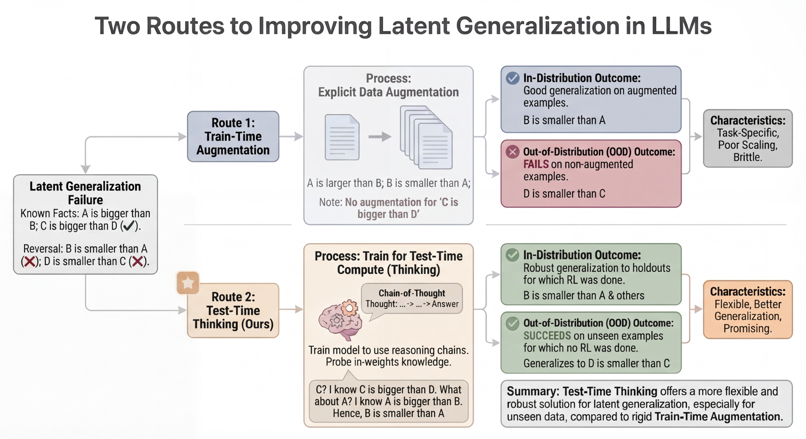

# Latent Generalization：区分已见答案与隐含答案的集合评测

[English](README-en.md)

> **L1 机制/评测组件，diagnostic only，不是完整模型能力复现。** CPU组件专测已通过；没有CUDA路径，不需要GPU验收。 未接入Evolve，不可据本地fixture成绩晋级。

## 论文信息

| 字段 | 内容 |
| --- | --- |
| 论文链接 | [arXiv:2604.01430v1](https://arxiv.org/abs/2604.01430v1)；[固定v1原文](https://arxiv.org/html/2604.01430v1) |
| 公司 / 作者机构 | 一作 **Arslan Chaudhry**，第一单位 **Google DeepMind**；论文有Google相关作者，按原文作者栏确认，不凭模型名归属 |
| 首次公开日期 | **2026-04-01 22:10:21 UTC**，依据arXiv v1记录；本次是历史官方源补漏，不是今天新首发 |
| 原作者开源代码 | 截至2026-11-13，固定v1未找到已核实的本篇作者代码仓库；基础模型与依赖仓库不算本篇开源。 |
| 本地 adapter / key | `latent-generalization`；`adapter: null`，独立组件 |
| 本地复现代码 | `src/auto_research/foundation_models/latent_generalization.py` |
| 验收范围 | CPU组件专测已通过；没有CUDA路径，不需要GPU验收。 |

## 原始论文总结

### 背景与主要改动

模型记住 A>B 并不必然推出 B<A，记住多个关系也不保证能答出未显式训练的组合。论文把知识获取、会思考的轨迹引导、正确性RL分开，研究在一个结构训练出的推理能力能否迁移到仅做知识SFT的另一个结构。

<!-- paper-figure:start -->
### 原论文关键图

[](https://arxiv.org/html/2604.01430v1)

Figure1，固定v1 HTML；训练期增广与测试期思考的原论文流程对比。 来源与图像SHA见[assets/provenance.json](assets/provenance.json)。图片来自[原论文](https://arxiv.org/html/2604.01430v1)，版权归原作者所有；图中的完整实验结论不等于本地组件结果。

<!-- paper-figure:end -->

### 核心机制与公式

原算法先对Gemini2.5 Flash做knowledge SFT，再用知道gold答案的teacher生成正确思考轨迹bootstrap，最后做正确性REINFORCE变体。这里不伪造该私有训练器。精确实现的是§3.3的paper-specific集合指标：all答案P/R/F1、训练已见答案recall、heldout答案recall、完整集合exact-match及其pass@N、指定heldout primary答案是否出现。预测必须整个集合正确，不能有漏答或误答。

```text
R_heldout = |prediction ∩ A_heldout| / |A_heldout|; exact = 1[prediction = A_all]
```

### 原文结果与限制

原文比较知识SFT、显式增广和thinking，在受控语义结构及reversal任务观察latent generalization；本地没有产生模型答案，更没有证明跨结构迁移。heldout知识可以在knowledge acquisition中出现，但不能泄漏进相关bootstrap/RL目标或被奖励的思考轨迹；原文用结构独立prompt前缀降低该泄漏。

## 本地复现

### 数据协议与代码映射

`score_completion` 要求heldout是all的子集，primary属于heldout，且gold集合非空；`exact_set_pass_at_n` 对已经完成的独立尝试计算无偏pass估计。负控显示：train recall=1可以同时heldout recall=0；heldout recall=1也能因额外误答导致exact=0。纯CPU离线评测，无模型训练、语义judge、Evolve或能力晋级。

```bash
PYTHONPATH=src python -c 'from auto_research.foundation_models.latent_generalization import diagnostic; print(diagnostic(42, device="cpu"))'
PYTHONPATH=src python -m pytest -q tests/test_colm_foundation_components.py
```

### 结果、负控与边界

本批组件专测为44项通过、6项CUDA本机跳过；跳过不等于通过。三种子标准产物统一使用 `metrics/component-cpu-seeds42-44.json`；没有训练或公开benchmark成绩。CPU组件专测已通过；没有CUDA路径，不需要GPU验收。 所有metric仅属L1诊断，无gold给actor、无test选择、无模型效果提升声明。

### 完整实验处置

原文方法依赖私有Gemini2.5 Flash微调、gold-conditioned teacher trace及正确性RL；没有可据以还原完整训练的公开接口。本地只实现§3.3的集合评测，不编造原文未报告的GPU小时。

**私有/商业训练依赖，完整实验不复现（审查 DONE）**。不把未公开训练接口虚构成可复现实验，也不编造GPU小时。
