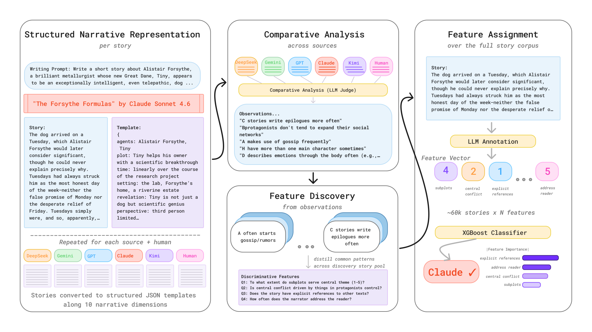
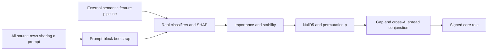

# StoryScope: stable narrative cores rather than surface detection shortcuts

<!-- source-sha256: 82619b14e93eca3b1b07d3de3740c86dfd97c3064552beb26e3f8722077623e6 -->

[简体中文](README.md)

> Local delivery is an L1 numerical/protocol component, not a full paper capability reproduction. Full experiments are cost-deferred and review-DONE, with no pretrained model/API training, automatic retry or evolve promotion.

Independent component artifacts: [CPU, three seeds](metrics/component-cpu-seeds42-44.json). They validate only the stated small operators; actual NVIDIA execution is supported by a separate sanitized batch receipt.

## Paper information

| Field | Value |
|---|---|
| Paper | [StoryScope: Investigating idiosyncrasies in AI fiction](https://arxiv.org/abs/2604.03136v1); [fixed v1](https://arxiv.org/html/2604.03136v1) |
| Company / institution | First author Jenna Russell: University of Maryland, College Park; original byline also verifies Google DeepMind. Group by the first author's institution, not model brands. |
| First publication | 2026-04-03 15:56:38 UTC, arXiv v1; historical omission, not a new paper this batch |
| Author code | [Author-linked repository](https://github.com/jenna-russell/storyscope). A public MIT author repository, README and dataset entry are verified. Current upstream authors/sample counts contain revisions; this write-up's method and cost claims remain pinned to v1. |
| Adapter | `storyscope` is a catalog key; `adapter=null`, not a full reproduce/evolve adapter |
| Local code | `src/auto_research/foundation_models/storyscope.py`; `tests/test_nov13_colm_evaluation.py` |

<!-- paper-figure:start -->
### Key figure from the original paper



Source: [fixed original](https://arxiv.org/html/2604.03136v1/storyscope_pipeline2.png). Image from the [original paper](https://arxiv.org/abs/2604.03136v1); copyright belongs to its original authors. The complete system or results in this figure are not results of the local component. Source hashes and visual review are recorded in `assets/provenance.json`.
<!-- paper-figure:end -->

## Original paper summary

### Background and main change

StoryScope studies narrative choices rather than only lexical style. It structures stories, compares human and five-model narratives written from the same prompt, discovers and deduplicates semantic features, assigns them at corpus scale, and uses classifiers plus bootstrap SHAP to distinguish cross-model cores from source-specific fingerprints.

The local component does not replace semantic features with word counts, keywords or author labels. It implements AppendixD's core gate on external statistics and prompt-block bootstrap indices. Fixed v1 does not fully quantify fingerprint thresholds in AppendixD, so no guessed fingerprint selector is supplied.



### Core criteria

A feature is important only when its mean absolute SHAP strictly exceeds the75th percentile across features. Stable-important membership also requires stability at least the median among important features, SHAP above the95th-percentile null-label baseline, and permutation $p\le0.10$.

Core membership requires that quadrant and null significance, $stab\ge0.55$, $top25\ge0.60$, an absolute human–AI mean-value gap of at least0.20, and a range of at most0.35 across the five AI source means. These are conjunctive thresholds, not an invented weighted score. The sign of the mean gap labels AI-leaning versus human-leaning cores.

Real classifier, encoding and prompt-level resampling statistics are external. Supplying synthetic vectors does not recreate50 fitted SHAP analyses. Prompt groups must be separated before training/validation/test splits and resampling.

### Original offline and online results

The fixed paper uses61,608 stories,10,272 prompts and304 narrative features. It reports93.2% macro-F1 for human-versus-AI detection and68.4% for six-way attribution. Thirty core features retain about91% of the narrative detector's F1. Strong surface-text attribution baselines prevent interpreting this as universal detection superiority. No production online A/B is reported.

## Local component

### Data protocol and code mapping

`prompt_bootstrap` samples prompts and expands all rows for every selected prompt, including repeated blocks. `select_core_features` actually computes importance/stability thresholds, significance and cross-model checks, returning a core mask and direction. There is no semantic feature generation, full XGBoost/SHAP fitting or text-detector API.

```bash
PYTHONPATH=src python -c 'from auto_research.foundation_models.storyscope import diagnostic; print(diagnostic(42))'
PYTHONPATH=src python -m pytest -q tests/test_nov13_colm_evaluation.py
```

### Local evidence and negative controls

The diagnostic generates50 prompt-block draws and checks source-row integrity. A high-SHAP source-specific feature fails the cross-model spread criterion; tests also exercise permutation and top25 boundaries. A selected-feature count is not accuracy or an attribution verdict. No evolve capability promotion is provided.

### Full-experiment cost decision

The original pipeline processes roughly5,000 words per story, uses GPT5.1 for templates/discovery and Gemini3Flash for304-feature assignment, embeds feature descriptions with F2LLM4B, and fits bootstrap classifiers and baselines. Full reproduction is cost-deferred and review-DONE: no corpus download, API calls or full detector training. Released caches are not evidence of local semantic execution. Current upstream author/sample details have changed, so methods and costs remain pinned to v1.
