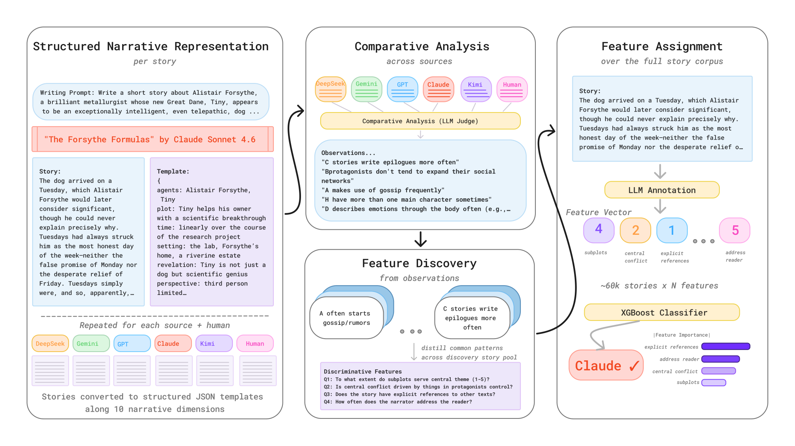
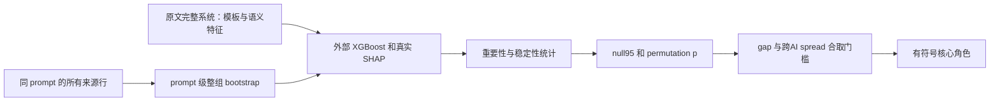

# StoryScope：从叙事特征到稳定核心，而非词面检测捷径

> 本地交付是 L1 数值/协议组件，不是完整论文能力复现。完整实验成本过高，不复现（审查 DONE）；未执行模型/API训练，不启用自动重试或 evolve 晋级。

本轮独立机制记录：[CPU 三种子](metrics/component-cpu-seeds42-44.json)。这些产物只验收所述小算子，不是论文能力分数；真实 GPU 结果以统一脱敏回执为准。

## 论文信息

| 字段 | 内容 |
|---|---|
| 论文链接 | [StoryScope: Investigating idiosyncrasies in AI fiction](https://arxiv.org/abs/2604.03136v1)；[固定 v1 原文](https://arxiv.org/html/2604.03136v1) |
| 公司 / 机构 | 一作 Jenna Russell：University of Maryland, College Park；原文另确认 Google DeepMind 署名，按一作所属机构聚合，不以模型品牌判断机构 |
| 首次公开日期 | 2026-04-03 15:56:38 UTC（arXiv v1，不是本轮新首发） |
| 原作者代码 | [作者链接](https://github.com/jenna-russell/storyscope)；作者公开MIT仓库/README与数据入口已核；当前README作者/数据量有修订，算法和成本只按固定v1，不将新版当v1。 |
| Adapter | `storyscope` 为 catalog key，`adapter=null`，不是完整 reproduce/evolve adapter |
| 本地复现代码 | `src/auto_research/foundation_models/storyscope.py`；专测 `tests/test_nov13_colm_evaluation.py` |

<!-- paper-figure:start -->
### 原论文关键图



来源：[固定 v1 原论文](https://arxiv.org/html/2604.03136v1)。图片来自[原论文](https://arxiv.org/abs/2604.03136v1)，版权归原作者所有；图中完整系统或实验结果不等于本地组件结果。原始来源、SHA256与视觉核验见 `assets/provenance.json`。
<!-- paper-figure:end -->

## 原始论文总结

### 背景与主要改动

作者身份检测常抓词汇或句长，却无法解释故事怎样组织主题、角色、时间和冲突。StoryScope 先把平行故事改为结构化叙事模板，在同一写作 prompt 的人类/五个模型之间比较，再归纳特征、去重、批量赋值。随后用分类器与 bootstrap SHAP 区分跨模型的人类–AI核心和特定模型指纹。

本地没有把字数、几个关键词或已知作者标签假装成语义特征。贡献限定为真实外部特征统计上的精确核心门控，以及保持同 prompt 六个来源共同抽样的 bootstrap 索引。模型指纹阈值在固定 v1 的 Appendix D 未完整量化，本地不猜一个“看起来合理”的规则冒充。



### 核心公式

固定 v1 Appendix D：重要性必须**严格超过**所有特征平均绝对 SHAP 的75%分位；stable-important 还要达到重要特征的稳定性中位数，SHAP 超过 null-label 的95%基线且置换 $p\le0.10$。

核心是严格合取，不是把下列项加成一个任意分数：stable-important、null 显著、$stab\ge0.55$、$top25\ge0.60$、人类与AI平均值绝对差至少0.20，以及五个AI模型均值的最大最小差不超过0.35。方向由 AI 均值减人类均值的正负决定。这个门槛不能把只在一个模型很强的线索叫“跨模型核心”。

统计量必须来自真实分类器、正确的编码列和 prompt 层级重采样。接口接收外部 $stab/top25/null/p$，不宣称用少量合成向量重新计算了50次真实 SHAP。先按 prompt 分 train/validation/test，再做重采样，不能把同一 prompt 的人类与AI故事分到两侧。

### 论文离线与线上效果

原文61,608故事、10,272 prompt、304叙事特征。叙事特征的人类–AI检测 macro-F1 为93.2%，六路来源识别 macro-F1 为68.4%；30核心保留约91%的叙事检测F1。文章强调词面基线在六路任务很强，因此“可解释叙事信号”不等于各项检测全面最优。未报告生产线上 A/B。

## 本地复现

### 数据协议与代码映射

`prompt_bootstrap` 对 prompt 采样并把该 prompt 所有行一并展开；重复抽中同一 prompt 也保留整组重复。`select_core_features` 验证输入并实际计算分位、中位数、显著性和跨模型门槛，返回核心 mask 与方向。没有 LLM 特征发现/赋值、完整 XGBoost/SHAP 拟合或可调用的文本检测模型。

```bash
PYTHONPATH=src python -c 'from auto_research.foundation_models.storyscope import diagnostic; print(diagnostic(42))'
PYTHONPATH=src python -m pytest -q tests/test_nov13_colm_evaluation.py
```

### 本地结果与负控

诊断保留50次 prompt-block 索引，确认每个 prompt 的来源同时出现；构造高SHAP但跨模型差太大的特征，必须被核心门槛拒绝。另逐项检查 $p$ 和 $top25$ 临界条件。所选特征个数不是检测准确率；它也不能对具体作者作来源判定，不进入 evolve 能力晋级。

### 高成本完整实验

完整流程包含约5000词×61,608故事、GPT5.1模板/特征归纳、Gemini3Flash全量304特征赋值、F2LLM4B去重、50次bootstrap分类器及基线矩阵，**成本过高，不复现（审查 DONE）**。作者已发布缓存/源码不等于本地已执行语义阶段；本轮不下载语料、不调用API、不重训完整检测器。当前仓库作者与样本数已有修订，本页方法与成本固定v1而非悄悄混版本。
