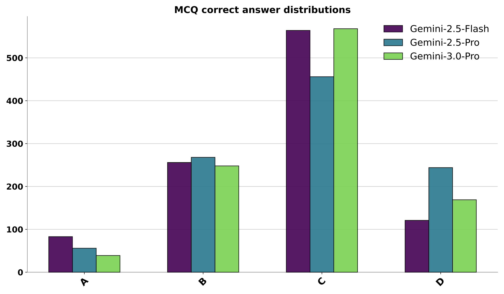

# LLM stochasticity: correct marginals do not establish independence

<!-- source-sha256: 9c879b4c31cbbb96adda8b1bc5011027c39a1ccb1d26863d6fbc924bfddf4c6a -->

[简体中文](README.md)

> **L1 mechanism/evaluation component, diagnostic only—not a complete capability reproduction.** CPU component tests passed. There is no CUDA execution path and no GPU claim. Not integrated with Evolve; fixture results cannot justify promotion.

## Paper information

| Field | Value |
| --- | --- |
| Paper | [arXiv:2604.06543v1](https://arxiv.org/abs/2604.06543v1); [fixed v1 source](https://arxiv.org/html/2604.06543v1) |
| First author / institution | **Xiangming Gu**, first affiliation **National University of Singapore**; Google participation is verified from the author block, not model names |
| Original publication date | **2026-04-08 00:44:14 UTC**, arXiv v1 record; historical official-source backfill, not today's first publication |
| Author code | No verified paper-specific author implementation repository was found in fixed v1 as of 2026-11-13; model/dependency repositories do not count as this paper's code. |
| Local adapter / key | `llm-stochasticity`; `adapter: null`, independent component |
| Local code | `src/auto_research/foundation_models/llm_stochasticity.py` |
| Validation | CPU component tests passed. There is no CUDA execution path and no GPU claim. |

## Original paper summary

### Background and main change

Asking an LLM for a random number is not access to a reliable random source. Across models, distributions and sequential/batch prompts, the paper finds category bias, history repulsion and periodicity; a uniform histogram may still arise from a deterministic sequence.

<!-- paper-figure:start -->
### Key original-paper figure

[](https://arxiv.org/html/2604.06543v1)

Figure 1 from fixed v1 SVG, rendered to PNG: the authors' biased multiple-choice answer distribution, not local measurements. Source and image hashes are in [assets/provenance.json](assets/provenance.json). Figure from the [original paper](https://arxiv.org/html/2604.06543v1); copyright belongs to the original authors. Full-paper findings are not local component results.

<!-- paper-figure:end -->

### Defining mechanism and formula

Discrete uniformity uses chi-square; continuous standard uniform/normal samples use KS. The default requires all 1,024 samples and never drops invalid support values. Label-invariant repeat/transition diagnostics and continuous lag-1 autocorrelation expose temporal structure separately. A large p-value means non-rejection, not proof of randomness, unbiasedness or independence.

```text
χ²=Σ_j (observed_j-N/K)^2/(N/K); D_KS=sup_x |F_N(x)-F(x)|
```

### Original results and limitations

The paper's multi-model/distribution prompt matrix and long-history sampling runs are not reproduced. External PRNGs can supply controlled randomness, but that is no longer spontaneous model sampling. NumPy reference samples are explicitly fixtures, never presented as LLM outputs.

## Local reproduction

### Data protocol and code mapping

The discrete evaluator rejects wrong counts, duplicate labels, booleans/non-integers and out-of-support values. The continuous evaluator rejects nonfinite and invalid uniform-support inputs. A repeating 0,1,2,3 cycle has zero chi-square but no adjacent repeats and concentrated transitions, proving that marginal tests alone are insufficient. This CPU component uses optional SciPy.

```bash
PYTHONPATH=src python -c 'from auto_research.foundation_models.llm_stochasticity import diagnostic; print(diagnostic(42, device="cpu"))'
PYTHONPATH=src python -m pytest -q tests/test_colm_foundation_components.py
```

### Results, negative controls and boundaries

The component test set has 44 passes and six locally skipped CUDA cases; skipping is not passing. Standard three-seed outputs use `metrics/component-cpu-seeds42-44.json`, not training or public-benchmark results. CPU component tests passed. There is no CUDA execution path and no GPU claim. All metrics are L1 diagnostics. No gold is exposed to an actor, no test-based selection is authorized, and no model improvement is claimed.

### Full-experiment disposition

1024 samples per distribution/prompt/model with sequential long histories across Qwen up to 32B and Gemini; full model sweep not reproduced.

**Full experiment not reproduced due to cost (review DONE).** No large checkpoint/corpus downloads, scaled-down substitute presented as replication, or automatic full-training retries.
