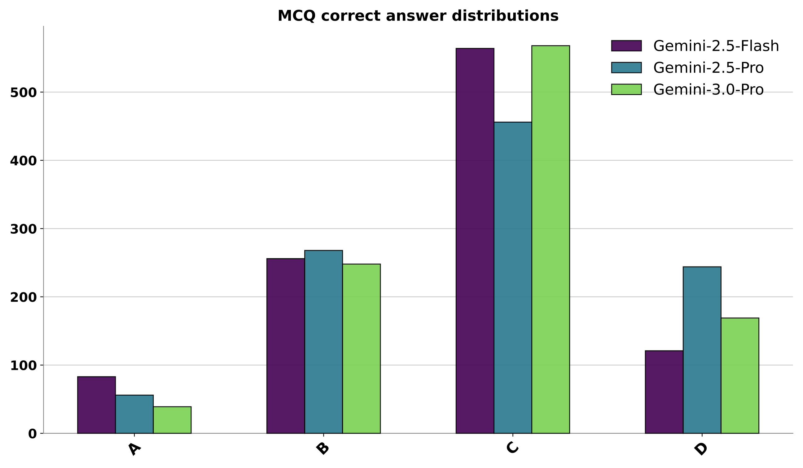

# LLM Stochasticity：边缘分布正确不代表采样独立

[English](README-en.md)

> **L1 机制/评测组件，diagnostic only，不是完整模型能力复现。** CPU组件专测已通过；没有CUDA路径，不需要GPU验收。 未接入Evolve，不可据本地fixture成绩晋级。

## 论文信息

| 字段 | 内容 |
| --- | --- |
| 论文链接 | [arXiv:2604.06543v1](https://arxiv.org/abs/2604.06543v1)；[固定v1原文](https://arxiv.org/html/2604.06543v1) |
| 公司 / 作者机构 | 一作 **Xiangming Gu**，第一单位 **National University of Singapore**；论文有Google相关作者，按原文作者栏确认，不凭模型名归属 |
| 首次公开日期 | **2026-04-08 00:44:14 UTC**，依据arXiv v1记录；本次是历史官方源补漏，不是今天新首发 |
| 原作者开源代码 | 截至2026-11-13，固定v1未找到已核实的本篇作者代码仓库；基础模型与依赖仓库不算本篇开源。 |
| 本地 adapter / key | `llm-stochasticity`；`adapter: null`，独立组件 |
| 本地复现代码 | `src/auto_research/foundation_models/llm_stochasticity.py` |
| 验收范围 | CPU组件专测已通过；没有CUDA路径，不需要GPU验收。 |

## 原始论文总结

### 背景与主要改动

要求LLM“随机选一个数”不等价于访问可靠随机源。论文比较不同模型、离散/连续目标分布、逐次和批量提示，发现明显类别偏好、历史排斥和周期性；看起来均匀的直方图也可能来自确定性序列。

<!-- paper-figure:start -->
### 原论文关键图

[](https://arxiv.org/html/2604.06543v1)

Figure1，固定v1 SVG转PNG；作者多选题正确选项分布的偏置结果图，非本地指标。 来源与图像SHA见[assets/provenance.json](assets/provenance.json)。图片来自[原论文](https://arxiv.org/html/2604.06543v1)，版权归原作者所有；图中的完整实验结论不等于本地组件结果。

<!-- paper-figure:end -->

### 核心机制与公式

离散均匀分布使用卡方统计量，连续标准均匀/正态使用KS统计量；默认检查1024个完整样本，不丢掉越界或解析失败后缩小分母。本地另外计算与标签重命名无关的lag1重复率、最大转移频率，以及连续序列lag1自相关，把边缘拟合与时序依赖分开。p值大仅表示当前检验未拒绝，不是证明95%概率随机、模型无偏或样本独立。

```text
χ²=Σ_j (observed_j-N/K)^2/(N/K); D_KS=sup_x |F_N(x)-F(x)|
```

### 原文结果与限制

原文覆盖Qwen多尺寸与Gemini等模型的多分布提示矩阵，模型反复调用和长历史上下文实验未复现。调用外部PRNG可以提供可控随机性，但这不再是模型自发随机采样；本地诊断使用的NumPy参考样本会显式标成fixture，不冒充LLM输出。

## 本地复现

### 数据协议与代码映射

`evaluate_discrete_uniform` 拒绝错误样本数、重复标签、布尔/非整数、support之外的值；`evaluate_continuous` 拒绝NaN和均匀分布越界。反例序列0,1,2,3不断循环：直方图卡方为0，却从无相邻重复且转移高度集中，说明边缘分布检验不足。依赖可选research-components中的SciPy，纯CPU。

```bash
PYTHONPATH=src python -c 'from auto_research.foundation_models.llm_stochasticity import diagnostic; print(diagnostic(42, device="cpu"))'
PYTHONPATH=src python -m pytest -q tests/test_colm_foundation_components.py
```

### 结果、负控与边界

本批组件专测为44项通过、6项CUDA本机跳过；跳过不等于通过。三种子标准产物统一使用 `metrics/component-cpu-seeds42-44.json`；没有训练或公开benchmark成绩。CPU组件专测已通过；没有CUDA路径，不需要GPU验收。 所有metric仅属L1诊断，无gold给actor、无test选择、无模型效果提升声明。

### 完整实验处置

原文每种分布/提示/模型默认1024次采样，覆盖Qwen至32B及Gemini，并有长历史逐次采样与多种控制。完整模型调用矩阵不复现；本地统计核只读外部已完成样本。

**完整实验成本过高，不复现（审查 DONE）**。不下载大权重/语料、不以缩水模型冒充原论文、不自动重试完整训练。
