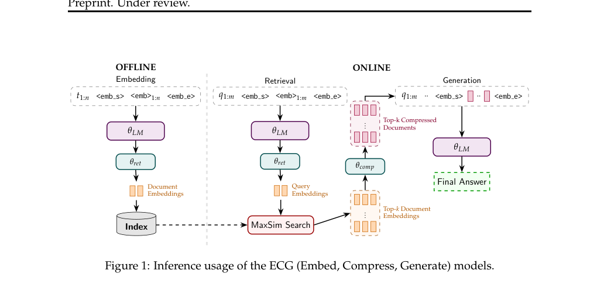

# ECG: shared representations for retrieval and context compression

<!-- source-sha256: 2d522783223ba0b570c26df2de796e7731ee037643b31cc39a0543368a720c7f -->

[简体中文](README.md)

> **L1 mechanism/evaluation component, diagnostic only—not a complete capability reproduction.** CPU and real NVIDIA A100-SXM4-80GB L1 checks passed for seeds 42/43/44; only small tensor operators were executed, not full training. Not integrated with Evolve; fixture results cannot justify promotion.

## Paper information

| Field | Value |
| --- | --- |
| Paper | [arXiv:2604.14403v1](https://arxiv.org/abs/2604.14403v1); [fixed v1 source](https://arxiv.org/pdf/2604.14403v1) |
| First author / institution | **Julian Killingback**, first affiliation **University of Massachusetts Amherst**; Google participation is verified from the author block, not model names |
| Original publication date | **2026-04-15 20:34:10 UTC**, arXiv v1 record; historical official-source backfill, not today's first publication |
| Author code | No verified paper-specific author implementation repository was found in fixed v1 as of 2026-11-13; model/dependency repositories do not count as this paper's code. |
| Local adapter / key | `ecg-rag`; `adapter: null`, independent component |
| Local code | `src/auto_research/foundation_models/ecg_rag.py` |
| Validation | CPU and real NVIDIA A100-SXM4-80GB L1 checks passed for seeds 42/43/44; only small tensor operators were executed, not full training. |

## Original paper summary

### Background and main change

On-device RAG must limit both index storage and generation context/KV costs. ECG stores one multi-vector retrieval representation and projects it into compressed context for the same decoder, avoiding separate retrieval and compression representations.

<!-- paper-figure:start -->
### Key original-paper figure

[](https://arxiv.org/pdf/2604.14403v1#page=2)

Figure 1, PDF page 2: shared model/document representations for Embed, Compress and Generate. Source and image hashes are in [assets/provenance.json](assets/provenance.json). Figure from the [original paper](https://arxiv.org/pdf/2604.14403v1); copyright belongs to the original authors. Full-paper findings are not local component results.

<!-- paper-figure:end -->

### Defining mechanism and formula

Each projection block has four scalar-gated residual layers, with ReLU only in the first three. Retrieval vectors are scaled by sqrt(d), not unit-normalized; compression undoes that scaling. Retrieval averages per-query-vector maximum document dot products. RAG training sums teacher-to-student generation FKL, learned-temperature InfoNCE and learned-alpha teacher-margin MSE.

```text
L=L_gen+L_NCE+L_margin; L_gen=Σ_t KL(P_reader || P_student); margin=(ΔS-αΔT)^2
```

### Original results and limitations

The paper reports near-reader performance at roughly one tenth of the context, with 135M/1B models, eight H100 training GPUs, about 110k questions and 840k/2.1M pooled passages. Only the differentiable core is implemented here; there are no generated answers or replicated on-device latency/retrieval claims.

## Local reproduction

### Data protocol and code mapping

Compression genuinely consumes stored E_ret. Teacher distributions/relevance are detached while alpha and temperature remain differentiable. FKL sums answer-token KLs before batch averaging; margin uses declared hard negatives only. The paper specifies a large positive gate bias but no exact value: five is an explicit local convention. There is no pretrained decoder, index, special-token integration or full training pipeline.

```bash
PYTHONPATH=src python -c 'from auto_research.foundation_models.ecg_rag import diagnostic; print(diagnostic(42, device="cpu"))'
PYTHONPATH=src python -m pytest -q tests/test_colm_foundation_components.py
```

### Results, negative controls and boundaries

The component test set has 44 passes and six locally skipped CUDA cases; skipping is not passing. Standard three-seed outputs use `metrics/component-cpu-seeds42-44.json`, with `metrics/component-cuda-seeds42-44.json` and a sanitized GPU receipt for CUDA. CPU and real NVIDIA A100-SXM4-80GB L1 checks passed for seeds 42/43/44; only small tensor operators were executed, not full training. All metrics are L1 diagnostics. No gold is exposed to an actor, no test-based selection is authorized, and no model improvement is claimed.

Real-GPU evidence: [three-seed CUDA metrics](metrics/component-cuda-seeds42-44.json) and [sanitized A100 receipt](../../gpu-validations/ecg-rag-a100-20261113.json), bound to frozen source commit `1b7fe8699efd48e6421b01f6df756d6e4086eb52`. About 1.468 seconds for all seven CUDA components is small-operator time, not this paper's training runtime.

### Full-experiment disposition

8 NVIDIA H100 training; 135M/1B models, Wikipedia pretraining and ~110k NQ/TriviaQA questions, pooled 840k/2.1M passage evaluation; full study not reproduced.

**Full experiment not reproduced due to cost (review DONE).** No large checkpoint/corpus downloads, scaled-down substitute presented as replication, or automatic full-training retries.
