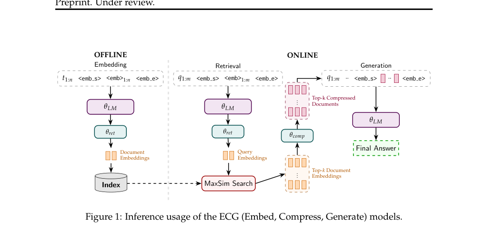

# ECG：检索和上下文压缩共享一套表示

[English](README-en.md)

> **L1 机制/评测组件，diagnostic only，不是完整模型能力复现。** CPU及真实NVIDIA A100-SXM4-80GB的42/43/44三种子L1检查已通过；只运行小张量算子，没有完整训练。 未接入Evolve，不可据本地fixture成绩晋级。

## 论文信息

| 字段 | 内容 |
| --- | --- |
| 论文链接 | [arXiv:2604.14403v1](https://arxiv.org/abs/2604.14403v1)；[固定v1原文](https://arxiv.org/pdf/2604.14403v1) |
| 公司 / 作者机构 | 一作 **Julian Killingback**，第一单位 **University of Massachusetts Amherst**；论文有Google相关作者，按原文作者栏确认，不凭模型名归属 |
| 首次公开日期 | **2026-04-15 20:34:10 UTC**，依据arXiv v1记录；本次是历史官方源补漏，不是今天新首发 |
| 原作者开源代码 | 截至2026-11-13，固定v1未找到已核实的本篇作者代码仓库；基础模型与依赖仓库不算本篇开源。 |
| 本地 adapter / key | `ecg-rag`；`adapter: null`，独立组件 |
| 本地复现代码 | `src/auto_research/foundation_models/ecg_rag.py` |
| 验收范围 | CPU及真实NVIDIA A100-SXM4-80GB的42/43/44三种子L1检查已通过；只运行小张量算子，没有完整训练。 |

## 原始论文总结

### 背景与主要改动

设备端RAG既要控制文档索引磁盘占用，也要限制生成时的上下文/KV开销。ECG不是简单把检索器输出拼进prompt，而是只存一份多向量检索表示，再经投影转成同一decoder可消费的压缩上下文，避免独立检索向量和压缩向量重复存储。

<!-- paper-figure:start -->
### 原论文关键图

[](https://arxiv.org/pdf/2604.14403v1#page=2)

Figure1，PDF 第2页；同一模型与文档表示用于Embed、Compress、Generate。 来源与图像SHA见[assets/provenance.json](assets/provenance.json)。图片来自[原论文](https://arxiv.org/pdf/2604.14403v1)，版权归原作者所有；图中的完整实验结论不等于本地组件结果。

<!-- paper-figure:end -->

### 核心机制与公式

每个投影块有4层：sigmoid标量门控的残差加上LN后的线性投影，前三层ReLU，最后一层不限制正负。E_ret除以sqrt(d)用于点积检索，进入compression块前乘回sqrt(d)，不是单位范数归一化。检索S取每个query向量对doc向量的最大点积，再对query向量求平均。RAG联合训练由teacher→student生成FKL、可学习温度InfoNCE、可学习α的teacher-margin MSE相加。

```text
L=L_gen+L_NCE+L_margin; L_gen=Σ_t KL(P_reader || P_student); margin=(ΔS-αΔT)^2
```

### 原文结果与限制

原文报告压缩到约1/10上下文时接近传统reader性能，使用135M/1B基座、8张H100训练，约11万NQ/TriviaQA问题和84万/210万pooled passages评测。这里只实现可微核心，不生成答案，不宣称端侧延迟、检索召回或这些完整结果已复现。

## 本地复现

### 数据协议与代码映射

`SharedRepresentation` 真正让compression依赖stored E_ret；`joint_loss` 固定teacher logits/relevance，不让teacher获得梯度，保留α与温度梯度。FKL按答案token求和再按题平均；只有显式hard negatives进入margin，正例不能混入负例mask。gate的大正bias原文无确数，本地5是明确初始化约定。未带pretrained decoder、索引、特殊token注入或完整训练管道。

```bash
PYTHONPATH=src python -c 'from auto_research.foundation_models.ecg_rag import diagnostic; print(diagnostic(42, device="cpu"))'
PYTHONPATH=src python -m pytest -q tests/test_colm_foundation_components.py
```

### 结果、负控与边界

本批组件专测为44项通过、6项CUDA本机跳过；跳过不等于通过。三种子标准产物统一使用 `metrics/component-cpu-seeds42-44.json`，GPU另用 `metrics/component-cuda-seeds42-44.json` 与脱敏回执。CPU及真实NVIDIA A100-SXM4-80GB的42/43/44三种子L1检查已通过；只运行小张量算子，没有完整训练。 所有metric仅属L1诊断，无gold给actor、无test选择、无模型效果提升声明。

真实GPU产物：[三种子CUDA指标](metrics/component-cuda-seeds42-44.json)、[脱敏A100回执](../../gpu-validations/ecg-rag-a100-20261113.json)，绑定冻结源码 `1b7fe8699efd48e6421b01f6df756d6e4086eb52`。全批7个CUDA组件用时约1.468秒是小算子时间，不是本篇完整训练耗时。

### 完整实验处置

固定v1 Appendix B.1使用8张H100训练135M/1B模型，先Wikipedia预训练，再约11万NQ/TriviaQA问题；评测pool约84万/210万passages。单卡不尝试该训练/全量检索矩阵。

**完整实验成本过高，不复现（审查 DONE）**。不下载大权重/语料、不以缩水模型冒充原论文、不自动重试完整训练。
