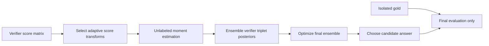
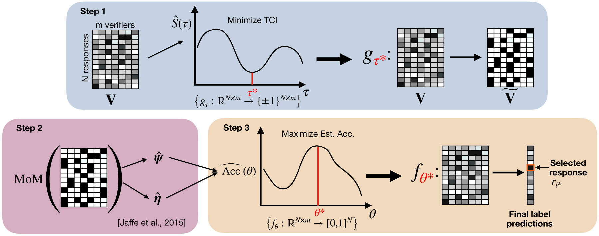

# FUSE: Verifier Ensembles Without Gold Answers

<!-- source-sha256: db9252a69f7df13458a0275206d6137bbc9ad0fbd671d3a4d96fe35da707d944 -->

[简体中文](README.md)

> Historical high-priority catch-up; full experiment not reproduced due to cost (review complete). No local capability results or executable Evolve operator.

## Paper information

| Field | Details |
|---|---|
| Paper | [arXiv 2604.18547v1](https://arxiv.org/abs/2604.18547v1); [pinned text](https://arxiv.org/html/2604.18547v1) |
| Organization | First author Joonhyuk Lee: Stanford University. Coauthor Regev Cohen: Google. The paper is not grouped under Google by first authorship. |
| First public release | 2026-04-20 17:40:33 UTC (arXiv v1, not the institution listing date). |
| Authors' code | Appendix G releases raw HLE/IMO data and says the pipeline will be open sourced; no full author pipeline was verified. HazyResearch/scaling-verification is baseline code, not FUSE. This is not proof of non-release. |
| Adapter / method | `fuse-verifiers` (catalog only); `adapter: null`. |
| Local reproduction code | None; only this note and `src/auto_research/paper_specs/catalog/foundation-models/fuse-verifiers.json`. |

## Original paper

### Motivation and method

Verifier errors can be correlated, so averaging may amplify them. FUSE reads only candidate score matrices, estimates query-dependent verifier quality from second and third moments, selects transforms to reduce dependence, constructs correctness posteriors, and optimizes an ensemble. True labels are used only for independent evaluation.

Redrawn from Figure 2 / Algorithm 1. [Original workflow](https://arxiv.org/html/2604.18547v1).

<!-- paper-figure:start -->
### Key figure from the paper

> **Figure 2:** Score transforms, moment estimation, and ensemble optimization, without gold labels. Author SVG rendered to PNG, separate from the Mermaid redraw. From the [original paper](https://arxiv.org/abs/2604.18547v1); copyright remains with the authors.
<!-- paper-figure:end -->

### Core equations

With identification assumptions including a better-than-random majority and triplet conditional independence, moment estimates give triplet posteriors (Section 2.3):

$$
\hat p(r)=\frac{1}{\binom{m}{3}}\sum_{j_1<j_2<j_3}\hat p_{j_1,j_2,j_3}(r),\quad
\theta^*=\arg\max_\theta\sum_i(2\hat p(r_i)-1)\hat f_\theta(V_i).
$$

Estimated posteriors are not labels. Violated assumptions, constant scores, or highly correlated verifiers remove reliability guarantees. Mean-score ranking is not FUSE.

### Paper results

Pinned v1 Table 1, 70B Best-of-100 on GPQA Diamond: FUSE 64.4%, WEAVER 64.1%, mean ensemble 57.6%. The supervised comparison sees labels for 5% of questions; FUSE does not. HLE and IMO are also reported, but these are neither production A/B nor local measurements.

## Local status and cost

Appendix F uses eight H100-80GB GPUs for new HLE/IMO generation and verification. **Full generation is not reproduced due to cost (review complete)**. The paper explicitly notes that processing existing score matrices does not need a GPU; the cost of generation is not a reason to rule out the offline core.

The [author data organization](https://huggingface.co/FUSE-verifiers) provides raw data; Appendix G promises later full pipeline release. HazyResearch/scaling-verification is a comparison baseline, not official FUSE code. No data download, ensemble implementation, local score, GPU receipt, or Evolve integration was added.
