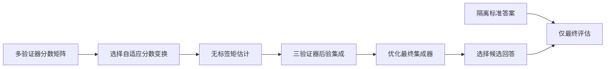
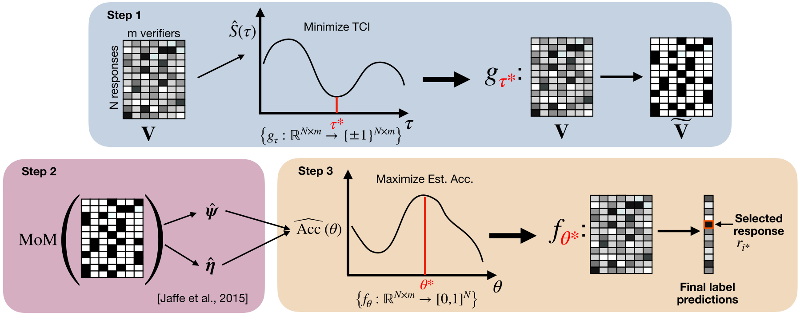

# FUSE：不读取标准答案的验证器集成

> 历史高优先补漏资料；**成本过高，不复现（审查 DONE）**。没有本地能力结果或可执行 Evolve 算子。

## 论文信息

| 字段 | 内容 |
| --- | --- |
| 论文链接 | [arXiv 2604.18547v1](https://arxiv.org/abs/2604.18547v1)；[固定正文](https://arxiv.org/html/2604.18547v1) |
| 公司 / 机构 | 一作 Joonhyuk Lee：Stanford University；合作者 Regev Cohen：Google。Google 合作论文不改归为一作 Google |
| 首次公开日期 | 2026-04-20 17:40:33 UTC（arXiv v1，不用机构目录日期覆盖） |
| 原作者代码 | 原文Appendix G发布原始HLE/IMO数据；所读版本称pipeline将开源，未确认作者完整pipeline；HazyResearch/scaling-verification为基线不是FUSE作者实现；未找到不表示已证明未发布 |
| 本地 adapter / 稳定键 | `fuse-verifiers`（仅资料键）；`adapter: null` |
| 本地复现代码 | 无；仅本文及 `src/auto_research/paper_specs/catalog/foundation-models/fuse-verifiers.json` |

## 原始论文总结

### 背景与主要改动

多个验证器并不独立，直接平均可能让相关错误相互放大。FUSE 只读取候选分数矩阵，通过二、三阶矩估计查询条件下的验证器质量，选择能缓解相关性的分数变换，再构造正确后验并优化集成器；真实正确标签只用于独立评估。

图按原文 Figure 2 / Algorithm 1 重绘。[原始流程图](https://arxiv.org/html/2604.18547v1)。

<!-- paper-figure:start -->
### 原论文关键图

> **原论文 Figure 2**：分数变换、矩估计和集成器优化的三个阶段；标准答案不参与这些估计步骤。 图片来自[原论文](https://arxiv.org/abs/2604.18547v1)，版权归原作者所有；此处将作者SVG渲染为PNG展示，不是上方Mermaid重绘。点击图片查看原始图源。
<!-- paper-figure:end -->

### 核心公式

在满足多数验证器优于随机、三元条件独立等识别假设时，由矩估计产生各三元组后验，原文 §2.3：

$$
\hat p(r)=\frac{1}{\binom{m}{3}}\sum_{j_1<j_2<j_3}\hat p_{j_1,j_2,j_3}(r),\quad
\theta^*=\arg\max_\theta\sum_i(2\hat p(r_i)-1)\hat f_\theta(V_i).
$$

这些是估计后验，不是真实标签；假设不成立、分数常量或验证器高度相关时，不能据此保证可靠性。只按平均分排序不等于实现 FUSE。

### 论文离线与线上效果

v1 Table 1 的 70B Best-of-100 GPQA Diamond：FUSE 64.4%，WEAVER 64.1%，平均集成 57.6%；监督对照可见 5% 问题的标签，FUSE 不可见。原文还报告 HLE/IMO 等评测，不是生产 A/B，也不是本地测量。

## 本地复现与成本判断

附录 F 的 HLE/IMO 新生成与验证采用 8×H100-80GB，完整生成实验**成本过高，不复现（审查 DONE）**。但论文明确：读取既有分数的矩阵计算无需 GPU，不能据完整生成规模错误拒绝离线核心。

[作者数据组织](https://huggingface.co/FUSE-verifiers) 提供原始数据；所读附录 G 仅承诺后续发布完整 pipeline。HazyResearch/scaling-verification 是被比较基线代码，不冒记为 FUSE 官方源码。本轮未下载数据或实现集成器，无本地分数、GPU 回执或 Evolve 接入。
