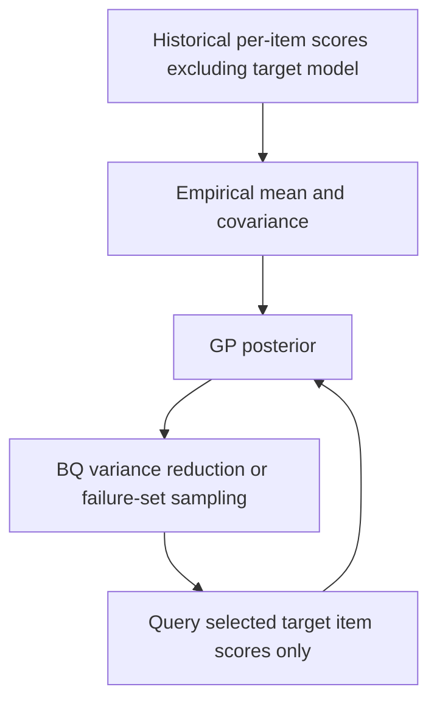
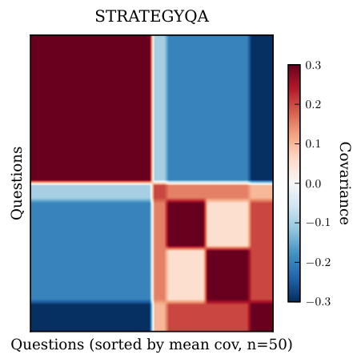

<!-- source-sha256: cc148ceb5167cf0b909f04441d1ab4d47b382022debe81d65496c74d579492c9 -->

[简体中文](README.md) · English

# ProEval: Historical score transfer and active evaluation component

## Paper information

| Field | Details |
|---|---|
| Paper | [ProEval](https://arxiv.org/abs/2604.23099) |
| Institution | Google DeepMind; first author Yizheng Huang |
| First public release | 2026-04-25 (arXiv v1) |
| Author code | [google-deepmind/proeval](https://github.com/google-deepmind/proeval), public repository linked by the paper. Upstream training is not run locally. |
| Local adapter or method key | `proeval`, standalone CPU evaluation core with no reproduce adapter |
| Local reproduction code | `src/auto_research/foundation_models/google16_proeval.py` |

## Method summary

Estimate a GP prior from historical per-item scores of other models, use Bayesian quadrature for overall performance, and select the next item by variance reduction or a failure superlevel set. The local code runs real matrix posterior updates and active selection without treating constructed score fixtures as real model evaluation.

## Original paper summary

### Background and main changes

Scoring every item each time is impractical with expensive models or judges. ProEval reuses per-item score correlations across historical models to form a probabilistic surrogate for a target model's scores. A target score enters the update only after its item is selected. Primary source: [v1 §§2.1–2.4, Eqs. 2, 5, 7, 10, and 12](https://arxiv.org/html/2604.23099v1#S2).



<!-- paper-figure:start -->
### Key figure from the paper

[](https://arxiv.org/html/2604.23099v1#S2.F2)

> **StrategyQA panel of Figure 2:** Historical score correlations form an empirical GP prior. Only this panel is shown, not the complete four-panel figure or a local fixture result. Copyright belongs to the authors. See [source and hash](assets/provenance.json).
<!-- paper-figure:end -->

### Core equations

$$
\mu_t=\mu+K_{:O}(K_{OO}+\sigma^2I)^{-1}(y_O-\mu_O),\quad
K_t=K-K_{:O}(K_{OO}+\sigma^2I)^{-1}K_{O:}.
$$

$$
\mathbb ES=w^\top\mu_t,\quad \mathbb VS=w^\top K_tw,\quad
\Delta_i=\frac{(w^\top K_{t,:i})^2}{K_{t,ii}+\sigma^2}.
$$

Failure acquisition maximizes posterior variance only over candidates with $\mu_t(i)+\beta\sqrt{K_{t,ii}}\ge\lambda$. At least three distinct historical model records are required; target IDs, duplicate observations, and nonfinite scores are rejected explicitly.

### Offline and online results

The paper reports approximate performance estimates using fewer scored items on reasoning, safety, and classification benchmarks. This is not production A/B. The local run does not repeat the full 16-model or generative failure synthesis matrix or claim its speedup.

## Local reproduction

```bash
PYTHONPATH=src python scripts/run_google16_statistics.py --seed 42 --output runs/google16-statistics.json
```

### Data protocol and results

There are only 4 historical score fixtures and target scores for 4 questions. Acquisition receives queried scores only, not the hidden target array. Independent tests compare the analytical variance reduction for each candidate with the change after adding an actual observation. Results are in `metrics/component-cpu-seed42.json` with `diagnostic_only=true`. No real LLM evaluation, formal capability claim, or Evolve promotion.

### Code mapping and scope

`EmpiricalGP` implements an empirical GP, finite-pool BQ, and SS. It omits GMM source-model selection, learned prompt encoders, TPF/RPF/SF training, SS-Gen, and topic UCB/LLM generation. The full multi-benchmark/API experiment is too costly and not reproduced (review DONE). The named empirical-score core is not full ProEval.

Requiring at least three historical records is a local numerical-interface threshold. It does not ensure the sample relationships and other conditions for the theoretical bound; that bound is not verified locally.
