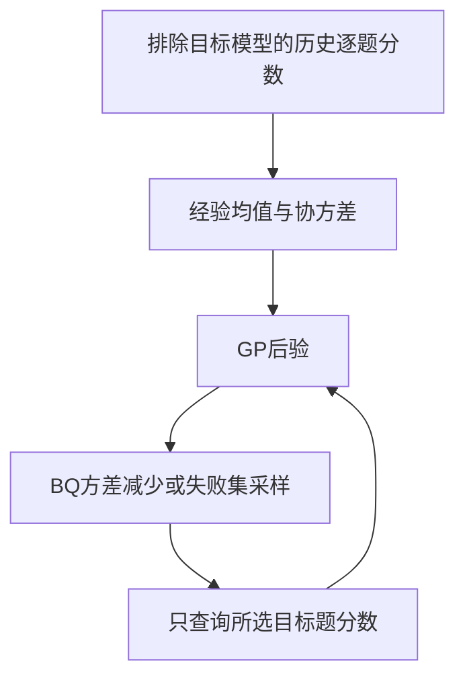
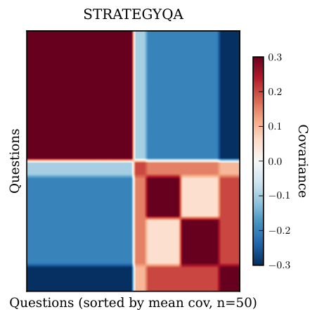

# ProEval：历史评分迁移与主动评测组件

## 论文信息

| 字段 | 内容 |
|---|---|
| 论文链接 | [ProEval](https://arxiv.org/abs/2604.23099) |
| 公司 / 机构 | Google DeepMind；第一作者 Yizheng Huang |
| 首次公开日期 | 2026-04-25（arXiv v1） |
| 原作者开源代码 | [google-deepmind/proeval](https://github.com/google-deepmind/proeval)，原文链接公开仓库；本地未执行上游训练 |
| 本地 adapter | `proeval`，独立CPU评测核心，无 reproduce adapter |
| 本地复现代码 | `src/auto_research/foundation_models/google16_proeval.py` |

## 方法摘要

从其他模型的历史逐题分数估计GP先验，利用Bayesian quadrature估计总体性能，并按方差减少或失败超水平集选择下一道待评题。本地执行真实矩阵后验与主动选择，但不把自建分数夹具当成真实模型评测。

## 原始论文总结

### 背景与主要改动

昂贵模型或评审器不适合每次全量评分。ProEval复用历史模型之间逐题表现的相关性，形成目标模型的概率评分替身；目标分数只在对应题被选中后传入更新。主源：[v1 §2.1–2.4 Eq2、5、7、10、12](https://arxiv.org/html/2604.23099v1#S2)。



<!-- paper-figure:start -->
### 原论文关键图

[](https://arxiv.org/html/2604.23099v1#S2.F2)

> **Figure 2的StrategyQA子图**：展示历史模型的评分关联如何形成经验GP先验。仅展示这一个子图，非完整四面板图，非本地生成fixture结果。版权归原作者；[来源与hash](assets/provenance.json)。
<!-- paper-figure:end -->

### 核心公式

$$
\mu_t=\mu+K_{:O}(K_{OO}+\sigma^2I)^{-1}(y_O-\mu_O),\quad
K_t=K-K_{:O}(K_{OO}+\sigma^2I)^{-1}K_{O:}.
$$
$$
\mathbb ES=w^\top\mu_t,\quad \mathbb VS=w^\top K_tw,\quad
\Delta_i=\frac{(w^\top K_{t,:i})^2}{K_{t,ii}+\sigma^2}.
$$

失败采集仅在$\mu_t(i)+\beta\sqrt{K_{t,ii}}\ge\lambda$的候选上最大化后验方差。至少三份不同历史模型记录；显式拒绝目标ID、重复观察和非有限分数。

### 论文离线与线上效果

原文报告在推理、安全和分类基准用更少评测样本得到近似性能估计；这不是生产流量A/B。本地没有重跑16模型或生成式失败合成的完整矩阵，不引用其加速倍数为本地结论。

## 本地复现

```bash
PYTHONPATH=src python scripts/run_google16_statistics.py --seed 42 --output runs/google16-statistics.json
```

### 数据协议与结果

仅4份历史评分数学夹具和4题目标分数；采集器只得到已查询分数，不接受整个隐藏目标数组。独立测试逐候选比较解析方差减少与真正增加一次观测后的方差之差。记录位于`metrics/component-cpu-seed42.json`，`diagnostic_only=true`，无真实LLM评价、正式能力或evolve晋级声明。

### 代码映射与边界

`EmpiricalGP`实现经验GP、有限池BQ与SS，不含GMM源模型选择、learned prompt encoder、TPF/RPF/SF训练、SS-Gen、topic UCB/LLM生成。完整多基准/API实验成本过高，不复现（审查DONE）；已实现的是明确命名的经验评分子核心，不是完整ProEval。

至少三份历史记录只是本地数值接口门槛，不保证论文理论界所需的样本关系等额外条件；本轮不宣称该界已被验证。
