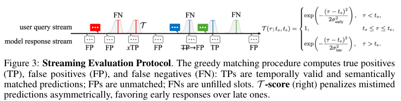

# Don't Pause! Every prediction matters in a streaming video

<!-- source-sha256: 288a15162e800fa0dc10d1bb27c69c97d66b39cf07cff0a099b2effa9fe63950 -->

[简体中文](README.md)

> **L1 mechanism/scoring component, diagnostic only, not a full capability reproduction.** High-cost full experiments are not reproduced (review DONE), with no Evolve promotion.

## Paper information

| Field | Value |
| --- | --- |
| Paper | [Fixed v2](https://arxiv.org/html/2604.24317v2) |
| First author / affiliation | Dibyadip Chatterjee; National University of Singapore. Yale Song is affiliated with Google Inc.; the first author is not relabeled Google. |
| Original publication | 2026-04-27T11:07:03Z; historical April27 backfill from Google’s directory, reviewing November5 v2; discovery is not publication |
| Original source code | Yes: [author repository](https://github.com/dibschat/SPOT-Bench), pinned12ab7f6c215d22c651bbbfde33c09ea5b6a4f101, MIT. The local independent scorer was checked against evals/metrics.py without downloading videos or executing upstream models. |
| Local adapter / key | `spot-bench`; null adapter, independent component |
| Local code | `src/auto_research/foundation_models/spot_bench.py` |

## Original paper

### Background and method

SPOT-Bench evaluates continuous video output: every response affects the score rather than only answers at paused queries. Human-acceptable windows define gold slots. Timeliness is1 inside and has wider early and narrower late Gaussian tails outside. Temporally valid, semantically correct responses arrive chronologically; each open slot absorbs up to K and keeps its best timeliness. Excess or unmatched outputs are false positives and empty slots false negatives. Weighted T-F1 combines timing, coverage and over-response. Ctrl-SPOT is a separate full streaming controller combining persistent query state, long/short KV, retrieval and dead-time summaries; the local work is a scorer, not that controller.

### Key original figure

[](https://arxiv.org/pdf/2604.24317v2#page=6)

Complete Figure 3 and caption from fixed-v2 page6, visually checked without scientific modification. Copyright belongs to the authors. [Source](https://arxiv.org/pdf/2604.24317v2#page=6) · [crop and fingerprint](assets/provenance.json). This is a paper figure, not local evidence.

### Core formula

$$
P=\frac{xTP}{TP+FP},\quad R=\frac{xTP}{TP+FN},\quad T\!F1=\frac{2PR}{P+R},\qquad xTP=\sum_{j:C_j>0}\max_{i\,matched\,j}\mathcal T(t_i;s_j,e_j).
$$

Fixed-v2 Algorithm1 and pinned author code do not break after a match: one prediction may fill multiple eligible open slots. TP counts occupied slots, not all absorbed responses. The component follows that explicit algorithm instead of silently substituting the prose's closest-single-slot description. K defaults to5; a threshold is explicit and zero still requires T>0. Caller-supplied semantics[slot][prediction] is offline evaluator input, never exposed to an evaluated policy. No GPT judge, semantic model or video input is implemented.

### Reported results

Fixed-v2 Table5 reports macro T-F1@5 of3.9% for single-frame Qwen2.5-VL,10.2% for Ctrl-SPOT with that backbone, and11.7% with InternVL3.5 on a940-video/5,093-slot suite. These are full streaming-model paper results, not capability scores from the local scorer. Table7's0.51s single-H100 latency is also the authors' setting. No production online A/B is reported.

### Relationship to existing methods

e-RWSC assumes iid responses from a fixed policy and certifies majority dominance rather than truth. SPOT slots use gold evaluation times and explicit semantic matches to score timeliness, without an online significance certificate. Both can produce attractive values on ideal inputs, but one is stopping evidence under sampling assumptions and the other offline scoring of supplied traces; neither may be conflated with model capability.

## Local implementation

### Data protocol and code mapping

Pure-CPU standard-library asymmetric timeliness, semantic matrices indexed by original predictions, chronological open-slot absorption and K-closing, and weighted precision/recall/F1. Synthetic controls cover wrong semantics, no outputs, seven repeats exceeding K=5, overlapping slots and asymmetric penalties. A perfect synthetic trace scoring1 checks a definition, not agent capability. Persistent queries, CPU/GPU KV, retrieval and summaries of Ctrl-SPOT are absent, as are video, LLM and paid-judge calls or Evolve promotion.

```bash
PYTHONPATH=src python -c 'from auto_research.foundation_models.spot_bench import diagnostic; print(diagnostic(42))'
PYTHONPATH=src python -m pytest -q tests/test_nov23_spot_bench.py
```

### Results, controls and limits

The three-seed CPU artifact is [mechanism diagnostics](metrics/component-cpu-seeds42-44.json). CPU only, explicitly rejecting CUDA; no GPU model capability is claimed. No user conversations or private data are read. Synthetic values are not model capability, and three seeds do not qualify them for formal ranking.

### High-cost full experiment

The full suite has940 videos and5,093 slots with per-second streaming over multiple3B–9B models,7B/8B controllers and semantic judging. Even if one H100 runs a single configuration, the complete video/model/task matrix and serving integration exceed the routine single-A100/A30 component budget. They are not reproduced, without downloading videos merely to demonstrate cost. Only the scorer has a30-second-per-seed budget and zero model/data downloads or APIs.

**High cost: not reproduced (review DONE).** Keep the method and its limits without automatic retries or a blocked review watermark.
