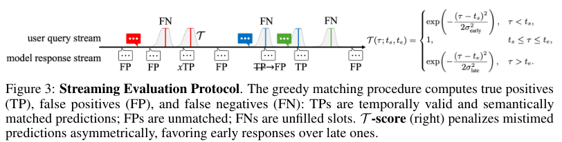

# Don't Pause! Every prediction matters in a streaming video

[English](README-en.md)

> **L1机制/计分组件，diagnostic only，不是完整论文能力复现。** 高成本完整实验不复现（审查 DONE），不接Evolve晋级。

## 论文信息

| 字段 | 内容 |
| --- | --- |
| 论文链接 | [arXiv:2604.24317v2](https://arxiv.org/html/2604.24317v2) |
| 公司 / 作者机构 | 一作 **Dibyadip Chatterjee**，**National University of Singapore**；合作者Yale Song署名Google Inc.，不把一作归为Google |
| 首次公开日期 | **2026-04-27T11:07:03Z**；4月27日首发；本轮Google目录历史补录，核对11月5日v2，不把发现日当首发 |
| 原作者开源代码 | 是：[原作者SPOT-Bench](https://github.com/dibschat/SPOT-Bench)，固定12ab7f6c215d22c651bbbfde33c09ea5b6a4f101，MIT；本地独立实现并核对evals/metrics.py，不下载视频或执行上游模型。 |
| 本地 adapter / key | `spot-bench`；adapter为null，独立组件 |
| 本地复现代码 | `src/auto_research/foundation_models/spot_bench.py` |

## 原始论文总结

### 背景与主要改动

SPOT-Bench针对持续视频流：每个输出都会影响分数，不只在暂停询问时读一个答案。人工可接受时间窗是gold slot，窗内timeliness为1，窗外采用早侧较宽、晚侧较窄的Gaussian尾。语义正确且时间有效的响应按时间顺序被开放slot吸收，每slot最多K次并只保留最好timeliness；过量或不匹配输出为FP，空slot为FN。T-F1以加权TP衡量及时性、覆盖和过度回应。Ctrl-SPOT则是另一个完整流式控制器，组合持久query状态、长短期KV、检索与dead-time总结；本地只做评测器，不冒充控制器。

<!-- paper-figure:start -->
### 原论文关键图

[](https://arxiv.org/pdf/2604.24317v2#page=6)

固定v2第6页Figure 3完整截图和图注，版权归原作者；已视觉核对，未改科学内容。[来源](https://arxiv.org/pdf/2604.24317v2#page=6) · [裁剪/指纹](assets/provenance.json)。这是论文方法图，不是本地结果。
<!-- paper-figure:end -->


### 核心公式

$$
P=\frac{xTP}{TP+FP},\quad R=\frac{xTP}{TP+FN},\quad T\!F1=\frac{2PR}{P+R},\qquad xTP=\sum_{j:C_j>0}\max_{i\,matched\,j}\mathcal T(t_i;s_j,e_j).
$$

固定v2 Algorithm1及固定作者源码均没有匹配后break：同一预测可以吸收进多个合格开放slot，TP按非空slot数而非全部预测数计。本地忠实该明确算法，不悄悄改成正文另一处的closest-single-slot口述。K默认5，threshold显式提供；阈值0仍要求T>0。semantics[slot][prediction]由调用者提供，是离线评测输入，不给被评估policy。没有GPT judge、语义模型或视频输入。

### 论文离线与线上效果

固定v2 Table5在940视频/5093 slots的任务库上报告，Qwen2.5-VL单帧baseline macro T-F1@5为3.9%，Ctrl-SPOT+Qwen2.5-VL为10.2%，+InternVL3.5为11.7%；这些是完整流式模型的论文结果，不是本地计分器产生的能力分数。Table7单H100的latency0.51s也是作者特定设置。未报告生产线上A/B。

### 与已有方法的关系

e-RWSC依据固定政策iid答案流，检验的是多数占优而非答案真实正确；SPOT的slot则用评测gold时间和显式语义匹配计及时性，不提供在线显著性证书。两者都可在输入完美时给出漂亮数值，但一个是采样分布假设下的停止证据，一个是给定trace的离线计分，不能混作模型能力。

## 本地复现

### 数据协议与代码映射

纯CPU、stdlib的非对称timeliness、按原时间索引语义矩阵、开放slot逐时吸收与K关闭、加权P/R/F1。合成trace负控包括错误语义、空输出、7次重复超过K=5、多slot重叠和早晚惩罚；完美合成trace得1只是定义检查，不是任何Agent能力。无Ctrl-SPOT的持久query/CPU-GPU KV/检索/总结，无视频、LLM或付费judge调用，不接Evolve晋级。

```bash
PYTHONPATH=src python -c 'from auto_research.foundation_models.spot_bench import diagnostic; print(diagnostic(42))'
PYTHONPATH=src python -m pytest -q tests/test_nov23_spot_bench.py
```

### 结果、负控与边界

三seed CPU产物见[机制诊断](metrics/component-cpu-seeds42-44.json)。CPU-only，显式拒绝CUDA；没有宣称GPU模型能力。 不读取用户会话或私有数据；合成数值不是模型能力，不能因三个seed就进入正式排名。

### 高成本完整实验

完整基准940视频、5093 slots，多个3B–9B模型逐秒流式推理，另含7B/8B控制器和语义judge评测。即使单H100单点可运行，完整视频×模型×任务矩阵与服务集成不符合日常单A100/A30低成本预算，直接不复现；不是先下载视频再证明贵。仅计分组件每seed预算30秒、0模型/数据下载、0API。

**成本过高，不复现（审查 DONE）**；保留有价值方法和边界，不自动重试，不阻塞审查水位。
