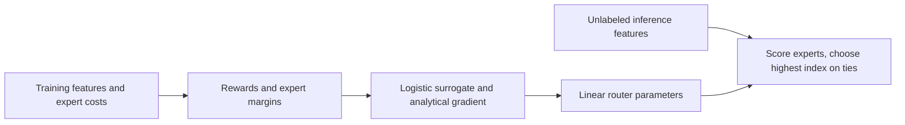
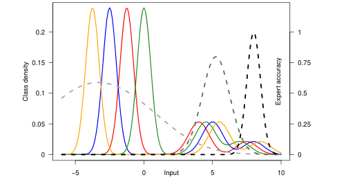

# mild: A margin objective for imbalanced expert routing

<!-- source-sha256: 1d66c96e149410989597fe9ac5f9af3ad91a31442c554835f7947de2c7b00008 -->

[简体中文](README.md)

## Paper information

| Field | Value |
|---|---|
| Paper | [Optimized Deferral for Imbalanced Settings](https://arxiv.org/abs/2604.27723) |
| Organization | Google Research; first listed author Corinna Cortes |
| First published | 2026-04-30 (arXiv v1) |
| Original author code | No author implementation link found in the reviewed paper. |
| Local adapter | `mild`, standalone CPU routing objective, not a reproduce adapter |
| Local code | `src/auto_research/foundation_models/google16_mild.py` |

## Method overview

Cast expert selection as cost-sensitive input-to-expert classification. Different expert margins address coverage imbalance. The local code implements the logistic surrogate, analytical gradient, and bounded linear-router training. Inference accepts only features and trained parameters, not answers or actual expert costs.

## Original paper summary

### Background and main changes

Specialists with narrow coverage can be overwhelmed by majority experts. Different expert margins balance learning. The low-cost component preserves training rewards rather than reducing costs to one argmin label. See [v1 §5.3 and §4.2](https://arxiv.org/html/2604.27723v1#S5.SS3).



<!-- paper-figure:start -->
### Key figure from the paper

[](https://arxiv.org/pdf/2604.27723v1#page=2)

> **Figure 1, PDF page 2.** Class distribution, expert accuracy, and cost jointly determine routing; a class is not an expert. The diagram is not a measured local result. Copyright belongs to the authors. [Source, crop, and hash](assets/provenance.json).
<!-- paper-figure:end -->

### Core equation

$$
\bar c_k=\sum_{k'\ne k}c_{k'},\quad
L(f)=\frac1m\sum_{i,k}\bar c_{ik}\log\sum_{k'}
\exp\left(\frac{f_{ik'}-f_{ik}}{\rho_k}\right)+\lambda\|f\|^2.
$$

Suggested margins scale as $\rho_k\propto(m_kX_k^2)^{1/3}$. Counts and feature bounds come only from training. Parameter selection cannot see test. Stable log-sum-exp is used; $\rho_k$ is not an ordinary class weight, and the inference router never receives expert costs.

### Offline and online results in the paper

The paper compares mild and tdef on synthetic and real image experts and MMLU LLM routing. Synthetic experts that see labels are an idealization, not a real inference system. There is no production A/B, and the full experiments and gains are not reproduced locally.

## Local reproduction

```bash
PYTHONPATH=src python scripts/run_google16_statistics.py --seed 42 --output runs/google16-statistics.json
```

### Data contract and results

Four authored, linearly separable fixtures check 100 optimization steps and analytical gradients against finite differences, not generalization. Equal scores use the paper's highest-expert-index tie break. Stable metrics: `metrics/component-cpu-seed42.json`, `diagnostic_only=true`. No actual expert capability or Evolve improvement is claimed.

### Code mapping and limits

`surrogate_and_gradient` implements the logistic objective, `margin_schedule` the theoretical scaling, `fit_router` bounded linear CPU optimization, and `route` prediction without costs or labels. Full 200-epoch image experiments, multiple experts, 5 runs, and multiple LLM evaluations are not reproduced due to cost (review DONE). No large experts were downloaded. This decision is separate from the low-cost mathematical component.
